# Recruitment ATS

Recruitment ATS is a mini applicant tracking system for small companies. It brings open positions, a public career site, CVs from the career site, a recruitment mailbox, and manual entry, a staged hiring pipeline, automatic candidate emails, interview scorecards, a consent-based talent pool, reports, and an audit log into one place — with **AI-assisted CV screening that explains every score with evidence from the CV and never makes the hiring decision**, plus AI help at the other steps: criteria drafted from a job description, past candidates found in the talent pool by meaning, and interview questions aimed at what the CV did not prove.

## 1. Requirements — Research, INVEST, Use Cases, and Acceptance Criteria

Requirements are derived top-down: business problem → stakeholders → goals → recruitment process → epics → features → user stories. Each story is reviewed with INVEST and has observable acceptance criteria.

### 1.1 Top-down problem analysis

Small hiring teams collect CVs from many channels, screen them manually, track progress in personal spreadsheets, exchange interview feedback by chat, rarely tell candidates what happens, and forget good candidates from earlier rounds. The result is lost candidates, slow screening, no pipeline visibility, biased feedback, a poor candidate experience, and uncontrolled personal data (Vietnam's Personal Data Protection Law No. 91/2025/QH15 is in force since 01/01/2026).

| Goal | Measured by |
|---|---|
| G1 Centralize candidates | Every application from the career site, mailbox, manual entry, and bulk import stored with CV and source; duplicates detected |
| G2 Faster screening | AI analysis within 60 s per CV; sort by fit score |
| G3 Transparent pipeline | Every stage change recorded; count per stage on dashboard |
| G4 Fair, independent evaluation | Blind scorecards; AI never auto-rejects |
| G5 Accountability | Stage changes, AI overrides, exports, CV deletions, user changes are audited |
| G6 Measurable AI quality | AI–human agreement and override rate reported |
| G7 Candidates are informed | Receipt, interview, and result emails for every applicant; failures visible |
| G8 Reuse of talent | Consented candidates searchable and addable to another position |
| G9 Channel effectiveness | Applications per source, including LinkedIn and Facebook share links |
| G10 AI across the hiring flow | Criteria drafts, semantic pool matches, and interview-question drafts — each reviewed by a person before use |

What makes this project different from a generic ATS:

1. **Explainable AI scoring** — per-criterion result with a quote from the CV; the score is computed by backend code.
2. **Blind screening** — personal attributes are redacted before the CV is sent to the AI.
3. **Independent interviews** — an interviewer sees other scorecards only after submitting their own.
4. **Consent-first talent pool** — candidates join only with explicit consent and can leave from any email.
5. **Safe automatic emails** — outcome emails wait 10 minutes so a mistake can be cancelled.
6. **AI across the hiring flow, always as a draft** — create position (AI drafts criteria) → find candidates (semantic search in the consented talent pool) → screen (AI judges each criterion with evidence) → interview (AI suggests questions) → a person decides.

### Scope

- **Position vs. job post.** A *position* (vị trí tuyển dụng) is the internal record: job description, headcount, target hire date, and weighted evaluation criteria. A *job post* (tin tuyển dụng) is its public version on the company's own **career site**; HR publishes or unpublishes it.
- **Channels (all free).** Candidates apply on the career site — a separate public web app with its own domain — without an account. HR shares source-tagged links to a job post on LinkedIn, Facebook, or elsewhere (`?src=linkedin`), so applications are classified automatically. CVs sent to the recruitment mailbox are collected into a CV inbox. Recruiters can still add CVs manually or import Excel + ZIP.
- **Candidate communication.** Automatic emails from editable templates: receipt immediately; interview invitation, change, cancellation, rejection, and offer notice after a 10-minute cancel window.
- **Talent pool and export.** Consented candidates can be added to another position; candidate lists export to Excel.
- **Out of scope:** candidate accounts, API integration with paid job boards (TopCV, VietnamWorks) and automatic posting to LinkedIn/Facebook (no public API), SMS and calendar integration, headcount planning, OCR for scanned CVs, offer letters and onboarding, and AI that learns from past decisions or makes reject/hire decisions.

Full analysis, market research (Greenhouse, Base E-Hiring, FastWork, EasyHRM, Vingroup practice), channel feasibility, scope, constraints, and risks: [Top-down research](docs/01-research-top-down.md).

### 1.2 Product mind map

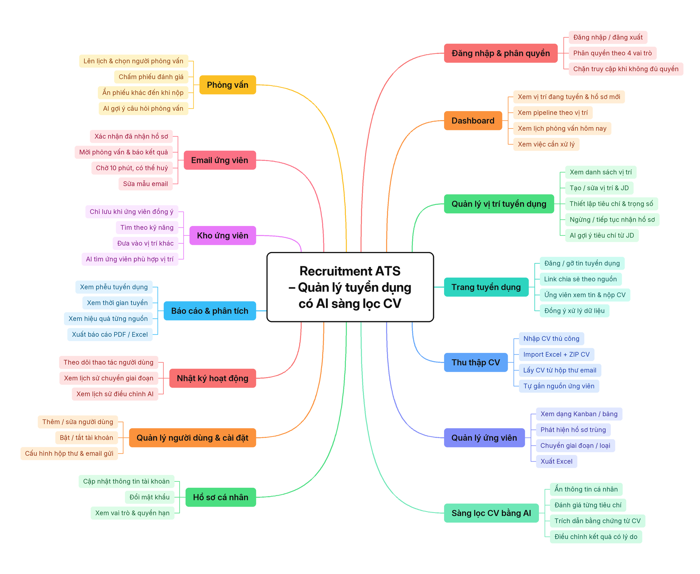

Editable source: [`docs/mindmap/recruitment-ats.xmind`](docs/mindmap/recruitment-ats.xmind) (same structure, open with XMind). After editing it, regenerate the image with `python docs/mindmap/render_mindmap.py`.

### 1.3 INVEST requirements

The backlog contains **34 user stories (149 story points)**, grouped by epic. Every story passes the INVEST review and has Given/When/Then acceptance criteria.

| Criterion | Meaning in Recruitment ATS |
|---|---|
| **Independent** | Each story produces a demonstrable outcome and depends on others only when unavoidable. |
| **Negotiable** | Layout and implementation may change while outcome, permissions, and business rules stay fixed. |
| **Valuable** | Each story names the benefit to a hiring role or the candidate. |
| **Estimable** | Roles, inputs, outputs, and failure outcomes are explicit; every story is estimated in points. |
| **Small** | One capability per story; the largest stories (AI analysis, bulk import, online apply, CV inbox, automatic emails) are 8 points. |
| **Testable** | Every story maps to observable acceptance criteria, including authorization and error behaviour; external services have fakes. |

```text
US01–US02   Authentication and session
US03        Dashboard
US04–US07   Positions (view, create, edit, close/reopen)
US08–US11   Candidates and applications (view, add with CV, edit, move stage)
US12–US13   AI screening (analyze with evidence, human override)
US14–US15   Interviews (schedule, blind scorecard)
US16        Bulk import (Excel + ZIP, atomic)
US17–US18   Reports and export
US19        Audit log
US20        User management
US21        Personal profile and password
US22        Job post: publish / unpublish, share links per source
US23–US24   Career site: browse job posts, apply online with consent
US25        CV inbox from the recruitment mailbox
US26        Talent pool
US27–US28   Automatic candidate emails, email templates
US29        Mailbox and sender settings
US30        Export candidates to Excel
US31        Candidate data consent (join, leave, delete)
US32        AI-suggested criteria from a job description
US33        AI matching of pool candidates to a position (embeddings)
US34        AI-suggested interview questions
```

Backlog, per-story INVEST review, and acceptance criteria: [INVEST requirements](docs/03-invest-requirements.md).

### 1.4 Use cases

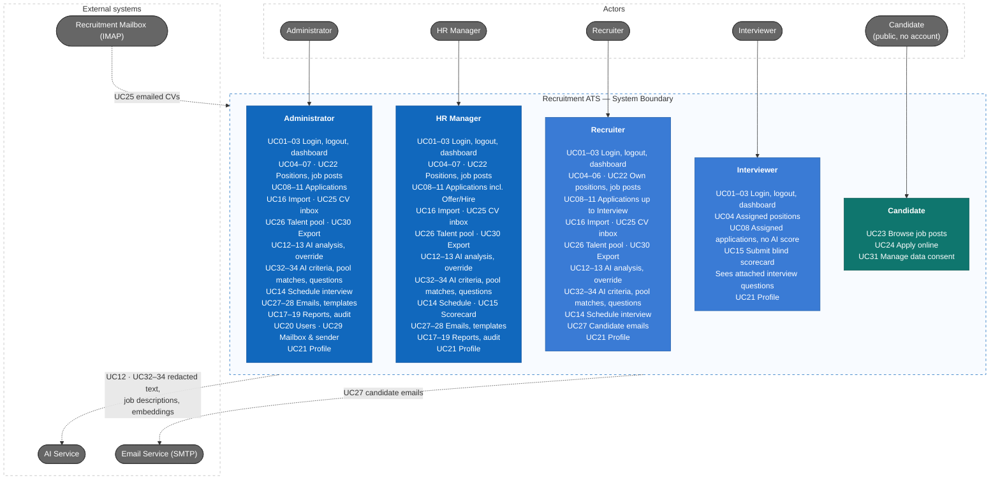

Detailed use case diagram (one node per use case), include/extend relationships, 25 business rules, and use case specifications: [Actors, business rules, and use cases](docs/02-use-cases.md).

### 1.5 Roles and permissions

Four internal roles have accounts; candidates use the public career site without an account. Department heads take part as Interviewers; a separate Hiring Manager role can be added later without changing the existing roles.

| Capability | Admin | HR Manager | Recruiter | Interviewer |
|---|---|---|---|---|
| Dashboard | Yes | Yes | Yes | Own interviews |
| View positions | Yes | Yes | Yes | Assigned only |
| Create / edit positions | Yes | Yes | Own positions | No |
| Close / reopen positions | Yes | Yes | No | No |
| Publish / unpublish job posts, share links | Yes | Yes | Own positions | No |
| View applications | Yes | Yes | Yes | Assigned only, no AI score |
| Add / edit applications, bulk import, CV inbox | Yes | Yes | Yes | No |
| Move pipeline stage | Yes | Yes | Up to Interview, and reject | No |
| Run / override AI analysis (reason required) | Yes | Yes | Yes | No |
| AI criteria drafts, pool matches, interview-question drafts | Yes | Yes | Yes (criteria: own positions) | Sees attached questions only |
| Schedule interviews | Yes | Yes | Yes | No |
| Submit scorecard | No | If on panel | No | If on panel |
| Candidate emails (view, edit or cancel pending) | Yes | Yes | Yes | No |
| Talent pool, export candidates to Excel | Yes | Yes | Yes | No |
| Email templates | Yes | Yes | No | No |
| Mailbox and sender settings | Yes | No | No | No |
| Reports and export | Yes | Yes | No | No |
| Audit log | Yes | Yes | No | No |
| User management | Yes | No | No | No |

**Candidate (no account):** browse published job posts, apply with consent, and join or leave the talent pool or delete their data from the signed link in any email.

The backend must enforce RBAC, position ownership, panel assignment, blind scorecards, and the limits of the public API; hiding frontend controls serves UI/UX only.

## 2. Information Architecture, Screen Hierarchy, and UI/UX

The information architecture has two parts: a public career site for candidates and an authenticated workspace for the hiring team, organized by hiring capability. Navigation follows the role matrix, and loading, empty, validation, conflict, error, saving, success, AI-analysis, email, inbox, and job-post states are defined consistently.

### 2.1 Information architecture

```text
Career site — separate public app, no login
└── Job list · Job detail · Apply form · Thank-you · Privacy policy · Consent management

Internal app
├── Login
└── Authenticated (below)

Authenticated
├── Dashboard
├── Positions
│   ├── List · Create / edit
│   └── Detail: Overview · Criteria · Job post · Pipeline (Kanban)
├── Candidates
│   ├── Table · Add application · Export Excel
│   └── Application detail: Profile & CV · AI analysis · Interviews · Emails · History
├── CV inbox
├── Talent pool
├── Interviews: My interviews · Scorecard
├── Bulk import
├── Reports
├── Audit log
├── Users
├── Settings: Email templates · Mailbox & sender
├── Profile
└── Forbidden
```

### 2.2 Screen hierarchy

Candidates reach the career site from shared links; it has its own mobile-first layout and never links into the internal app. Login leads to the authenticated shell (sidebar + topbar). The shell owns navigation to feature pages; forms (create position, add application, move/reject, schedule interview, override a criterion result, assign inbox item, add pool candidate to position, edit pending email, user form) open as modals on their parent page, as in the reference project.

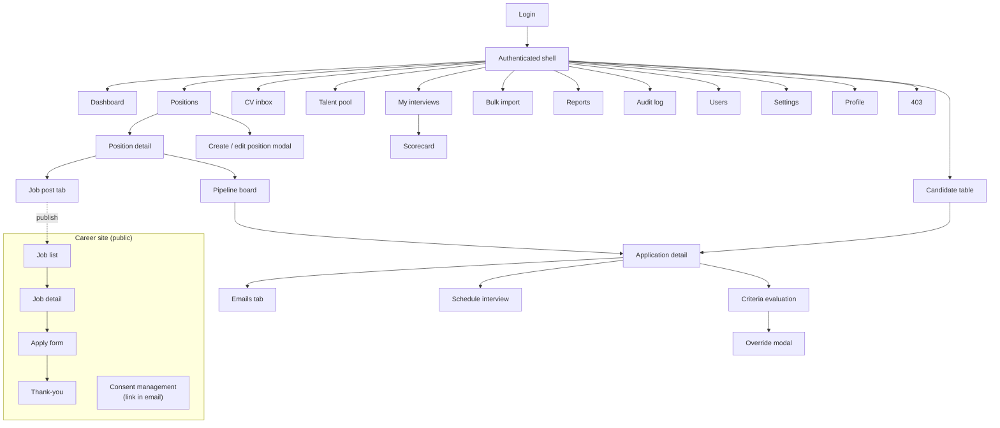

Screen inventory (38 screens, including 6 public career-site screens), requirement-to-screen mapping, task flows, state contract, accessibility rules, and screen-to-API mapping: [Information architecture](docs/04-information-architecture.md).

### 2.3 UI prototype

High-fidelity prototype in Figma: **[Recruitment ATS — UI](https://www.figma.com/design/0TYozUq5jB0KJcdo8vjVjQ/Recruitment-ATS?node-id=0-1)** — design tokens, 47 icons, components, 18 internal screens, and 7 career-site screens (desktop and mobile apply). The career site follows the structure of the Vingroup Career Portal; the internal app is a dense working tool without decorative styling. Design direction, tokens with contrast ratios, and every screen: [UI/UX](docs/05-ui-ux.md).

#### Career site — job list

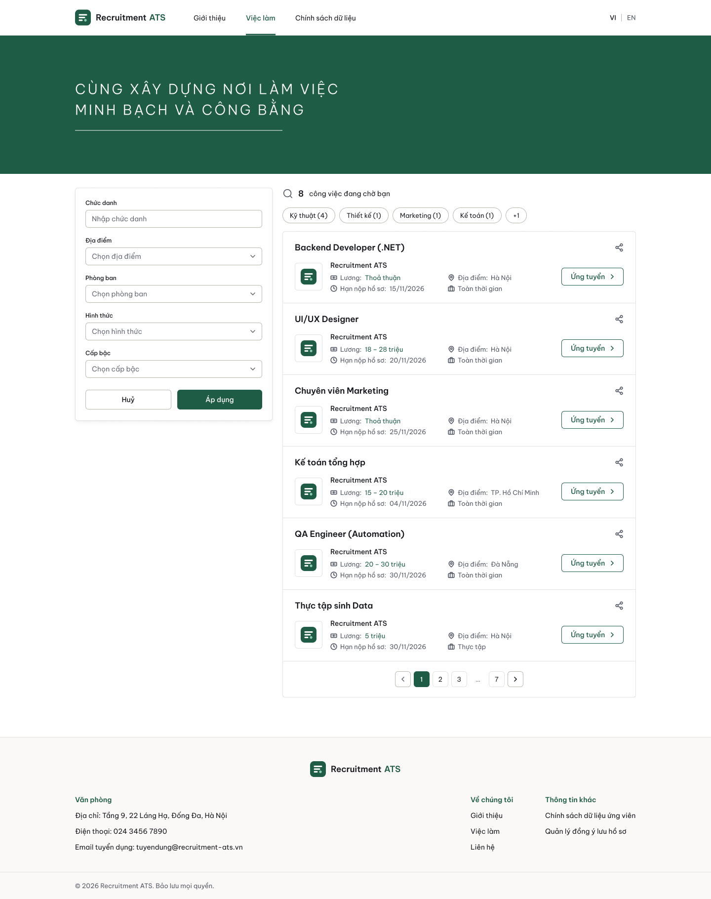

#### Career site — apply

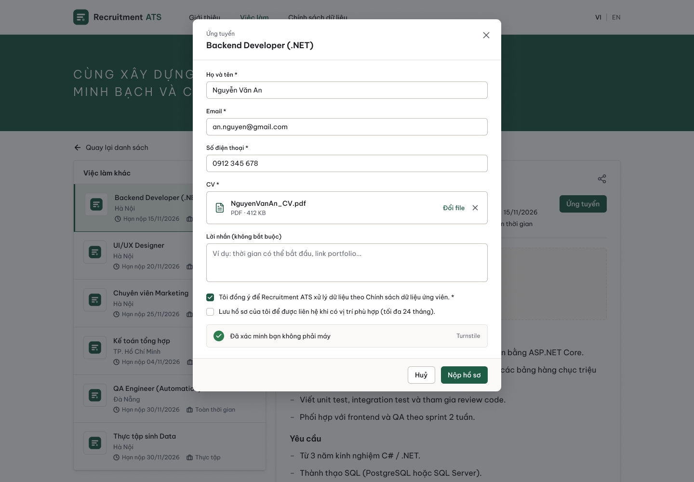

#### Dashboard

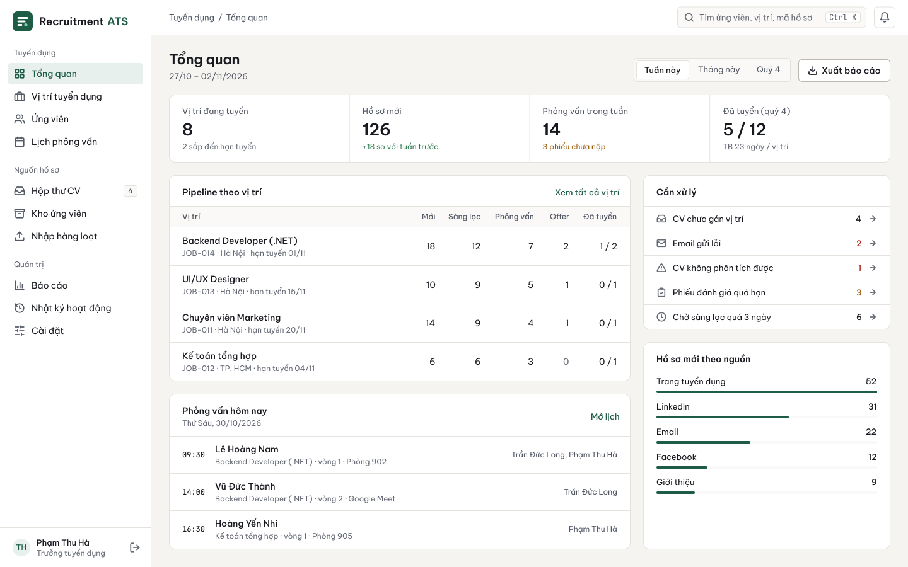

#### Pipeline (Kanban)

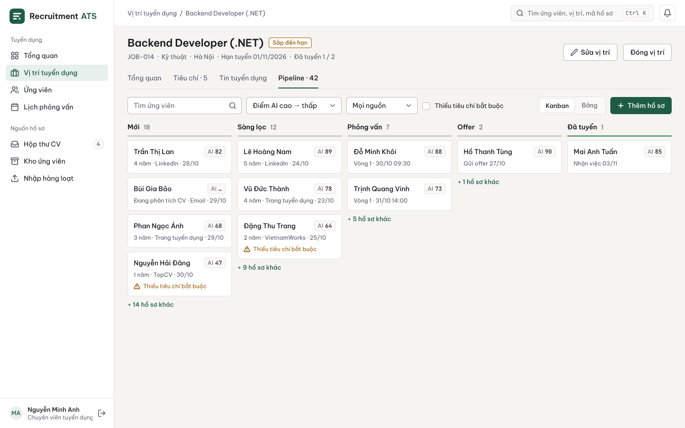

#### Application detail — criteria evaluation with CV evidence

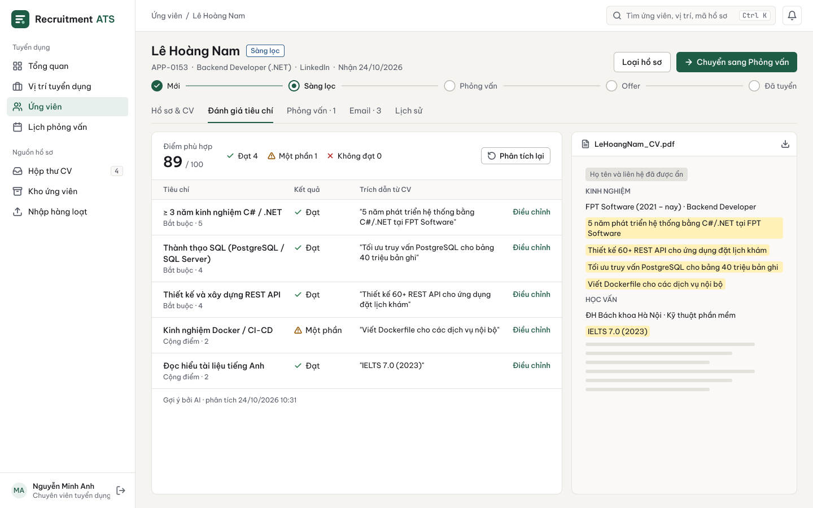

#### Candidate emails with a 10-minute cancel window

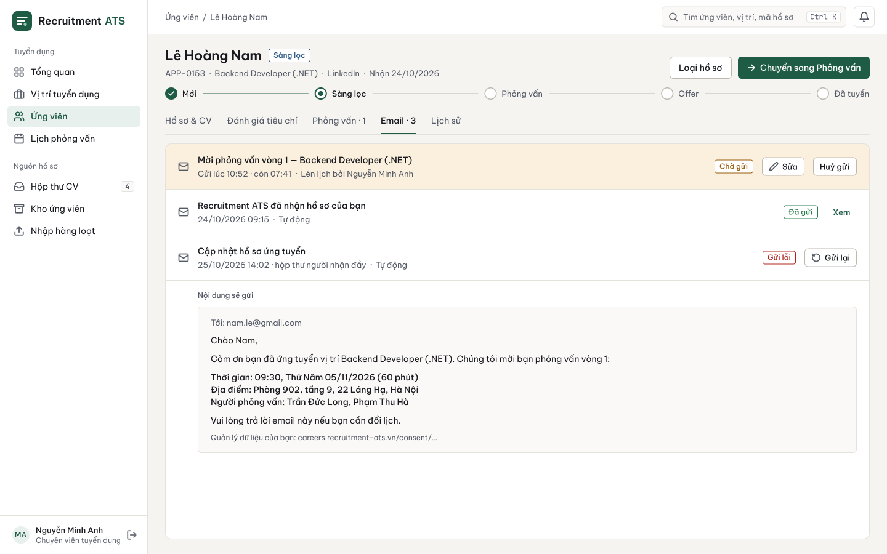

#### CV inbox

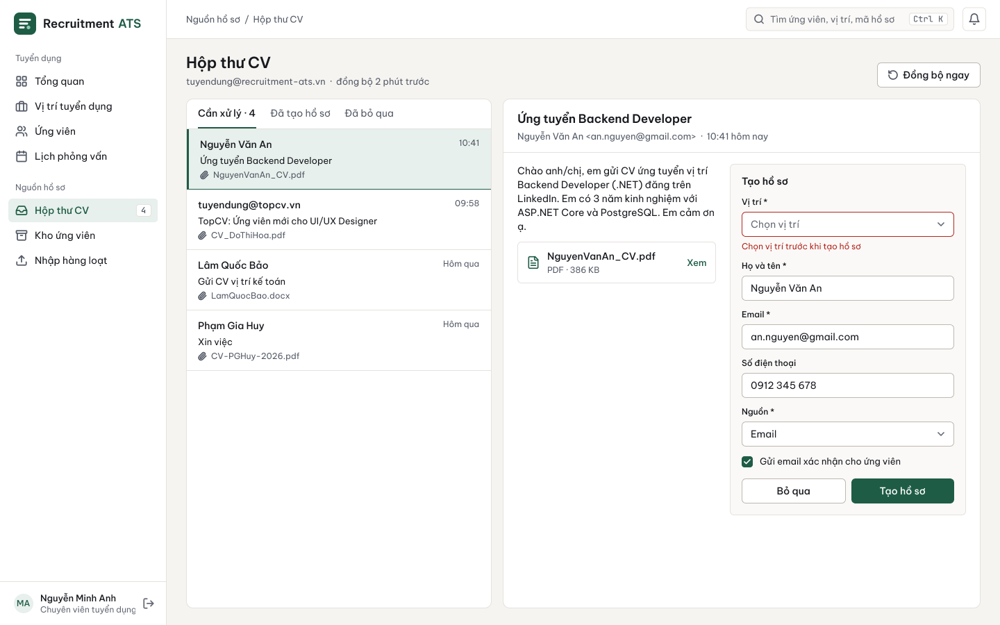

#### Interview scorecard

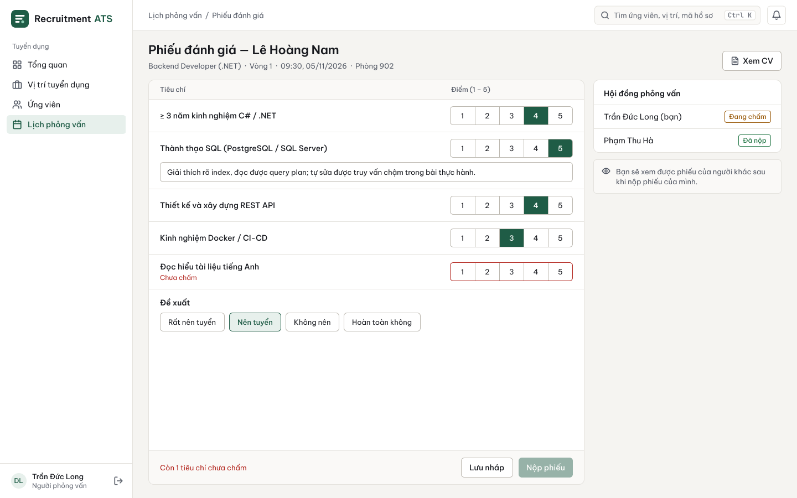

## 3. C4 Architecture

The architecture is described with the C4 model: system context, containers, components of the API and the Worker, and a deployment view. Slow, scheduled, and external work (AI analysis, candidate emails, mailbox intake, retention) runs in a separate Worker; both queues are PostgreSQL tables written in the same transaction as the action that creates them, so a pending email exists only if the action committed and can be cancelled safely.

### 3.1 System context

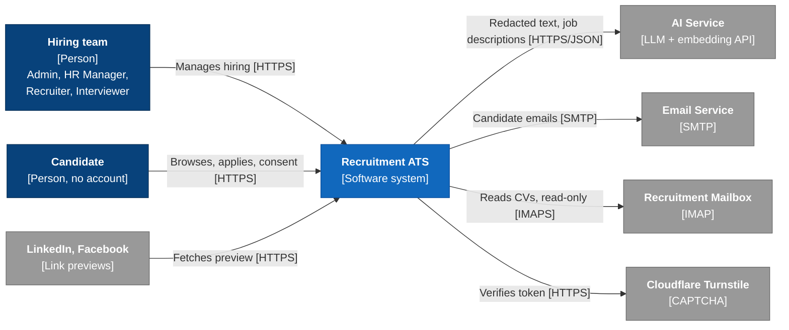

### 3.2 Containers

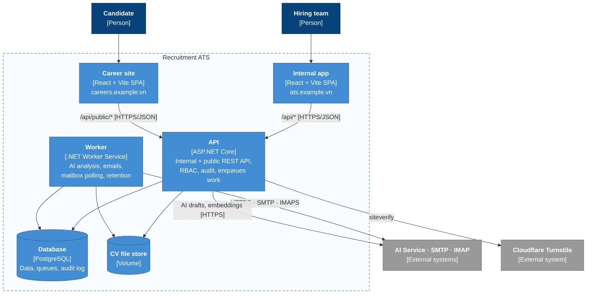

### 3.3 Key decisions

| # | Decision |
|---|---|
| AD-01 | Separate **Worker** container sharing the application core with the API |
| AD-02 | Queues are **PostgreSQL tables** claimed with `FOR UPDATE SKIP LOCKED`; no message broker |
| AD-03 | CV files on a volume behind `IFileStorage` |
| AD-04 | Career site stays a Vite SPA; link-preview crawlers get Open Graph HTML from the API |
| AD-05 | Public API is a rate-limited route group in the same API, protected by **Cloudflare Turnstile** |
| AD-06 | JWT access token in memory + rotating refresh token in an `httpOnly` cookie |
| AD-07 | PII redaction runs in the Worker before the AI adapter (`IResumeAnalyzer`) |
| AD-08 | Internal app polls AI status; no WebSocket |
| AD-09 | One VM with Docker Compose behind Caddy, two domains |
| AD-10 | Mermaid flowcharts with C4 styling |
| AD-11 | Simplified Clean Architecture (see section 5) |
| AD-12 | One OpenAI-compatible AI adapter chosen by environment variables; DeepSeek V4.1 Flash for development and demo with synthetic CVs only; `Fake` analyzer for tests |
| AD-13 | Embeddings in PostgreSQL with `pgvector` (1024 dimensions); embedding provider configured separately because DeepSeek has no embedding API |

Architecture drivers, full context and container diagrams, component diagrams for the API and the Worker, key interactions (AI analysis, email queue, public apply, link previews), deployment, and open items: [C4 architecture](docs/06-c4-architecture.md).

## 4. Database Diagrams and OpenAPI 3.0 Contract

### 4.1 Database

PostgreSQL 16 (with `pgvector`) and 28 tables. The schema enforces the rules that must hold even under concurrent requests: one application per candidate and position, no duplicate candidates by email or phone, a rejection reason exactly when rejected, and no overlapping interviews for a panel member (exclusion constraint). The AI analysis queue and the email queue are ordinary tables claimed with `FOR UPDATE SKIP LOCKED`.

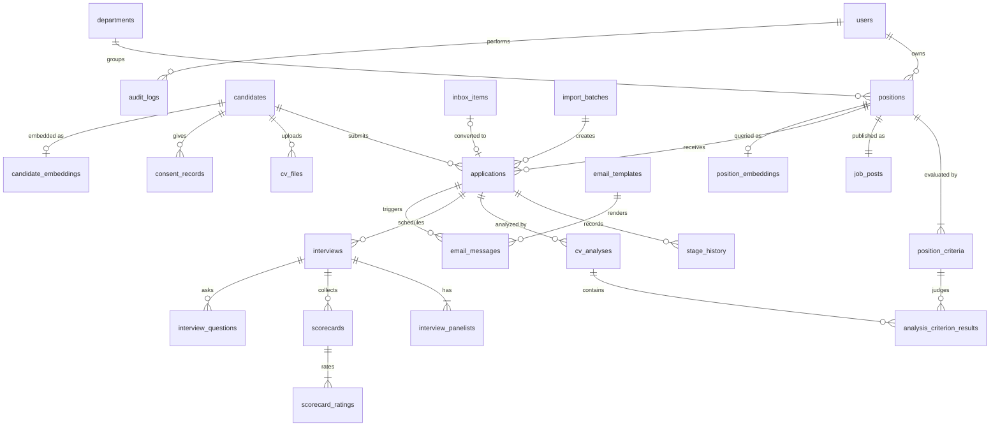

| Decision | Choice |
|---|---|
| Keys | UUIDv7 generated by the application; readable position codes `JOB-001` |
| Enumerations | `varchar` + `CHECK`, same values as the API |
| Criteria changes | Versioned rows; old analyses become `OUTDATED` but stay readable |
| AI results | AI result and human override stored side by side; score recalculated by code |
| Personal data | Anonymization instead of deletion, so reports stay correct (BR-17, BR-24) |
| Concurrency | Optimistic locking on `xmin`; stale updates return 409 |

Full ER diagrams per domain, queue claims, retention jobs, and rule-to-constraint traceability: [Database design](docs/07-database-design.md). Reference DDL: [`docs/database/schema.sql`](docs/database/schema.sql).

### 4.2 OpenAPI 3.0 contract

[`docs/api/openapi.yaml`](docs/api/openapi.yaml) — OpenAPI 3.0.3, **88 operations**, validated with `redocly lint`.

| Group | Base path | Operations |
|---|---|---|
| Auth, profile, dashboard, lookups | `/api/auth`, `/api/me`, `/api/dashboard`, `/api/lookups` | 9 |
| Positions, job posts, pool matches, AI criteria drafts | `/api/positions` | 12 |
| Applications, candidates, AI screening | `/api/applications`, `/api/candidates`, `/api/cv-files`, `/api/analyses` | 16 |
| Interviews, scorecards, AI question drafts | `/api/interviews`, `/api/applications/{id}/scorecards`, `/api/applications/{id}/interview-question-suggestions` | 10 |
| Emails, CV inbox, talent pool, imports | `/api/emails`, `/api/inbox-items`, `/api/talent-pool`, `/api/imports` | 18 |
| Reports, audit, users, settings | `/api/reports`, `/api/audit-logs`, `/api/users`, `/api/settings` | 15 |
| Public career site | `/api/public` | 8 |

Every internal operation declares its roles in `x-roles`; errors use RFC 7807 Problem Details with a stable `errorCode` and `traceId`; Interviewers never receive AI fields. Conventions, status codes, error codes, the endpoint list, and story coverage: [OpenAPI contract](docs/08-openapi-contract.md).

## 5. Frontend and Backend Folder Structures

The backend uses **Simplified Clean Architecture** (AD-11), the same three-project core as the course reference project ([finance-manager](https://github.com/PhamHiep948/finance-manager)), with a second host for the Worker. Business rules and ports live in `Application`; `Infrastructure` implements the ports; `Api` and `Worker` are thin hosts that reuse the same use cases. The frontend is an npm workspace with two React apps sharing a generated API client and a UI package.

| Option | Verdict |
|---|---|
| Layered N-tier | Rejected — business code would depend on EF Core and concrete adapters; AI, SMTP, and IMAP could not be faked cleanly, and the Worker could not reuse the services |
| Full Clean Architecture (Domain project, MediatR, CQRS) | Rejected — ~85 handlers and an extra project add ceremony without a driver at this scale |
| **Simplified Clean Architecture** | **Selected** — two hosts share one core; every external service is a replaceable port; pure rules are unit-tested without a database |

### 5.1 Backend (.NET 10 LTS)

```text
src/backend/
├── RecruitmentAts.slnx
├── src/
│   ├── RecruitmentAts.Application/     # modules: Positions, Applications, Screening, Interviews,
│   │                                   # Communication, Inbox, Imports, Consent, … + Abstractions (ports)
│   ├── RecruitmentAts.Infrastructure/  # EF Core + PostgreSQL, queues, MailKit, LLM, files, Excel, PDF
│   ├── RecruitmentAts.Api/             # controllers (route name = operationId), JWT, ProblemDetails
│   └── RecruitmentAts.Worker/          # AnalysisRunner, EmailDispatcher, MailboxPoller, RetentionJob
└── tests/                              # Application, Infrastructure (Testcontainers), Api (+ contract),
                                        # Worker, ArchitectureTests
```

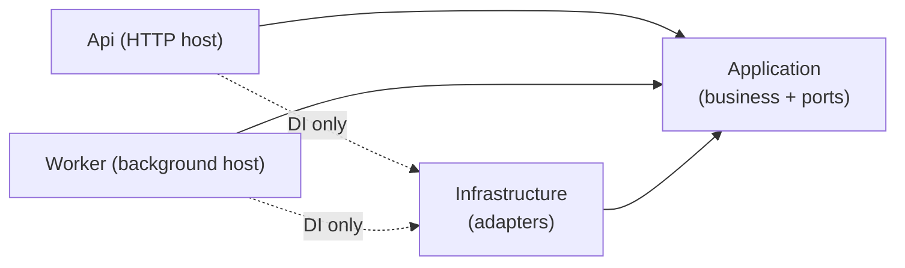

### 5.2 Frontend (React + Vite + TypeScript)

```text
src/frontend/
├── apps/
│   ├── internal/src/features/          # auth, dashboard, positions, job-posts, applications, screening,
│   │                                   # interviews, emails, inbox, talent-pool, imports, reports, audit,
│   │                                   # users, settings, profile
│   └── career/src/features/            # jobs, apply, consent, privacy
├── packages/
│   ├── api-client/                     # types generated from docs/api/openapi.yaml, auth refresh, ProblemDetails
│   └── ui/                             # design tokens and shared components
└── e2e/                                # Playwright
```

Data flow: page → feature hook (TanStack Query) → feature `api.ts` (functions named by `operationId`) → `api-client` → API.

Project responsibilities, module layout, dependency rules enforced by architecture tests, test strategy, packages, the C4-component-to-folder ownership map, naming, configuration, and the order of creation: [Folder structures](docs/09-folder-structure.md).

## 6. Detailed Class and Sequence Design

Class diagrams are written in Mermaid, as in the course reference project. Sequence and state diagrams are drawn with the team's **ve-diagram-srs** skill; each one is available as PNG, SVG, and an editable draw.io file, generated from [`docs/diagrams/ve_ats.py`](docs/diagrams/ve_ats.py).

| Artifact | Content |
|---|---|
| [Class design](docs/10-class-design.md) | 11 class diagrams (cross-cutting, auth, positions, applications and intake, AI screening, interviews, communication, inbox/import/pool, career site and consent, reports, AI assistance) and traceability of all 88 OpenAPI operations to controller actions and Application methods |
| [Sequence and state diagrams](docs/11-sequence-and-state-diagrams.md) | 20 sequence diagrams for the main flows and error paths, including the four AI-assistance flows; 6 state diagrams (application stage, CV analysis, candidate email, position, job post, inbox item) |

### 6.1 AI screening classes

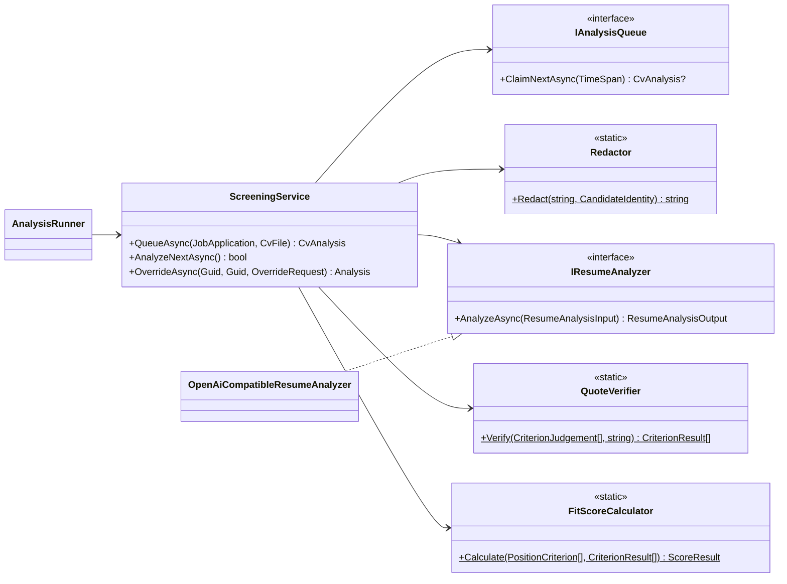

### 6.2 Analyze CV with AI

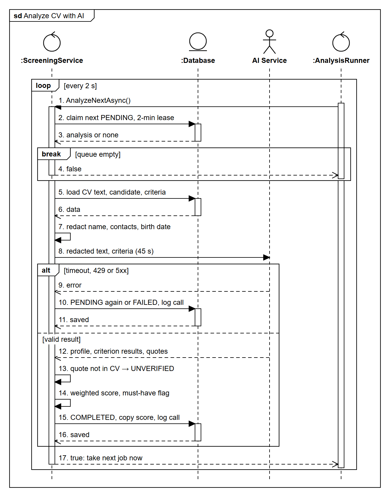

### 6.3 Application stage

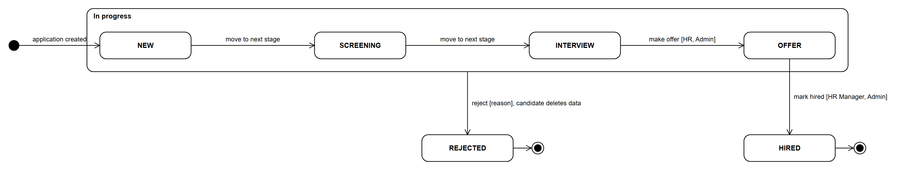

## Documentation

- [Top-down research](docs/01-research-top-down.md)
- [Actors, business rules, and use cases](docs/02-use-cases.md)
- [INVEST requirements and acceptance criteria](docs/03-invest-requirements.md)
- [Information architecture](docs/04-information-architecture.md)
- [UI/UX design](docs/05-ui-ux.md)
- [C4 architecture](docs/06-c4-architecture.md)
- [Database design](docs/07-database-design.md) · [Reference DDL](docs/database/schema.sql)
- [OpenAPI contract](docs/08-openapi-contract.md) · [OpenAPI YAML](docs/api/openapi.yaml)
- [Frontend and backend folder structures](docs/09-folder-structure.md)
- [Class design](docs/10-class-design.md) · [Sequence and state diagrams](docs/11-sequence-and-state-diagrams.md) · [Diagram sources](docs/diagrams/)
- [Mind map](docs/mindmap.png) · [XMind source](docs/mindmap/recruitment-ats.xmind)

## Project Progress

- [x] Top-down problem analysis and research
- [x] Mind map
- [x] Use case diagram and business rules
- [x] User stories (INVEST) and acceptance criteria
- [x] Information architecture and screen hierarchy
- [x] UI/UX prototype (Figma)
- [x] C4 architecture
- [x] Database design and OpenAPI contract
- [x] Folder structures
- [x] Class and sequence diagrams
- [ ] Implementation
