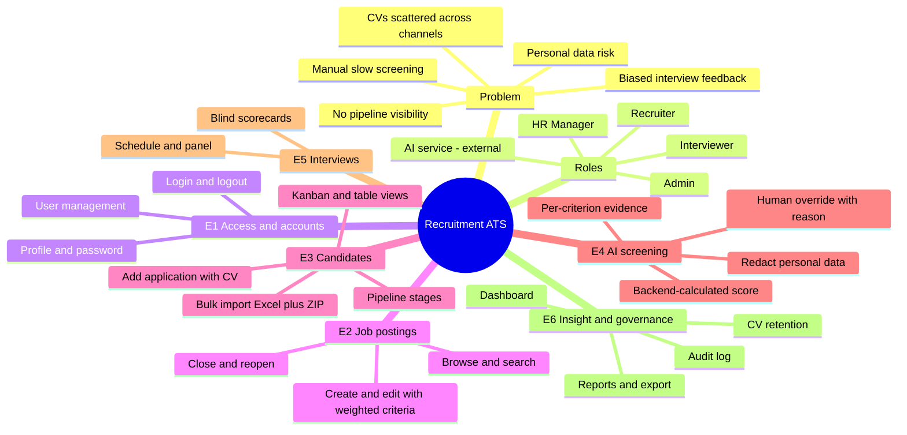
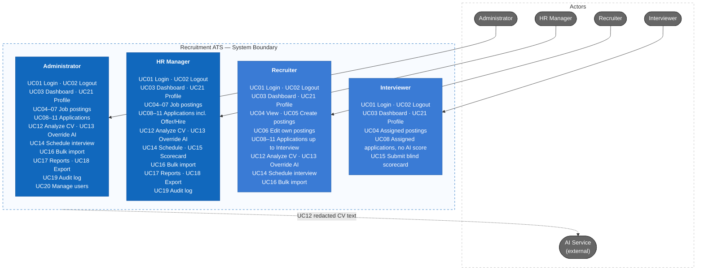
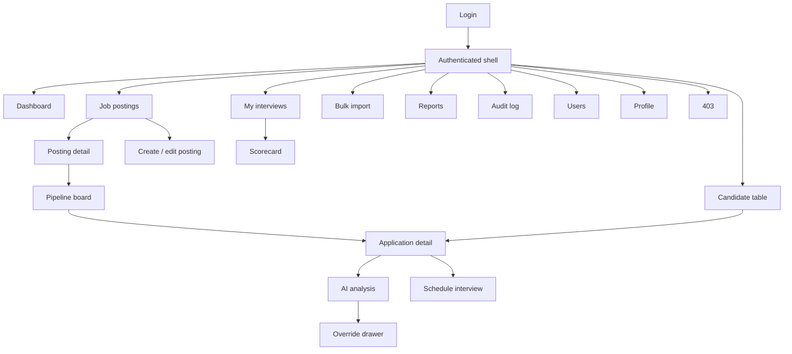

# Recruitment ATS

Recruitment ATS is a mini applicant tracking system for small companies. It brings job postings, CV intake, a staged hiring pipeline, interview scorecards, reports, and an audit log into one place — with **AI-assisted CV screening that explains every score with evidence from the CV and never makes the hiring decision**.

## 1. Requirements — Research, INVEST, Use Cases, and Acceptance Criteria

Requirements are derived top-down: business problem → stakeholders → goals → recruitment process → epics → features → user stories. Each story is reviewed with INVEST and has observable acceptance criteria.

### 1.1 Top-down problem analysis

Small hiring teams collect CVs from many channels, screen them manually, track progress in personal spreadsheets, and exchange interview feedback by chat. The result is lost candidates, slow screening, no pipeline visibility, biased feedback, and uncontrolled personal data (Vietnam's Personal Data Protection Law No. 91/2025/QH15 is in force since 01/01/2026).

| Goal | Measured by |
|---|---|
| G1 Centralize candidates | Every application stored with CV and source; duplicates detected |
| G2 Faster screening | AI analysis within 60 s per CV; sort by fit score |
| G3 Transparent pipeline | Every stage change recorded; count per stage on dashboard |
| G4 Fair, independent evaluation | Blind scorecards; AI never auto-rejects |
| G5 Accountability | Stage changes, AI overrides, CV deletions, user changes are audited |
| G6 Measurable AI quality | AI–human agreement and override rate reported |

What makes this project different from a generic ATS:

1. **Explainable AI scoring** — per-criterion result with a quote from the CV; the score is computed by backend code.
2. **Blind screening** — personal attributes are redacted before the CV is sent to the AI.
3. **Independent interviews** — an interviewer sees other scorecards only after submitting their own.

Full analysis, market research (Greenhouse, Base E-Hiring), scope, constraints, and risks: [Top-down research](docs/01-research-top-down.md).

### 1.2 Product mind map

Editable XMind file: [`docs/mindmap/recruitment-ats.xmind`](docs/mindmap/recruitment-ats.xmind).



### 1.3 INVEST requirements

The V1 backlog contains **21 user stories (84 story points)**, grouped by epic. Every story passes the INVEST review and has Given/When/Then acceptance criteria.

| Criterion | Meaning in Recruitment ATS |
|---|---|
| **Independent** | Each story produces a demonstrable outcome and depends on others only when unavoidable. |
| **Negotiable** | Layout and implementation may change while outcome, permissions, and business rules stay fixed. |
| **Valuable** | Each story names the benefit to a hiring role. |
| **Estimable** | Roles, inputs, outputs, and failure outcomes are explicit; every story is estimated in points. |
| **Small** | One capability per story; the largest stories (AI analysis, bulk import) are 8 points. |
| **Testable** | Every story maps to observable acceptance criteria, including authorization and error behaviour. |

```text
US01–US02   Authentication and session
US03        Dashboard
US04–US07   Job postings (view, create, edit, close/reopen)
US08–US11   Candidates and applications (view, add with CV, edit, move stage)
US12–US13   AI screening (analyze with evidence, human override)
US14–US15   Interviews (schedule, blind scorecard)
US16        Bulk import (Excel + ZIP, atomic)
US17–US18   Reports and export
US19        Audit log
US20        User management
US21        Personal profile and password
```

Backlog, per-story INVEST review, and acceptance criteria: [INVEST requirements](docs/03-invest-requirements.md).

### 1.4 Use cases



Detailed use case diagram (one node per use case), include/extend relationships, 17 business rules, and use case specifications: [Actors, business rules, and use cases](docs/02-use-cases.md).

### 1.5 Roles and permissions

| Capability | Admin | HR Manager | Recruiter | Interviewer |
|---|---|---|---|---|
| Dashboard | Yes | Yes | Yes | Own interviews |
| View job postings | Yes | Yes | Yes | Assigned only |
| Create / edit job postings | Yes | Yes | Own postings | No |
| Close / reopen postings | Yes | Yes | No | No |
| View applications | Yes | Yes | Yes | Assigned only, no AI score |
| Add / edit applications, bulk import | Yes | Yes | Yes | No |
| Move pipeline stage | Yes | Yes | Up to Interview, and reject | No |
| Run / override AI analysis | Yes | Yes | Yes (reason required) | No |
| Schedule interviews | Yes | Yes | Yes | No |
| Submit scorecard | No | If on panel | No | If on panel |
| Reports and export | Yes | Yes | No | No |
| Audit log | Yes | Yes | No | No |
| User management | Yes | No | No | No |

The backend must enforce RBAC, posting ownership, panel assignment, and blind scorecards; hiding frontend controls serves UI/UX only.

## 2. Information Architecture, Screen Hierarchy, and UI/UX

The information architecture organizes the authenticated workspace by hiring capability. Navigation follows the role matrix, and loading, empty, validation, conflict, error, saving, success, and AI-analysis states are defined consistently.

### 2.1 Information architecture

```text
Public
└── Login

Authenticated
├── Dashboard
├── Job postings
│   ├── List · Create / edit
│   └── Detail: Overview · Criteria · Pipeline (Kanban)
├── Candidates
│   ├── Table · Add application
│   └── Application detail: Profile & CV · AI analysis · Interviews · History
├── Interviews: My interviews · Scorecard
├── Bulk import
├── Reports
├── Audit log
├── Users
├── Profile
└── Forbidden
```

### 2.2 Screen hierarchy

Login leads to the authenticated shell (sidebar + topbar). The shell owns navigation to feature pages; small forms (add application, move/reject, schedule interview, override AI, user form) open as modals or drawers on their parent page.



Screen inventory (22 screens), requirement-to-screen mapping, task flows, state contract, accessibility rules, and screen-to-API mapping: [Information architecture](docs/04-information-architecture.md).

### 2.3 UI prototype

High-fidelity prototype in Figma: **[Recruitment ATS — UI](https://www.figma.com/design/0TYozUq5jB0KJcdo8vjVjQ/Untitled?node-id=0-1)** (design tokens, components, and 11 key screens). Design decisions: [UI/UX](docs/05-ui-ux.md).

#### Dashboard


#### Pipeline (Kanban)


#### Application detail — AI analysis with evidence


#### Override AI result


#### Blind interview scorecard


## 3. C4 Architecture

_Planned._

## 4. Database Diagrams and OpenAPI 3.0 Contract

_Planned._

## 5. Frontend and Backend Folder Structures

_Planned._

## 6. Detailed Class and Sequence Design

_Planned._

## Documentation

- [Top-down research](docs/01-research-top-down.md)
- [Actors, business rules, and use cases](docs/02-use-cases.md)
- [INVEST requirements and acceptance criteria](docs/03-invest-requirements.md)
- [Information architecture](docs/04-information-architecture.md)
- [UI/UX design](docs/05-ui-ux.md)
- [Mind map (XMind)](docs/mindmap/recruitment-ats.xmind)

## Project Progress

- [x] Top-down problem analysis and research
- [x] Mind map
- [x] Use case diagram and business rules
- [x] User stories (INVEST) and acceptance criteria
- [x] Information architecture and screen hierarchy
- [x] UI/UX prototype (Figma)
- [ ] C4 architecture
- [ ] Database design and OpenAPI contract
- [ ] Folder structures
- [ ] Class and sequence diagrams
- [ ] Implementation
