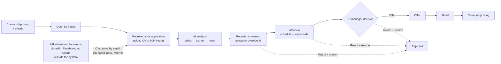

# Top-down Problem Analysis & Research

> Design status: TARGET V1
>
> Implementation status: NOT STARTED (requirements and UI/UX phase)

Product name in the interface: **Recruitment ATS**.

This document decomposes the assignment from the business goal down to user stories:

```text
Business problem → Stakeholders → Goals & metrics → Recruitment process
  → Epics → Features → User stories (see 03-invest-requirements.md)
```

## 1. Problem context

Small and medium companies (10–100 employees) in Vietnam usually recruit with spreadsheets, a shared mailbox, and folders of CVs on Google Drive. This causes recurring problems:

| Problem | Consequence |
|---|---|
| CVs arrive through many channels (email, job boards, referrals) | Candidates are lost or duplicated; nobody knows the full list |
| Screening is manual | A recruiter spends several minutes per CV; urgent roles stay open longer |
| Pipeline status lives in personal spreadsheets | Managers cannot see where each candidate is or which stage is a bottleneck |
| Interview feedback is collected by chat | Interviewers influence each other; feedback is lost; decisions are not traceable |
| CVs are personal data | Under Vietnam's Personal Data Protection Law (Law No. 91/2025/QH15, in force since 01/01/2026, detailed by Decree No. 356/2025/ND-CP, which replaced Decree 13/2023/ND-CP), the company must control who accesses CVs and delete data that is no longer needed |

**Problem statement:** a small hiring team needs one place to define open positions and their evaluation criteria, collect CVs from every sourcing channel, screen them, move candidates through a defined pipeline, collect independent interview feedback, and report on hiring results — with AI assistance for the slowest step (CV screening) but without letting AI make hiring decisions.

## 2. Stakeholders

| Stakeholder | Role in system | Main interest |
|---|---|---|
| System administrator | `ADMIN` | Accounts, roles, system audit |
| Head of recruitment / HR manager | `HR_MANAGER` | Overall pipeline, final decisions (offer / hire), reports |
| Recruiter | `RECRUITER` | Daily work: job postings, CV intake, screening, scheduling |
| Interviewer (hiring manager, team lead, engineer) | `INTERVIEWER` | Only the candidates assigned to them; submit feedback quickly |
| Candidate | Not a system user in V1 | Fair evaluation; personal data handled lawfully |
| AI service provider | External system | Receives redacted CV text; returns structured analysis |

## 3. Goals and success metrics

| Goal | Metric (measured in demo data) |
|---|---|
| G1 — Centralize candidates | 100% of applications stored with CV and source; duplicate candidates detected by email/phone |
| G2 — Faster screening | AI analysis available for a CV in under 60 seconds; recruiter can sort applications by fit score |
| G3 — Transparent pipeline | Every stage change is recorded with actor and time; dashboard shows count per stage |
| G4 — Fair, independent evaluation | Interviewers cannot read other scorecards before submitting their own; AI never auto-rejects |
| G5 — Accountability | Important actions (stage change, AI override, CV deletion, user change) appear in the audit log |
| G6 — AI quality is measurable | Agreement between AI criterion results and recruiter decisions is reported; override rate is tracked |

## 4. Market research

| Product | Relevant ideas | What we adopt in V1 |
|---|---|---|
| **Greenhouse** (global ATS, "structured hiring") | Interview scorecards; a visibility setting that lets interviewers see other scorecards only after submitting their own, to reduce bias and groupthink | Blind scorecards until submission (business rule BR-07) |
| **Base E-Hiring** (Vietnamese ATS by Base Enterprise) | Multi-channel candidate sourcing, talent pools, AI "Scan CV", automatic emails and scheduling, SLA per recruitment stage, recruitment reports | Pipeline stages, CV scanning with AI, recruitment reports. Job-board integration and email automation are out of scope |
| Regulation reference: **EU AI Act** | AI systems used to screen or evaluate job candidates are classified as high-risk and require human oversight and transparency | Human-in-the-loop, evidence for every AI result, override with reason |

**Differentiation of this project** compared with a generic ATS:

1. **Explainable AI scoring** — the AI judges each job criterion separately and must quote evidence from the CV; the final score is calculated by deterministic backend code, not by the AI.
2. **Blind screening** — name, gender, date of birth, photo, and address are redacted before CV text is sent to the AI.
3. **Independent interview evaluation** — scorecards stay hidden until the interviewer submits their own.

## 5. Recruitment process (to-be)



A **job posting** in Recruitment ATS is an internal record of an open position: description, headcount, deadline, and the weighted criteria the AI and interviewers evaluate against. It is **not published anywhere**. HR writes the job description and advertises the role on external channels themselves; candidates never log in or apply through the system. Recruiters bring each CV in and record its source (BR-18). `OPEN` means "the team still accepts applications for this position", not "visible to the public".

Pipeline stages: `NEW → SCREENING → INTERVIEW → OFFER → HIRED`, with `REJECTED` reachable from any non-final stage.

## 6. Functional decomposition (Epic → Feature)

```text
Recruitment ATS
├── E1 Access & accounts
│   ├── F1.1 Login / logout                         → US01, US02
│   ├── F1.2 User management (Admin)                → US20
│   └── F1.3 Personal profile & password            → US21
├── E2 Job postings
│   ├── F2.1 Browse & search postings               → US04
│   ├── F2.2 Create / edit posting with criteria    → US05, US06
│   └── F2.3 Close / reopen posting                 → US07
├── E3 Candidates & applications
│   ├── F3.1 Browse & filter applications           → US08
│   ├── F3.2 Add application with CV                → US09
│   ├── F3.3 Edit candidate information             → US10
│   ├── F3.4 Move through pipeline stages           → US11
│   └── F3.5 Bulk import (Excel + ZIP of CVs)       → US16
├── E4 AI screening
│   ├── F4.1 Analyze CV and score fit               → US12
│   └── F4.2 Override AI result with reason         → US13
├── E5 Interviews
│   ├── F5.1 Schedule interview & assign panel      → US14
│   └── F5.2 Submit blind scorecard                 → US15
└── E6 Insight & governance
    ├── F6.1 Dashboard                              → US03
    ├── F6.2 Recruitment reports                    → US17
    ├── F6.3 Export reports (PDF / XLSX)            → US18
    └── F6.4 Audit log                              → US19
```

## 7. Scope

### In scope (V1)

- 4 internal roles with backend-enforced RBAC and record-level rules.
- Job postings with must-have / nice-to-have criteria and weights.
- Applications with CV upload (PDF, DOCX), duplicate detection, pipeline stages and history.
- Asynchronous AI analysis with PII redaction, per-criterion evidence, deterministic scoring, retry, and human override.
- Interview scheduling (date, time, location/link, panel) and blind scorecards.
- Bulk import, dashboard, reports, export, audit log, user management, profile.
- Automatic deletion of CVs of rejected candidates after a retention period.

### Non-goals (V1)

- Public career site or candidate self-service portal.
- Sending emails / SMS to candidates; calendar integrations (Google, Outlook).
- Posting to or pulling from job boards (TopCV, VietnamWorks, LinkedIn…).
- OCR for scanned (image-only) CVs.
- Offer letters, e-signature, onboarding, payroll.
- AI chatbots or AI making automatic reject/hire decisions.

## 8. Constraints and assumptions

| Type | Statement |
|---|---|
| Technical | Stack follows the course reference project: React (Vite) frontend, ASP.NET Core REST API, PostgreSQL |
| Technical | AI access goes through one backend interface (`IResumeAnalyzer`) so the provider can be replaced and tests can use a fake |
| Legal | CV data is personal data; access is limited by role and assignment; retention period is configurable (default 6 months after rejection) |
| Data | One company (single tenant) per deployment |
| Assumption | CVs are text-based PDF/DOCX, maximum 10 MB each |
| Assumption | UI language is Vietnamese; documentation is English, as in the reference project |

## 9. Key risks

| Risk | Mitigation |
|---|---|
| AI bias against groups of candidates | Redact personal attributes; AI only ranks; every override is logged |
| AI hallucinates skills | Each criterion result must include a quote; backend verifies the quote exists in the CV text |
| AI unavailable or slow | Analysis is asynchronous; status `FAILED` with retry; manual screening always possible |
| Personal-data leakage | Role and assignment checks in the API; redaction before external calls; retention job |
| Scope creep | Non-goals above are fixed for V1 |

## Sources

- Greenhouse Support — [Scorecard visibility options](https://support.greenhouse.io/hc/en-us/articles/16187220652059-Scorecard-visibility-options)
- Base.vn — [Base E-Hiring](https://base.vn/app/e-hiring), [Help center](https://help.base.vn/support/solutions/folders/63000236706)
- Bộ Công an — [Luật Bảo vệ dữ liệu cá nhân có hiệu lực từ 01/01/2026](https://bocongan.gov.vn/chinh-sach-phap-luat/bai-viet/luat-bao-ve-du-lieu-ca-nhan-chinh-thuc-co-hieu-luc-thi-hanh-tu-ngay-01-01-2026-1767186124)
- EY Vietnam — [Legal alert: Decree No. 356/2025/ND-CP](https://www.ey.com/content/dam/ey-unified-site/ey-com/vi-vn/technical/tax/documents/ey-vietnam-legal-alert-march-2026-decree-no356-2025-nd-cp-providing-detailed-guidance-for-implementation-of-personal-data-protection-law-viet.pdf)

**Next:** [Use cases](02-use-cases.md) · [INVEST requirements](03-invest-requirements.md)
