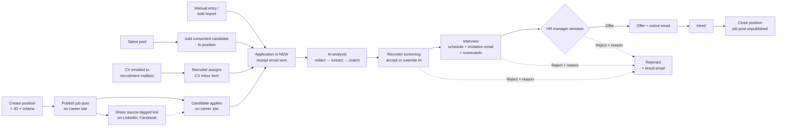

# Top-down Problem Analysis & Research

> Design status: TARGET
>
> Implementation status: NOT STARTED (requirements and UI/UX phase)

Product name in the interface: **Recruitment ATS**.

This document decomposes the assignment from the business goal down to user stories:

```text
Business problem → Stakeholders → Goals & metrics → Recruitment process
  → Epics → Features → User stories (see 03-invest-requirements.md)
```

## 1. Problem context

Small and medium companies (10–100 employees) in Vietnam usually recruit with spreadsheets, a shared mailbox, and folders of CVs on Google Drive. This causes recurring problems:

| Problem | Consequence |
|---|---|
| CVs arrive through many channels (job posts on social networks, email, job boards, referrals) | Candidates are lost or duplicated; nobody knows the full list or which channel works |
| Screening is manual | A recruiter spends several minutes per CV; urgent roles stay open longer |
| Pipeline status lives in personal spreadsheets | Managers cannot see where each candidate is or which stage is a bottleneck |
| Interview feedback is collected by chat | Interviewers influence each other; feedback is lost; decisions are not traceable |
| Candidates hear nothing back | No receipt, no interview confirmation, no result; the employer brand suffers |
| Good candidates from past rounds are forgotten | The team re-sources from scratch for every opening |
| CVs are personal data | Under Vietnam's Personal Data Protection Law (Law No. 91/2025/QH15, in force since 01/01/2026, detailed by Decree No. 356/2025/ND-CP, which replaced Decree 13/2023/ND-CP), the company must collect consent, control who accesses CVs, and delete data that is no longer needed |

**Problem statement:** a small hiring team needs one place to define open positions, publish them on its own career site, collect CVs from the career site, a recruitment mailbox, and manual entry, screen them, move candidates through a defined pipeline, keep candidates informed by email, collect independent interview feedback, reuse consented candidates later, and report on hiring results — with AI assistance for the slowest step (CV screening) but without letting AI make hiring decisions.

## 2. Stakeholders

| Stakeholder | Role in system | Main interest |
|---|---|---|
| System administrator | `ADMIN` | Accounts, roles, mailbox and sender settings, system audit |
| Head of recruitment / HR manager | `HR_MANAGER` | Overall pipeline, final decisions (offer / hire), email templates, reports |
| Recruiter | `RECRUITER` | Daily work: positions, job posts, CV intake, screening, scheduling, candidate communication |
| Interviewer (department head, team lead, engineer) | `INTERVIEWER` | Only the candidates assigned to them; submit feedback quickly |
| Candidate | Public user **without an account** | Find open jobs, apply easily, be informed, have personal data handled lawfully |
| AI service provider | External system | Receives redacted CV text, job descriptions, and redacted evidence; returns structured analysis, criteria and interview-question suggestions, and embeddings |
| Email service (SMTP) | External system | Delivers emails to candidates |
| Recruitment mailbox | External system | Receives CVs sent by email; read by the system |

A separate Hiring Manager role (department head who requests and approves hiring) was considered. It is not needed for a small team, where the department head joins as an Interviewer and the HR Manager decides; the RBAC model allows adding it later without changing existing roles.

## 3. Goals and success metrics

| Goal | Metric (measured in demo data) |
|---|---|
| G1 — Centralize candidates | 100% of applications from the career site, mailbox, manual entry, and bulk import are stored with CV and source; duplicate candidates detected by email/phone |
| G2 — Faster screening | AI analysis available for a CV in under 60 seconds; recruiter can sort applications by fit score |
| G3 — Transparent pipeline | Every stage change is recorded with actor and time; dashboard shows count per stage |
| G4 — Fair, independent evaluation | Interviewers cannot read other scorecards before submitting their own; AI never auto-rejects |
| G5 — Accountability | Important actions (stage change, AI override, CV deletion, export, user change) appear in the audit log |
| G6 — AI quality is measurable | Agreement between AI criterion results and recruiter decisions is reported; override rate is tracked |
| G7 — Candidates are informed | Every applicant receives a receipt email; every scheduled interview and final outcome triggers an email; no email is lost silently |
| G8 — Reuse of talent | Candidates who consented can be found in the talent pool and added to another position in one action |
| G9 — Channel effectiveness | Applications per source are reported, including LinkedIn and Facebook posts that link to the career site |
| G10 — AI across the hiring flow | AI drafts position criteria from a job description, finds matching consented candidates in the talent pool, and suggests interview questions for unverified criteria — every suggestion is reviewed by a person before it takes effect |

## 4. Market research

| Product | Relevant ideas | What we adopt |
|---|---|---|
| **Greenhouse** (global ATS, "structured hiring") | Separates the internal *job* (hiring plan, interview kit, scorecard attributes) from the public *job post* on the careers page and job boards. Permission levels (Basic, Job Admin, Site Admin) plus per-job hiring-team roles; interviewing is a task, not a role. Scorecards visible only after submitting one's own | Internal **position** + public **job post** on our own career site. Blind scorecards until submission (BR-07). Interviewers get minimal access |
| **Base E-Hiring** (Vietnamese ATS by Base Enterprise) | Multi-channel sourcing, talent pools, AI "Scan CV", automatic emails and scheduling, recruitment reports; two-way TopCV integration | Pipeline stages, CV scanning with AI, talent pool, automatic emails, reports |
| **FastWork Hiring** (Vietnamese HRM suite) | Headcount plan and hiring-plan approval; career web page; CV database for re-hiring; automatic emails (interview invitation, thank-you); notes, call and email history; channel cost and conversion reports; Excel import/export; API to pull CVs from the website | Career site, candidate database (talent pool), automatic emails, email history per application, Excel import/export, conversion by source. Headcount planning and call center are not adopted |
| **EasyHRM** (Vietnamese HRM suite) | AI CV filtering: read CVs in any format, match against weighted criteria, score and rank, "learn from HR decisions"; multi-channel posting and CV collection (Website, Facebook, LinkedIn, TopCV); automatic emails per stage; channel reports | Weighted criteria and ranking. **Not adopted:** learning from past HR decisions, because it can reproduce historical bias; our AI must quote evidence and stays advisory |
| Regulation reference: **EU AI Act** | AI systems used to screen or evaluate job candidates are classified as high-risk and require human oversight and transparency | Human-in-the-loop, evidence for every AI result, override with reason |
| Industry practice: **Vingroup** (public job-site articles, not official documentation) | Experienced hires: application → HR interview → in-depth interview with the department's direct manager → salary negotiation; group and member companies run their own career portals and also post on job boards | Department heads take part as Interviewers; own career site as the primary channel |

### Channel feasibility

| Channel | Publish job | Collect CVs automatically | Decision |
|---|---|---|---|
| Own career site | Yes (built in) | Yes (apply form) | **Adopted** — primary channel, free |
| Recruitment mailbox | — | Yes (IMAP / mail provider API) | **Adopted** — free |
| Manual entry, Excel + ZIP | — | — (recruiter uploads) | **Adopted** — free |
| LinkedIn | Job Posting API is closed to new partners; Apply Connect requires Talent Solutions partnership and Recruiter licences | No | **Share link only:** HR posts manually with a source-tagged link to the career site |
| Facebook | Jobs on Facebook and its API were shut down (2022–2023) | No | **Share link only**, same as LinkedIn |
| VietnamWorks | Open API (OAuth2, sandbox) after sales approval and a purchased posting package | Yes | Not adopted — paid; CVs forwarded by email are still captured |
| TopCV | Paid "Top Developer API" after NDA; CV delivery by webhook | Yes | Not adopted — paid; CVs forwarded by email are still captured |

**Differentiation of this project** compared with a generic ATS:

1. **Explainable AI scoring** — the AI judges each job criterion separately and must quote evidence from the CV; the final score is calculated by deterministic backend code, not by the AI.
2. **Blind screening** — name, gender, date of birth, photo, and address are redacted before CV text is sent to the AI.
3. **Independent interview evaluation** — scorecards stay hidden until the interviewer submits their own.
4. **Consent-first talent pool** — candidates enter the pool only with explicit consent and can withdraw from a link in any email.
5. **Safe automatic emails** — outcome emails wait 10 minutes in a queue so a mistaken stage change can be undone before the candidate is told.
6. **AI across the hiring flow, always as a draft** — AI suggests criteria when a position is created, finds consented past candidates by meaning (semantic search) when it opens, scores CVs with evidence during screening, and proposes questions for the interview; a person accepts, edits, or ignores each suggestion.

## 5. Recruitment process (to-be)



A **position** (UI: *vị trí tuyển dụng*) is the internal record of a role the company needs to fill: job description, headcount, target hire date, owner, and the weighted criteria the AI and interviewers evaluate against. A **job post** (UI: *tin tuyển dụng*) is the public version of one position on the company's career site: public title, description, benefits, location, and closing date — never the criteria weights or internal notes. HR publishes or unpublishes the job post and shares its link, tagged with a source, on LinkedIn, Facebook, or elsewhere. Candidates apply on the career site without creating an account.

Pipeline stages: `NEW → SCREENING → INTERVIEW → OFFER → HIRED`, with `REJECTED` reachable from any non-final stage.

## 6. Functional decomposition (Epic → Feature)

```text
Recruitment ATS
├── E1 Access & accounts
│   ├── F1.1 Login / logout                          → US01, US02
│   ├── F1.2 User management (Admin)                 → US20
│   └── F1.3 Personal profile & password             → US21
├── E2 Positions & job posts
│   ├── F2.1 Browse & search positions               → US04
│   ├── F2.2 Create / edit position with criteria    → US05, US06
│   ├── F2.3 Close / reopen position                 → US07
│   ├── F2.5 AI-suggested criteria from a job description → US32
│   └── F2.4 Publish job post & share links          → US22
├── E3 Career site (public)
│   ├── F3.1 Browse job posts                        → US23
│   ├── F3.2 Apply online with consent               → US24
│   └── F3.3 Manage own data consent                 → US31
├── E4 Candidates & applications
│   ├── F4.1 Browse & filter applications            → US08
│   ├── F4.2 Add application with CV                 → US09
│   ├── F4.3 Edit candidate information              → US10
│   ├── F4.4 Move through pipeline stages            → US11
│   ├── F4.5 Bulk import (Excel + ZIP of CVs)        → US16
│   ├── F4.6 CV inbox from recruitment mailbox       → US25, US29
│   ├── F4.7 Talent pool                             → US26
│   ├── F4.9 AI matching of pool candidates to a position → US33
│   └── F4.8 Export candidates to Excel              → US30
├── E5 AI screening
│   ├── F5.1 Analyze CV and score fit                → US12
│   └── F5.2 Override AI result with reason          → US13
├── E6 Interviews
│   ├── F6.1 Schedule interview & assign panel       → US14
│   ├── F6.3 AI-suggested interview questions        → US34
│   └── F6.2 Submit blind scorecard                  → US15
├── E7 Candidate communication
│   ├── F7.1 Automatic emails with cancel window     → US27
│   └── F7.2 Email templates                         → US28
└── E8 Insight & governance
    ├── F8.1 Dashboard                               → US03
    ├── F8.2 Recruitment reports                     → US17
    ├── F8.3 Export reports (PDF / XLSX)             → US18
    └── F8.4 Audit log                               → US19
```

## 7. Scope

### In scope

- 4 internal roles with backend-enforced RBAC and record-level rules; candidates as public users without accounts.
- Positions with must-have / nice-to-have criteria and weights; one public job post per position.
- Public career site: job list, job detail, apply form with consent, privacy policy, consent management by link.
- CV intake from the career site, a recruitment mailbox (IMAP), manual upload, and bulk import (Excel + ZIP); automatic source tagging.
- Applications with CV upload (PDF, DOCX), duplicate detection, pipeline stages and history.
- Asynchronous AI analysis with PII redaction, per-criterion evidence, deterministic scoring, retry, and human override.
- Interview scheduling (date, time, location/link, panel) and blind scorecards.
- Automatic candidate emails from editable templates, with a 10-minute cancel window for everything except the receipt email.
- Talent pool of consented candidates; add a pool candidate to another position.
- AI assistance outside screening: criteria drafted from a job description, semantic matching of consented pool candidates to a position, and interview questions drafted for criteria that need checking — all reviewed by a person before use.
- Excel export of candidates and talent pool; dashboard, reports, report export, audit log, user management, profile.
- Consent-based retention and automatic deletion of candidate data.

### Out of scope

- Candidate accounts, login, or an application status page (candidates are informed by email).
- API integration with paid job boards (TopCV, VietnamWorks) and automatic posting to LinkedIn or Facebook (no public API); these channels are covered by source-tagged share links and by CVs forwarded to the mailbox.
- SMS, chat, call-center integration; calendar integrations (Google, Outlook).
- Headcount planning and multi-level approval of hiring requests.
- OCR for scanned (image-only) CVs.
- Offer letters, e-signature, onboarding, payroll.
- AI chatbots, AI that learns from past hiring decisions, or AI making automatic reject/hire decisions.

## 8. Constraints and assumptions

| Type | Statement |
|---|---|
| Technical | Stack follows the course reference project: React (Vite) frontend, ASP.NET Core REST API, PostgreSQL |
| Technical | External services sit behind replaceable interfaces with fakes for tests: AI (`IResumeAnalyzer`), outgoing email (`IEmailSender`), recruitment mailbox (`IMailboxReader`) |
| Technical | The career site is a **separate frontend application** with its own domain and deployment; it calls only the public API (published job posts, apply, consent). The internal app and the career site share the backend and the design tokens |
| Cost | Every adopted channel is free; the test environment sends a small volume of email through a free SMTP tier or a sandbox inbox |
| Legal | CV data is personal data; processing requires consent or a recorded legal basis; access is limited by role and assignment; retention periods are configurable |
| Data | One company (single tenant) per deployment |
| Assumption | CVs are text-based PDF/DOCX, maximum 10 MB each |
| Assumption | UI language is Vietnamese; documentation is English, as in the reference project |

## 9. Key risks

| Risk | Mitigation |
|---|---|
| AI bias against groups of candidates | Redact personal attributes; AI only ranks; every override is logged |
| AI hallucinates skills | Each criterion result must include a quote; backend verifies the quote exists in the CV text |
| AI suggestions accepted without thought | Suggestions are drafts shown beside the editable form; nothing takes effect until a user saves; pool matches never create applications automatically |
| AI unavailable or slow | Analysis is asynchronous; status `FAILED` with retry; manual screening always possible |
| Personal-data leakage | Role and assignment checks in the API; public API exposes only job posts; redaction before external calls; retention job |
| Spam or malicious uploads on the career site | CAPTCHA, rate limits per IP and email, server-side file validation (BR-21) |
| Wrong email sent to a candidate | 10-minute queue with cancel and edit; pending emails cancelled automatically when the triggering action is undone (BR-23) |
| Emails land in spam | Send from the company's domain with SPF/DKIM; failures are retried and shown to HR |
| Mailbox credentials leak | Stored encrypted; configured by Admin only; read-only access |
| Unlawful retention | Pool only with explicit consent; withdrawal link in every email; automatic deletion (BR-17, BR-24) |
| Scope creep | Out-of-scope list above is fixed |

## Sources

- Greenhouse Support — [Scorecard visibility options](https://support.greenhouse.io/hc/en-us/articles/16187220652059-Scorecard-visibility-options), [Permission levels overview](https://support.greenhouse.io/hc/en-us/articles/360039614171-Permission-levels-overview), [Common Greenhouse definitions](https://support.greenhouse.io/hc/en-us/articles/115002277586-Common-Greenhouse-definitions)
- Base.vn — [Base E-Hiring](https://base.vn/app/e-hiring), [Help center](https://help.base.vn/support/solutions/folders/63000236706), [Tích hợp Hiring và TopCV](https://help.base.vn/support/solutions/articles/63000279994-base-hiring-h%C6%B0%E1%BB%9Bng-d%E1%BA%ABn-t%C3%ADch-h%E1%BB%A3p-hiring-v%C3%A0-topcv)
- FastWork — [FastWork Hiring](https://fastwork.vn/hiring/)
- EasyHRM — [AI tự lọc CV](https://easyhrm.vn/tin-tuc/ai-tu-loc-cv/), [Phần mềm tuyển dụng EasyHRM](https://easyhrm.vn/tin-tuc/phan-mem-tuyen-dung-easyhrm/)
- JobOKO — [Vingroup tuyển dụng 2026](https://vn.joboko.com/blog/vingroup-tuyen-dung-nwi1184)
- LinkedIn — [Job Posting API overview](https://learn.microsoft.com/en-us/linkedin/talent/job-postings/api/overview?view=li-lts-2026-04), [Apply Connect overview](https://learn.microsoft.com/en-us/linkedin/talent/apply-connect?view=li-lts-2025-10)
- SHRM — [Meta shelves Jobs on Facebook](https://www.shrm.org/resourcesandtools/hr-topics/talent-acquisition/pages/meta-shelves-jobs-on-facebook.aspx)
- VietnamWorks — [Developers](https://developers.vietnamworks.com/)
- TopCV — [Điều kiện giao dịch chung](https://www.topcv.vn/dieu-kien-giao-dich-chung); MISA — [Kết nối với sàn tuyển dụng TopCV](https://helpamis.misa.vn/amis-tuyen-dung/kb/ket-noi-voi-san-tuyen-dung-topcv/)
- Bộ Công an — [Luật Bảo vệ dữ liệu cá nhân có hiệu lực từ 01/01/2026](https://bocongan.gov.vn/chinh-sach-phap-luat/bai-viet/luat-bao-ve-du-lieu-ca-nhan-chinh-thuc-co-hieu-luc-thi-hanh-tu-ngay-01-01-2026-1767186124)
- EY Vietnam — [Legal alert: Decree No. 356/2025/ND-CP](https://www.ey.com/content/dam/ey-unified-site/ey-com/vi-vn/technical/tax/documents/ey-vietnam-legal-alert-march-2026-decree-no356-2025-nd-cp-providing-detailed-guidance-for-implementation-of-personal-data-protection-law-viet.pdf)

**Next:** [Use cases](02-use-cases.md) · [INVEST requirements](03-invest-requirements.md)
