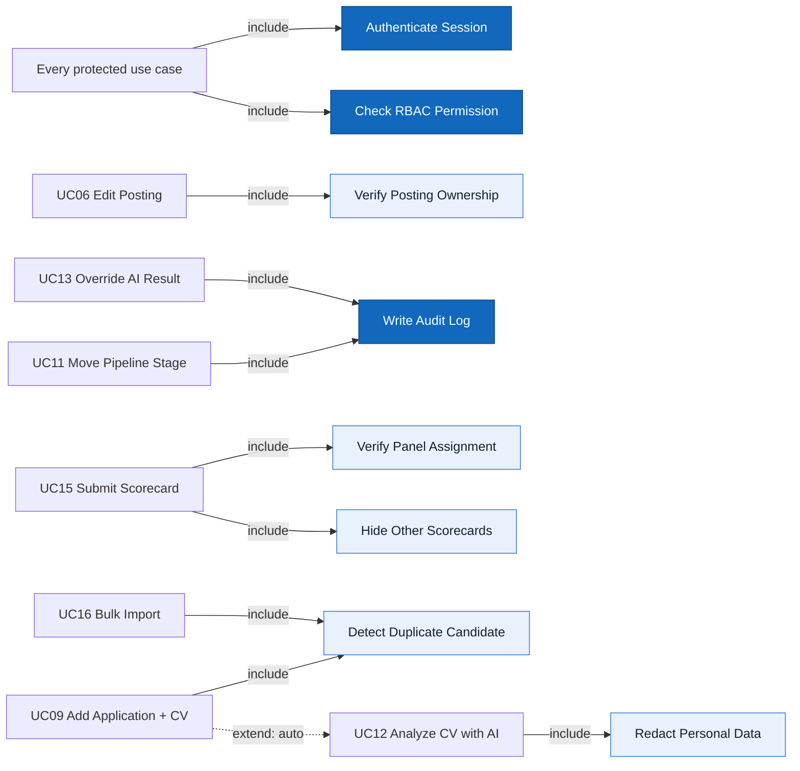

# Actors, Roles, Business Rules, and Use Cases

> Design status: TARGET V1
>
> Implementation status: NOT STARTED

Product name: **Recruitment ATS**.

## Actors / roles

| Role | Display name in UI | Description |
|---|---|---|
| `ADMIN` | Quản trị viên | Manages accounts and has full read access for support and audit |
| `HR_MANAGER` | Trưởng tuyển dụng | Owns the hiring process; makes offer / hire decisions; sees reports |
| `RECRUITER` | Chuyên viên tuyển dụng | Daily operations: postings, CV intake, screening, scheduling |
| `INTERVIEWER` | Người phỏng vấn | Interviews assigned candidates and submits scorecards |
| AI service | — (external system) | Receives redacted CV text and returns a structured analysis |

Candidates are **data subjects**, not system users, in V1.

## Role × feature matrix

| Feature | Admin | HR Manager | Recruiter | Interviewer |
|---|---|---|---|---|
| Dashboard | ✓ | ✓ | ✓ | Own interviews only |
| View job postings | ✓ | ✓ | ✓ | Postings they interview for |
| Create job posting | ✓ | ✓ | ✓ | |
| Edit job posting | ✓ | ✓ | Own postings | |
| Close / reopen posting | ✓ | ✓ | | |
| View applications | ✓ | ✓ | ✓ | Assigned only |
| Add application (upload CV) | ✓ | ✓ | ✓ | |
| Edit candidate information | ✓ | ✓ | ✓ | |
| Move pipeline stage | ✓ | ✓ | Up to `INTERVIEW`, and reject | |
| Run / view AI analysis | ✓ | ✓ | ✓ | |
| Override AI result | ✓ | ✓ | ✓ | |
| Schedule interview | ✓ | ✓ | ✓ | |
| Submit scorecard | | ✓ (if on panel) | | ✓ (if on panel) |
| View scorecards | ✓ | ✓ | ✓ | Only after submitting own |
| Bulk import | ✓ | ✓ | ✓ | |
| View reports | ✓ | ✓ | | |
| Export reports | ✓ | ✓ | | |
| Audit log | ✓ | ✓ | | |
| User management | ✓ | | | |
| Personal profile | ✓ | ✓ | ✓ | ✓ |

Menus and buttons are **not displayed** when the user lacks permission. Unauthorized URL access → `#/403`. The API, not the React client, enforces every rule in this table.

## Business rules

| ID | Rule |
|---|---|
| BR-01 | Pipeline stages are `NEW → SCREENING → INTERVIEW → OFFER → HIRED`. An application moves forward one stage at a time; skipping is not allowed. `HIRED` and `REJECTED` are final. |
| BR-02 | `REJECTED` can be set from any non-final stage and requires a reason from a fixed list plus an optional note. |
| BR-03 | Only `ADMIN` and `HR_MANAGER` may move an application to `OFFER` or `HIRED`. |
| BR-04 | Every stage change is stored in stage history (from, to, actor, time, reason). |
| BR-05 | New applications are accepted only for postings with status `OPEN`. Closing a posting does not change existing applications. |
| BR-06 | A candidate is identified by normalized email or phone number. An existing candidate is reused instead of duplicated; the same candidate cannot apply twice to the same posting. |
| BR-07 | **Blind scorecards:** an interviewer cannot read other scorecards of the same application until they have submitted their own. A submitted scorecard cannot be edited. |
| BR-08 | Interviewers see only applications where they are on the interview panel, and they never see the AI score, to avoid anchoring bias. |
| BR-09 | **AI is advisory only:** AI analysis never changes a stage, rejects, or hires a candidate. |
| BR-10 | Before CV text is sent to the AI service, name, gender, date of birth, photo, phone, email, and address are redacted. |
| BR-11 | The AI returns, for each job criterion, `MET`, `PARTIAL`, or `NOT_MET` with a quote from the CV. If the quote is not found in the CV text, the backend marks the criterion `UNVERIFIED` (counted as 0). |
| BR-12 | The fit score is calculated by backend code: `score = Σ(weight × value) / Σ(weight) × 100`, where `MET = 1`, `PARTIAL = 0.5`, `NOT_MET = UNVERIFIED = 0`. If any must-have criterion is not `MET`, the application is flagged **Missing must-have**; it is not rejected automatically. |
| BR-13 | Overriding an AI result requires a reason of at least 10 characters. The original AI result is kept; the override is logged in the audit log. |
| BR-14 | A Recruiter may edit only postings they own; an HR Manager can reassign the owner. |
| BR-15 | CV files must be PDF or DOCX, at most 10 MB, and contain extractable text. |
| BR-16 | Bulk import is all-or-nothing: one Excel file (maximum 200 rows) plus one ZIP of CVs matched by file name. Any invalid row means zero applications are created. |
| BR-17 | CVs of `REJECTED` applications are deleted automatically after the retention period (default 6 months); the candidate record is anonymized and the deletion is logged. |

## Use case diagram

Every use case is a separate node. HR roles are on the left; Interviewer and Admin are on the right; the AI service is an external secondary actor.

```mermaid
flowchart LR
    subgraph left["Actors"]
        direction TB
        manager(["HR Manager"])
        recruiter(["Recruiter"])
    end

    subgraph system["Recruitment ATS — System Boundary"]
        direction TB
        subgraph access["Access and overview"]
            direction LR
            uc01["UC01 Login"]
            uc02["UC02 Logout"]
            uc03["UC03 View Dashboard"]
            uc21["UC21 Manage Profile"]
        end
        subgraph jobs["Job postings"]
            direction LR
            uc04["UC04 View Postings"]
            uc05["UC05 Create Posting"]
            uc06["UC06 Edit Posting"]
            uc07["UC07 Close / Reopen Posting"]
        end
        subgraph apps["Candidates and applications"]
            direction LR
            uc08["UC08 View Applications"]
            uc09["UC09 Add Application + CV"]
            uc10["UC10 Edit Candidate"]
            uc11["UC11 Move Pipeline Stage"]
            uc16["UC16 Bulk Import"]
        end
        subgraph ai["AI screening"]
            direction LR
            uc12["UC12 Analyze CV with AI"]
            uc13["UC13 Override AI Result"]
        end
        subgraph interviews["Interviews"]
            direction LR
            uc14["UC14 Schedule Interview"]
            uc15["UC15 Submit Scorecard"]
        end
        subgraph governance["Insight and governance"]
            direction LR
            uc17["UC17 View Reports"]
            uc18["UC18 Export Reports"]
            uc19["UC19 View Audit Log"]
            uc20["UC20 Manage Users"]
        end
    end

    subgraph right["Actors"]
        direction TB
        interviewer(["Interviewer"])
        admin(["Administrator"])
        aiService(["AI Service<br/>(external)"])
    end

    manager --> uc01 & uc02 & uc03 & uc04 & uc05 & uc06 & uc07 & uc08 & uc09 & uc10 & uc11 & uc12 & uc13 & uc14 & uc15 & uc16 & uc17 & uc18 & uc19 & uc21
    recruiter --> uc01 & uc02 & uc03 & uc04 & uc05 & uc06 & uc08 & uc09 & uc10 & uc11 & uc12 & uc13 & uc14 & uc16 & uc21
    interviewer --> uc01 & uc02 & uc03 & uc04 & uc08 & uc15 & uc21
    admin --> uc01 & uc02 & uc03 & uc04 & uc05 & uc06 & uc07 & uc08 & uc09 & uc10 & uc11 & uc12 & uc13 & uc14 & uc16 & uc17 & uc18 & uc19 & uc20 & uc21
    uc12 -.-> aiService

    classDef actor fill:#666,color:#fff,stroke:#333
    classDef external fill:#999,color:#fff,stroke:#555,stroke-dasharray:4 4
    classDef usecase fill:#1168bd,color:#fff,stroke:#0b4f9e
    classDef aiCase fill:#7b3fbf,color:#fff,stroke:#5a2b8f
    class manager,recruiter,interviewer,admin actor
    class aiService external
    class uc01,uc02,uc03,uc04,uc05,uc06,uc07,uc08,uc09,uc10,uc11,uc14,uc15,uc16,uc17,uc18,uc19,uc20,uc21 usecase
    class uc12,uc13 aiCase
    style left fill:#fff,stroke:#bbb,stroke-dasharray:5 5
    style right fill:#fff,stroke:#bbb,stroke-dasharray:5 5
    style system fill:#f8fbff,stroke:#1168bd,stroke-dasharray:5 5
```

### Include / extend relationships

## Use cases

### UC01 Login

- **Actor:** all roles
- **Preconditions:** an active account exists
- **Main flow:** enter email and password → backend verifies credentials and account status → returns a Bearer access token and a safe profile → Dashboard
- **Alternative:** invalid credentials or disabled account → generic error, remain on login screen
- **Result:** authenticated client session (30-minute access token, no refresh token in V1)

### UC02 Logout

- **Actor:** all roles
- **Main flow:** click logout → call `logout` (audit) → client discards token and cached data → Login
- **Result:** internal pages are no longer accessible from this client

### UC03 View dashboard

- **Actor:** all roles
- **Main flow:** choose date range → KPIs (open postings, new applications, applications per stage, interviews this week, hires) + funnel chart + upcoming interviews + postings near deadline
- **Interviewer variant:** only "My upcoming interviews" and "Scorecards pending"
- **Result:** read-only overview filtered by permission

### UC04 View job postings

- **Actor:** all roles (Interviewer: only postings they interview for)
- **Main flow:** list with search (title, department), filters (status, department, owner), paging → open detail (description, criteria, pipeline summary)

### UC05 Create job posting

- **Actor:** Admin, HR Manager, Recruiter
- **Main flow:** form: title, department, location, employment type, headcount, deadline, description → add criteria (name, type `MUST_HAVE` / `NICE_TO_HAVE`, weight 1–5) → save as `DRAFT` or `OPEN`
- **Validation:** at least one criterion; deadline in the future; headcount ≥ 1
- **Result:** posting appears in the list; the creator becomes the owner

### UC06 Edit job posting

- **Actor:** Admin, HR Manager; Recruiter if they own the posting (BR-14)
- **Main flow:** edit fields and criteria → save → audit
- **Rule:** changing criteria increases the posting version; existing AI results are marked **Outdated** and can be re-analyzed

### UC07 Close / reopen posting

- **Actor:** Admin, HR Manager
- **Main flow:** confirm → status `CLOSED` (or back to `OPEN`) → audit
- **Result:** closed postings accept no new applications (BR-05)

### UC08 View applications

- **Actor:** all roles (Interviewer: assigned only, without AI score — BR-08)
- **Main flow:** two views: **Kanban** by stage for one posting, or **table** across postings; filter by posting, stage, fit score, source, missing must-have; sort by fit score or date → open application detail (CV preview, AI analysis, stage history, interviews, scorecards)

### UC09 Add application with CV

- **Actor:** Admin, HR Manager, Recruiter
- **Main flow:** choose posting → upload CV (BR-15) → enter or confirm candidate info (name, email, phone, source) → duplicate check (BR-06) → create application in `NEW` → AI analysis is queued automatically (extends UC12)
- **Alternative:** duplicate found → show the existing candidate and link the new application to it; same posting → 409 Conflict

### UC10 Edit candidate information

- **Actor:** Admin, HR Manager, Recruiter
- **Main flow:** edit name, email, phone, source, notes, or replace the CV → audit; replacing the CV triggers a new AI analysis

### UC11 Move pipeline stage

- **Actor:** Admin, HR Manager; Recruiter up to `INTERVIEW` and `REJECTED` (BR-03)
- **Main flow:** drag a card on the Kanban board or use the "Move to…" action → validate transition (BR-01) → if `REJECTED`, require a reason (BR-02) → save stage history → audit
- **Alternative:** invalid transition → 409 with the allowed next stages

### UC12 Analyze CV with AI

- **Actor:** Admin, HR Manager, Recruiter; secondary actor: AI service
- **Trigger:** automatic after UC09 / UC10 / UC16, or manual "Analyze again"
- **Main flow:** status `PENDING` → background worker extracts text → redacts personal data (BR-10) → sends text + criteria to the AI → receives structured result (skills, years of experience, education, languages, per-criterion result + quote) → verifies quotes (BR-11) → calculates score (BR-12) → status `COMPLETED`
- **Alternative:** no extractable text or AI error → status `FAILED` with reason and a retry button; manual screening is still possible
- **Result:** fit score 0–100, per-criterion evidence, and a "Missing must-have" flag; the stage is unchanged (BR-09)

### UC13 Override AI result

- **Actor:** Admin, HR Manager, Recruiter
- **Main flow:** open AI analysis → change one or more criterion results → enter reason (BR-13) → backend recalculates score → audit
- **Result:** both the AI result and the human result are visible; reports count the override

### UC14 Schedule interview

- **Actor:** Admin, HR Manager, Recruiter
- **Preconditions:** application is in `INTERVIEW`
- **Main flow:** choose round name, date and time, duration, location or meeting link, panel (one or more Interviewers / HR Managers) → save
- **Validation:** time in the future; at least one panel member; a panel member cannot have two overlapping interviews
- **Result:** the interview appears on panel members' dashboards

### UC15 Submit scorecard

- **Actor:** Interviewer or HR Manager on the panel
- **Main flow:** open the assigned interview → rate each posting criterion 1–5 and leave comments → overall recommendation (`STRONG_YES`, `YES`, `NO`, `STRONG_NO`) → submit
- **Rules:** other scorecards are hidden before submission (BR-07); submitted scorecards are read-only
- **Result:** after submission, the interviewer can see other submitted scorecards for that application

### UC16 Bulk import

- **Actor:** Admin, HR Manager, Recruiter
- **Main flow:** choose posting → download the Excel template → upload `.xlsx` + `.zip` of CVs → preview row validation (required columns, email format, matching CV file, duplicates) → confirm → atomic import (BR-16) → AI analysis queued for each new application
- **Result:** import batch summary (total, valid, created, errors)

### UC17 View reports

- **Actor:** Admin, HR Manager
- **Main flow:** choose date range and posting → recruitment funnel (count and conversion per stage), time-to-hire, applications by source, rejection reasons, AI override rate and AI–human agreement

### UC18 Export reports

- **Actor:** Admin, HR Manager
- **Main flow:** export the current report filters to PDF or XLSX; the export is audited

### UC19 View audit log

- **Actor:** Admin, HR Manager
- **Main flow:** filter by action, module, actor, and date range; read-only

### UC20 Manage users

- **Actor:** Admin
- **Main flow:** list, create, edit (name, email, phone, role), activate / deactivate accounts; Admin cannot deactivate their own account

### UC21 Personal profile

- **Actor:** all roles
- **Main flow:** update name, phone, avatar, timezone; change password after verifying the current one; role is read-only

**Related:** [Research](01-research-top-down.md) · [INVEST requirements](03-invest-requirements.md) · [Information architecture](04-information-architecture.md)
