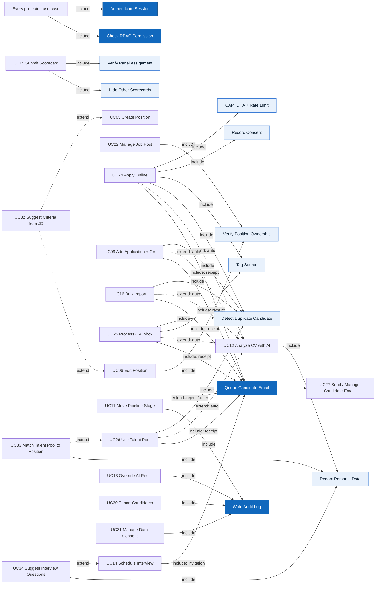

# Actors, Roles, Business Rules, and Use Cases

> Design status: TARGET
>
> Implementation status: NOT STARTED

Product name: **Recruitment ATS**.

## Actors / roles

| Actor | Display name in UI | Description |
|---|---|---|
| `ADMIN` | Quản trị viên | Manages accounts, mailbox and sender settings; full read access for support and audit |
| `HR_MANAGER` | Trưởng tuyển dụng | Owns the hiring process; makes offer / hire decisions; manages email templates; sees reports |
| `RECRUITER` | Chuyên viên tuyển dụng | Daily operations: positions, job posts, CV intake, screening, scheduling, candidate emails |
| `INTERVIEWER` | Người phỏng vấn | Interviews assigned candidates and submits scorecards (department heads take part in this role) |
| Candidate | Ứng viên | **Public user without an account.** Browses job posts, applies on the career site, and manages data consent from a link in emails |
| AI service | — (external system) | Receives redacted CV text and returns a structured analysis |
| Email service | — (external system) | SMTP provider that delivers emails to candidates |
| Recruitment mailbox | — (external system) | Company mailbox (e.g. `tuyendung@…`) read by the system to collect emailed CVs |

Two records describe an opening:

- A **position** (*vị trí tuyển dụng*) is internal: job description, headcount, target hire date, owner, and weighted evaluation criteria.
- A **job post** (*tin tuyển dụng*) is the public version of one position on the career site. HR publishes it and shares its link, tagged with a source, on LinkedIn, Facebook, or elsewhere. The system does not post to external sites itself.

## Role × feature matrix

| Feature | Admin | HR Manager | Recruiter | Interviewer |
|---|---|---|---|---|
| Dashboard | ✓ | ✓ | ✓ | Own interviews only |
| View positions | ✓ | ✓ | ✓ | Positions they interview for |
| Create position | ✓ | ✓ | ✓ | |
| Edit position | ✓ | ✓ | Own positions | |
| Close / reopen position | ✓ | ✓ | | |
| Edit, publish, unpublish job post; copy share links | ✓ | ✓ | Own positions | |
| View applications | ✓ | ✓ | ✓ | Assigned only |
| Add application (upload CV) | ✓ | ✓ | ✓ | |
| Process CV inbox (mailbox) | ✓ | ✓ | ✓ | |
| Bulk import | ✓ | ✓ | ✓ | |
| Edit candidate information | ✓ | ✓ | ✓ | |
| Move pipeline stage | ✓ | ✓ | Up to `INTERVIEW`, and reject | |
| Run / view AI analysis | ✓ | ✓ | ✓ | |
| Override AI result | ✓ | ✓ | ✓ | |
| AI-suggested criteria while creating / editing a position | ✓ | ✓ | Own positions | |
| AI matches from the talent pool for a position | ✓ | ✓ | ✓ | |
| AI-suggested interview questions | ✓ | ✓ | ✓ | Sees the attached questions only |
| Schedule / reschedule / cancel interview | ✓ | ✓ | ✓ | |
| Submit scorecard | | ✓ (if on panel) | | ✓ (if on panel) |
| View scorecards | ✓ | ✓ | ✓ | Only after submitting own |
| View candidate emails; edit or cancel pending ones | ✓ | ✓ | ✓ | |
| Talent pool (search, add to position) | ✓ | ✓ | ✓ | |
| Export candidates / talent pool to Excel | ✓ | ✓ | ✓ | |
| Email templates | ✓ | ✓ | | |
| Mailbox and sender settings | ✓ | | | |
| View reports | ✓ | ✓ | | |
| Export reports | ✓ | ✓ | | |
| Audit log | ✓ | ✓ | | |
| User management | ✓ | | | |
| Personal profile | ✓ | ✓ | ✓ | ✓ |

**Candidate (public, no login):** view published job posts, submit an application, and — only through the signed link in an email — leave the talent pool or request deletion of their data.

Menus and buttons are **not displayed** when the user lacks permission. Unauthorized URL access → `#/403`. The API, not the React client, enforces every rule in this table. Public endpoints expose only published job posts, the apply action, and the consent action.

## Business rules

| ID | Rule |
|---|---|
| BR-01 | Pipeline stages are `NEW → SCREENING → INTERVIEW → OFFER → HIRED`. An application moves forward one stage at a time; skipping is not allowed. `HIRED` and `REJECTED` are final. |
| BR-02 | `REJECTED` can be set from any non-final stage and requires a reason from a fixed list (including "Ứng viên rút hồ sơ") plus an optional note. |
| BR-03 | Only `ADMIN` and `HR_MANAGER` may move an application to `OFFER` or `HIRED`. |
| BR-04 | Every stage change is stored in stage history (from, to, actor, time, reason). |
| BR-05 | New applications are accepted only for positions with status `OPEN`. A job post can be `PUBLISHED` only while its position is `OPEN`; closing the position unpublishes the post, and reopening does not republish it automatically. Closing does not change existing applications. |
| BR-06 | A candidate is identified by normalized email or phone number. An existing candidate is reused instead of duplicated; the same candidate cannot have two applications for the same position. |
| BR-07 | **Blind scorecards:** an interviewer cannot read other scorecards of the same application until they have submitted their own. A submitted scorecard cannot be edited. |
| BR-08 | Interviewers see only applications where they are on the interview panel, and they never see the AI score, to avoid anchoring bias. |
| BR-09 | **AI is advisory only:** AI analysis never changes a stage, rejects, or hires a candidate. |
| BR-10 | Before CV text is sent to the AI service, name, gender, date of birth, photo, phone, email, and address are redacted. |
| BR-11 | The AI returns, for each job criterion, `MET`, `PARTIAL`, or `NOT_MET` with a quote from the CV. If the quote is not found in the CV text, the backend marks the criterion `UNVERIFIED` (counted as 0). |
| BR-12 | The fit score is calculated by backend code: `score = Σ(weight × value) / Σ(weight) × 100`, where `MET = 1`, `PARTIAL = 0.5`, `NOT_MET = UNVERIFIED = 0`. If any must-have criterion is not `MET`, the application is flagged **Missing must-have**; it is not rejected automatically. |
| BR-13 | Overriding an AI result requires a reason of at least 10 characters. The original AI result is kept; the override is logged in the audit log. |
| BR-14 | A Recruiter may edit only positions (and their job posts) they own; an HR Manager can reassign the owner. |
| BR-15 | CV files must be PDF or DOCX, at most 10 MB, and contain extractable text. |
| BR-16 | Bulk import is all-or-nothing: one Excel file (maximum 200 rows) plus one ZIP of CVs matched by file name. Any invalid row means zero applications are created. |
| BR-17 | **Retention without pool consent:** 6 months after a candidate's last application becomes `REJECTED`, their CVs are deleted and the candidate record is anonymized. Every deletion is logged. Candidates with pool consent follow BR-24. |
| BR-18 | Every application has exactly one source from a fixed list: `CAREER_SITE`, `LINKEDIN`, `FACEBOOK`, `TOPCV`, `VIETNAMWORKS`, `EMAIL`, `REFERRAL`, `OTHER`. Career-site applications take the source from the share link's `src` parameter, defaulting to `CAREER_SITE`; mailbox intake defaults to `EMAIL`; manual and bulk entry require a source. `OTHER` requires a short note. |
| BR-19 | **Consent:** applying on the career site requires agreeing to the privacy policy (policy version and time are stored). Joining the talent pool is a separate, optional, unticked checkbox. For mailbox, manual, and bulk intake, the recorded basis is "candidate submitted a CV for this position"; the receipt email carries the privacy notice and a link where the candidate can join the pool. |
| BR-20 | **Job post content** contains only public fields: title, department, location, employment type, optional salary range, description, requirements, benefits, and closing date. Criteria weights, internal notes, and owner are never public. After the closing date the post stays visible as "Đã hết hạn nhận hồ sơ" and the apply form is disabled. |
| BR-21 | **Public apply protection:** CAPTCHA on every submission; at most 5 submissions per IP per hour and 3 per email per day; BR-15 file rules are checked server-side. A repeat application to the same position creates nothing and shows the same neutral confirmation, so the form does not reveal whether an email is already known. |
| BR-22 | **Mailbox intake:** the mailbox is read every 5 minutes with read-only access; processed messages are tracked by Message-ID. Only messages with a PDF or DOCX attachment become CV inbox items. If the subject contains the code of an `OPEN` position in brackets (e.g. `[JOB-014]`) and BR-06 finds no conflict, the application is created automatically; otherwise the item waits for a recruiter. Dismissed items and their attachments are deleted after 7 days. |
| BR-23 | **Automatic emails** are rendered from templates and logged per application (template, recipient, time, status). Delays: receipt — immediately; interview invitation, interview change, interview cancellation, rejection, offer notice — queued for **10 minutes**, during which Admin, HR Manager, or Recruiter can edit or cancel them. When an interview is changed or cancelled while its invitation is still pending, the pending email is replaced or cancelled instead of sending both. Sending failures are retried 3 times (after 1, 5, 30 minutes), then marked `FAILED` and listed under *Cần xử lý*. No email is sent to an invalid address; the application is flagged instead. |
| BR-24 | **Talent pool:** contains only candidates with active pool consent. Consent lasts 24 months from the candidate's latest application or confirmation; 30 days before expiry the candidate receives a renewal email. Without renewal, the candidate leaves the pool and BR-17 applies. Every candidate email contains a signed link to leave the pool or delete all data; deletion removes CVs, anonymizes the candidate, and rejects open applications with reason "Ứng viên rút hồ sơ", and is logged. |
| BR-25 | **Excel export** of candidates or the talent pool contains only rows and columns the user may see, at most 5,000 rows, never CV files; each export writes an `EXPORT` audit entry with the filters used. |
| BR-26 | **AI suggestions are drafts:** criteria suggestions (UC32) and interview-question suggestions (UC34) are shown beside the editable form and take effect only when a user saves them; the user may accept, edit, or discard each item. A suggestion call is limited to 30 per user per hour and every call is logged with model, duration, and outcome. Job descriptions sent for criteria suggestion are internal text, not candidate data. |
| BR-27 | **Talent-pool matching:** only candidates with active pool consent (BR-24) are embedded and matched. Embeddings are computed from the same redacted CV text as BR-10, never from contact data, and are deleted when the candidate leaves the pool or is anonymized. A match is a ranking hint with a similarity value and the skills that overlap; it never creates an application — a user adds the candidate through UC26, after which normal screening applies. Candidates who already applied to the position are excluded. |
| BR-28 | **Interview questions:** suggestions are generated from the position criteria, the current analysis results, and their verified quotes — never from contact data. The scheduler reviews them and attaches at most 8 to the interview. Interviewers see the attached questions grouped by criterion, but never the AI result, quote, or score (BR-08). |

## Use case diagram

Every use case is a separate node. HR roles are on the left; Interviewer, Admin, and Candidate are on the right; external systems are secondary actors.

```mermaid
flowchart LR
    subgraph left["Actors"]
        direction TB
        manager(["HR Manager"])
        recruiter(["Recruiter"])
    end

    subgraph system["Recruitment ATS — System Boundary"]
        direction TB
        subgraph access["Access and overview"]
            direction LR
            uc01["UC01 Login"]
            uc02["UC02 Logout"]
            uc03["UC03 View Dashboard"]
            uc21["UC21 Manage Profile"]
        end
        subgraph jobs["Positions and job posts"]
            direction LR
            uc04["UC04 View Positions"]
            uc05["UC05 Create Position"]
            uc06["UC06 Edit Position"]
            uc07["UC07 Close / Reopen Position"]
            uc22["UC22 Manage Job Post"]
        end
        subgraph career["Career site (public)"]
            direction LR
            uc23["UC23 Browse Job Posts"]
            uc24["UC24 Apply Online"]
            uc31["UC31 Manage Data Consent"]
        end
        subgraph apps["Candidates and applications"]
            direction LR
            uc08["UC08 View Applications"]
            uc09["UC09 Add Application + CV"]
            uc10["UC10 Edit Candidate"]
            uc11["UC11 Move Pipeline Stage"]
            uc16["UC16 Bulk Import"]
            uc25["UC25 Process CV Inbox"]
            uc26["UC26 Use Talent Pool"]
            uc30["UC30 Export Candidates"]
        end
        subgraph ai["AI screening"]
            direction LR
            uc12["UC12 Analyze CV with AI"]
            uc13["UC13 Override AI Result"]
            uc32["UC32 Suggest Criteria from JD"]
            uc33["UC33 Match Talent Pool to Position"]
            uc34["UC34 Suggest Interview Questions"]
        end
        subgraph interviews["Interviews"]
            direction LR
            uc14["UC14 Schedule Interview"]
            uc15["UC15 Submit Scorecard"]
        end
        subgraph comms["Candidate communication"]
            direction LR
            uc27["UC27 Send / Manage Candidate Emails"]
            uc28["UC28 Manage Email Templates"]
        end
        subgraph governance["Insight and governance"]
            direction LR
            uc17["UC17 View Reports"]
            uc18["UC18 Export Reports"]
            uc19["UC19 View Audit Log"]
            uc20["UC20 Manage Users"]
            uc29["UC29 Configure Mailbox & Sender"]
        end
    end

    subgraph right["Actors"]
        direction TB
        interviewer(["Interviewer"])
        admin(["Administrator"])
        candidate(["Candidate<br/>(public, no account)"])
        aiService(["AI Service<br/>(external)"])
        mailService(["Email Service<br/>(external)"])
        mailbox(["Recruitment Mailbox<br/>(external)"])
    end

    manager --> uc01 & uc02 & uc03 & uc04 & uc05 & uc06 & uc07 & uc22 & uc08 & uc09 & uc10 & uc11 & uc16 & uc25 & uc26 & uc30 & uc12 & uc13 & uc32 & uc33 & uc34 & uc14 & uc15 & uc27 & uc28 & uc17 & uc18 & uc19 & uc21
    recruiter --> uc01 & uc02 & uc03 & uc04 & uc05 & uc06 & uc22 & uc08 & uc09 & uc10 & uc11 & uc16 & uc25 & uc26 & uc30 & uc12 & uc13 & uc32 & uc33 & uc34 & uc14 & uc27 & uc21
    interviewer --> uc01 & uc02 & uc03 & uc04 & uc08 & uc15 & uc21
    admin --> uc01 & uc02 & uc03 & uc04 & uc05 & uc06 & uc07 & uc22 & uc08 & uc09 & uc10 & uc11 & uc16 & uc25 & uc26 & uc30 & uc12 & uc13 & uc32 & uc33 & uc34 & uc14 & uc27 & uc28 & uc17 & uc18 & uc19 & uc20 & uc29 & uc21
    candidate --> uc23 & uc24 & uc31
    uc12 & uc32 & uc33 & uc34 -.-> aiService
    uc27 -.-> mailService
    uc25 -.-> mailbox

    classDef actor fill:#666,color:#fff,stroke:#333
    classDef external fill:#999,color:#fff,stroke:#555,stroke-dasharray:4 4
    classDef usecase fill:#1168bd,color:#fff,stroke:#0b4f9e
    classDef aiCase fill:#7b3fbf,color:#fff,stroke:#5a2b8f
    classDef publicCase fill:#0f766e,color:#fff,stroke:#0b5a54
    class manager,recruiter,interviewer,admin,candidate actor
    class aiService,mailService,mailbox external
    class uc01,uc02,uc03,uc04,uc05,uc06,uc07,uc08,uc09,uc10,uc11,uc14,uc15,uc16,uc17,uc18,uc19,uc20,uc21,uc22,uc25,uc26,uc27,uc28,uc29,uc30 usecase
    class uc12,uc13,uc32,uc33,uc34 aiCase
    class uc23,uc24,uc31 publicCase
    style left fill:#fff,stroke:#bbb,stroke-dasharray:5 5
    style right fill:#fff,stroke:#bbb,stroke-dasharray:5 5
    style system fill:#f8fbff,stroke:#1168bd,stroke-dasharray:5 5
```

### Include / extend relationships

## Use cases

### UC01 Login

- **Actor:** all internal roles
- **Preconditions:** an active account exists
- **Main flow:** enter email and password → backend verifies credentials and account status → returns a Bearer access token and a safe profile → Dashboard
- **Alternative:** invalid credentials or disabled account → generic error, remain on login screen
- **Result:** authenticated client session (15-minute access token, rotating refresh token in an `httpOnly` cookie — AD-06)

### UC02 Logout

- **Actor:** all internal roles
- **Main flow:** click logout → call `logout` (audit) → server revokes the refresh token → client discards the access token and cached data → Login
- **Result:** internal pages are no longer accessible from this client

### UC03 View dashboard

- **Actor:** all internal roles
- **Main flow:** choose date range → KPIs (open positions, new applications, applications per stage, interviews this week, hires) + funnel chart + upcoming interviews + positions near their target hire date + *Cần xử lý* (CV inbox items waiting, failed emails, failed AI analyses, overdue scorecards)
- **Interviewer variant:** only "My upcoming interviews" and "Scorecards pending"
- **Result:** read-only overview filtered by permission

### UC04 View positions

- **Actor:** all internal roles (Interviewer: only positions they interview for)
- **Main flow:** list with search (title, code, department), filters (status, department, owner, job post status), paging → open detail (overview, criteria, job post, pipeline)

### UC05 Create position

- **Actor:** Admin, HR Manager, Recruiter
- **Main flow:** form: title, department, location, employment type, headcount, target hire date, internal job description → add criteria (name, type `MUST_HAVE` / `NICE_TO_HAVE`, weight 1–5) → save as `DRAFT` or `OPEN`
- **Validation:** at least one criterion; target hire date in the future; headcount ≥ 1
- **Result:** position appears in the list with a code (e.g. `JOB-014`); the creator becomes the owner; a draft job post is prefilled from the position

### UC06 Edit position

- **Actor:** Admin, HR Manager; Recruiter if they own the position (BR-14)
- **Main flow:** edit fields and criteria → save → audit
- **Rule:** changing criteria increases the position version; existing AI results are marked **Outdated** and can be re-analyzed

### UC07 Close / reopen position

- **Actor:** Admin, HR Manager
- **Main flow:** confirm → status `CLOSED` (or back to `OPEN`) → audit
- **Result:** no new applications can be added (BR-05); the job post is unpublished and the career site no longer lists it

### UC08 View applications

- **Actor:** all internal roles (Interviewer: assigned only, without AI score — BR-08)
- **Main flow:** two views: **Kanban** by stage for one position, or **table** across positions; filter by position, stage, fit score, source, missing must-have; sort by fit score or date → open application detail (CV preview, AI analysis, interviews and scorecards, emails, stage history)

### UC09 Add application with CV

- **Actor:** Admin, HR Manager, Recruiter
- **Main flow:** choose position → upload CV (BR-15) → enter or confirm candidate info (name, email, phone, source — BR-18) → duplicate check (BR-06) → create application in `NEW` → AI analysis queued (extends UC12) → receipt email sent (BR-23)
- **Alternative:** duplicate found → show the existing candidate and link the new application to it; same position → 409 Conflict

### UC10 Edit candidate information

- **Actor:** Admin, HR Manager, Recruiter
- **Main flow:** edit name, email, phone, source, notes, or replace the CV → audit; replacing the CV triggers a new AI analysis

### UC11 Move pipeline stage

- **Actor:** Admin, HR Manager; Recruiter up to `INTERVIEW` and `REJECTED` (BR-03)
- **Main flow:** drag a card on the Kanban board or use the "Move to…" action → validate transition (BR-01) → if `REJECTED`, require a reason (BR-02) → save stage history → audit → for `REJECTED` and `OFFER`, the corresponding email is queued with a 10-minute cancel window (BR-23)
- **Alternative:** invalid transition → 409 with the allowed next stages

### UC12 Analyze CV with AI

- **Actor:** Admin, HR Manager, Recruiter; secondary actor: AI service
- **Trigger:** automatic after any intake (UC09, UC16, UC24, UC25, UC26) or CV replacement (UC10), or manual "Analyze again"
- **Main flow:** status `PENDING` → background worker extracts text → redacts personal data (BR-10) → sends text + criteria to the AI → receives structured result (skills, years of experience, education, languages, per-criterion result + quote) → verifies quotes (BR-11) → calculates score (BR-12) → status `COMPLETED`
- **Alternative:** no extractable text or AI error → status `FAILED` with reason and a retry button; manual screening is still possible
- **Result:** fit score 0–100, per-criterion evidence, and a "Missing must-have" flag; the stage is unchanged (BR-09)

### UC13 Override AI result

- **Actor:** Admin, HR Manager, Recruiter
- **Main flow:** open AI analysis → change one or more criterion results → enter reason (BR-13) → backend recalculates score → audit
- **Result:** both the AI result and the human result are visible; reports count the override

### UC14 Schedule interview

- **Actor:** Admin, HR Manager, Recruiter
- **Preconditions:** application is in `INTERVIEW`
- **Main flow:** choose round name, date and time, duration, location or meeting link, panel (one or more Interviewers / HR Managers) → save → invitation email queued (BR-23)
- **Alternative:** reschedule or cancel an interview → the pending invitation is replaced or cancelled; if already sent, a change or cancellation email is queued
- **Validation:** time in the future; at least one panel member; a panel member cannot have two overlapping interviews
- **Result:** the interview appears on panel members' dashboards

### UC15 Submit scorecard

- **Actor:** Interviewer or HR Manager on the panel
- **Main flow:** open the assigned interview → rate each position criterion 1–5 and leave comments → overall recommendation (`STRONG_YES`, `YES`, `NO`, `STRONG_NO`) → submit
- **Rules:** other scorecards are hidden before submission (BR-07); submitted scorecards are read-only
- **Result:** after submission, the interviewer can see other submitted scorecards for that application

### UC16 Bulk import

- **Actor:** Admin, HR Manager, Recruiter
- **Main flow:** choose position → download the Excel template → upload `.xlsx` + `.zip` of CVs → preview row validation (required columns, email format, valid source — BR-18, matching CV file, duplicates) → choose whether to send receipt emails (default on) → confirm → atomic import (BR-16) → AI analysis queued for each new application
- **Result:** import batch summary (total, valid, created, errors)

### UC17 View reports

- **Actor:** Admin, HR Manager
- **Main flow:** choose date range and position → recruitment funnel (count and conversion per stage), time-to-hire, applications and hires by source, rejection reasons, AI override rate and AI–human agreement, email delivery (sent, failed, cancelled)

### UC18 Export reports

- **Actor:** Admin, HR Manager
- **Main flow:** export the current report filters to PDF or XLSX; the export is audited

### UC19 View audit log

- **Actor:** Admin, HR Manager
- **Main flow:** filter by action, module, actor, and date range; read-only

### UC20 Manage users

- **Actor:** Admin
- **Main flow:** list, create, edit (name, email, phone, role), activate / deactivate accounts; Admin cannot deactivate their own account

### UC21 Personal profile

- **Actor:** all internal roles
- **Main flow:** update name, phone, avatar, timezone; change password after verifying the current one; role is read-only

### UC22 Manage job post

- **Actor:** Admin, HR Manager; Recruiter if they own the position (BR-14)
- **Preconditions:** position exists
- **Main flow:** open the *Tin tuyển dụng* tab of a position → edit public content (BR-20) and closing date → preview as candidates see it → **Publish** (only if the position is `OPEN` — BR-05) → copy share links, one per source (e.g. `careers.recruitment-ats.vn/jobs/backend-dotnet?src=linkedin`) → paste them into posts on LinkedIn, Facebook, or elsewhere
- **Alternative:** **Unpublish** → the post disappears from the career site; existing applications are unchanged
- **Result:** post status `DRAFT`, `PUBLISHED`, or `UNPUBLISHED`; publish and unpublish are audited

### UC23 Browse job posts

- **Actor:** Candidate (public)
- **Main flow:** open the career site → list of published job posts with search (title) and filters (department, location, employment type) → open a job post (public content, closing date, "Ứng tuyển" button)
- **Alternative:** post past its closing date → shown as "Đã hết hạn nhận hồ sơ", apply disabled (BR-20); unpublished or unknown post → "Tin không còn tồn tại" page with a link to the list

### UC24 Apply online

- **Actor:** Candidate (public); secondary actor: Email service
- **Preconditions:** job post is `PUBLISHED` and before its closing date
- **Main flow:** fill in full name, email, phone, optional message → upload CV (BR-15) → tick the privacy-policy consent (required) and, optionally, talent-pool consent (BR-19) → pass CAPTCHA (BR-21) → submit → source from `src` (BR-18) → duplicate check (BR-06) → application in `NEW` → AI analysis queued → receipt email sent → thank-you page
- **Alternative:** validation errors → stay on the form with field messages; repeat application to the same position → same thank-you page, nothing created (BR-21); rate limit hit → "Vui lòng thử lại sau"
- **Result:** application visible to HR with source and consent record

### UC25 Process CV inbox

- **Actor:** Admin, HR Manager, Recruiter; secondary actor: Recruitment mailbox
- **Trigger:** background job reads the mailbox every 5 minutes (BR-22)
- **Main flow:** emails with a CV attachment become inbox items (sender, subject, received time, attachments) → items whose subject names an `OPEN` position code are converted automatically → for the others, a recruiter opens *Hộp thư CV*, previews the CV, chooses the position, confirms candidate info prefilled from the sender, adjusts the source if the email was forwarded from a job board → create application → AI analysis queued → receipt email sent
- **Alternative:** not a CV → dismiss (deleted after 7 days); duplicate in the same position → item marked "Đã có hồ sơ" and linked to the existing application
- **Result:** every emailed CV is either an application or an explicitly dismissed item

### UC26 Use talent pool

- **Actor:** Admin, HR Manager, Recruiter
- **Main flow:** open *Kho ứng viên* → search by name, skills (from AI extraction), source, last position, or date → open the candidate (CVs, past applications, consent expiry) → **Add to position** (choose an `OPEN` position) → duplicate check (BR-06) → application in `NEW` → AI analysis queued → receipt email sent
- **Rule:** only candidates with active pool consent appear (BR-24)

### UC27 Send / manage candidate emails

- **Actor:** System (scheduler) with Email service; Admin, HR Manager, Recruiter manage the queue
- **Trigger:** application created, interview scheduled / changed / cancelled, stage moved to `REJECTED` or `OFFER` (BR-23)
- **Main flow:** render the template for the event → receipt is sent immediately; other emails wait 10 minutes as `PENDING` with a countdown on the application's *Email* tab → HR may **edit** the subject/body or **cancel** → at the scheduled time the email is sent → status `SENT`
- **Alternative:** delivery error → retry 3 times → `FAILED`, listed under *Cần xử lý* with "Gửi lại"; invalid candidate email → nothing sent, application flagged
- **Result:** complete email history per application; every email carries the consent link (BR-24)

### UC28 Manage email templates

- **Actor:** Admin, HR Manager
- **Main flow:** open *Cài đặt → Mẫu email* → choose an event (receipt, interview invitation, interview change, interview cancellation, rejection, offer notice, pool renewal) → edit subject and body with placeholders (`{{ten_ung_vien}}`, `{{vi_tri}}`, `{{thoi_gian}}`, `{{dia_diem}}`, `{{link_dong_y}}`…) → preview with sample data → send a test email to oneself → save
- **Validation:** unknown placeholders are rejected; the consent link placeholder cannot be removed

### UC29 Configure mailbox and sender

- **Actor:** Admin
- **Main flow:** open *Cài đặt → Hộp thư & người gửi* → enter recruitment mailbox (IMAP host, port, account, app password) and sender (SMTP host, port, account, display name) → **Test connection** → save (credentials stored encrypted) → enable / pause mailbox reading
- **Result:** UC25 and UC27 use these settings; changes are audited without logging secrets

### UC30 Export candidates

- **Actor:** Admin, HR Manager, Recruiter
- **Main flow:** on the candidate table or talent pool, apply filters → **Xuất Excel** → XLSX with name, email, phone, position, stage, source, fit score, applied date (BR-25)
- **Result:** file downloaded; `EXPORT` audit entry written

### UC31 Manage data consent

- **Actor:** Candidate (public), via the signed link in any email
- **Main flow:** open the link → see which data is held (positions applied for, pool status, expiry) → choose **Tham gia kho ứng viên**, **Rút khỏi kho ứng viên**, or **Xoá toàn bộ dữ liệu** → confirm
- **Result:** consent updated or data deleted as in BR-24; confirmation email (except after full deletion, which shows an on-screen confirmation); audited

### UC32 Suggest criteria from a job description

- **Actor:** Admin, HR Manager; Recruiter for own positions (BR-14); secondary actor: AI service
- **Trigger:** in the create / edit position form (UC05, UC06), the user clicks **"Gợi ý tiêu chí bằng AI"** after entering the title and internal job description
- **Main flow:** the API sends the title, level, and job description to the AI → receives up to 12 criteria, each with name, short description, type (`MUST_HAVE` / `NICE_TO_HAVE`), suggested weight 1–5, and a one-line rationale → the form shows them as a draft list beside the criteria builder → the user accepts, edits, or discards each item → **Lưu** saves the position as in UC05 / UC06 (BR-26)
- **Alternative:** description shorter than 50 characters → the button stays disabled with a hint; AI error or timeout (30 s) → message, the form keeps everything typed; limit reached → "Thử lại sau"
- **Result:** criteria are written only by the user's save; the AI call is logged

### UC33 Match talent pool to a position

- **Actor:** Admin, HR Manager, Recruiter; secondary actor: AI service (embeddings)
- **Background:** the Worker keeps one embedding per pool candidate from the redacted text of their latest CV (BR-27)
- **Main flow:** open a position → tab **"Gợi ý từ kho ứng viên"** → the API embeds the position (title, description, current criteria; cached per criteria version) → vector search over active pool candidates who have not applied to this position → up to 20 candidates ranked by similarity, each with latest position applied for, the skills that overlap the criteria, and consent expiry → **"Thêm vào vị trí"** continues with UC26
- **Alternative:** no candidate above the similarity floor → empty state "Chưa có ứng viên phù hợp trong kho"; embedding service unavailable → message, keyword search in UC26 still works
- **Result:** a ranked list for the user to act on; nothing is created automatically

### UC34 Suggest interview questions

- **Actor:** Admin, HR Manager, Recruiter; secondary actor: AI service
- **Preconditions:** application in `INTERVIEW` (UC14)
- **Main flow:** in the schedule-interview form, click **"Gợi ý câu hỏi"** → the API sends the criteria, the current analysis results, and their verified quotes (no contact data) → receives up to 10 questions, each linked to a criterion with a short purpose, criteria judged `PARTIAL`, `NOT_MET`, or `UNVERIFIED` first → the user edits, removes, or adds questions and keeps at most 8 → saving the interview stores them with it (BR-26, BR-28)
- **Alternative:** no completed analysis → questions are generated from the criteria alone and the form says so; AI error → the interview can still be saved without questions
- **Result:** panel members see the questions on their interview and scorecard page, grouped by criterion, without any AI result or score

**Related:** [Research](01-research-top-down.md) · [INVEST requirements](03-invest-requirements.md) · [Information architecture](04-information-architecture.md)
