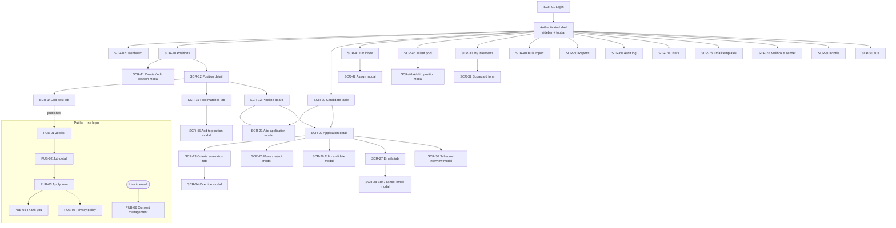
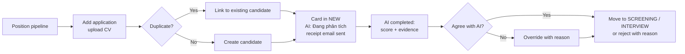
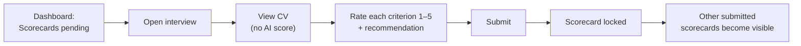
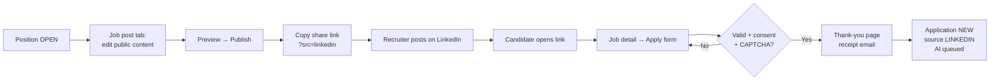
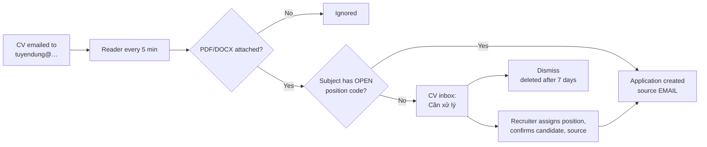
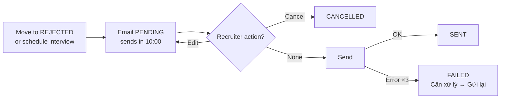
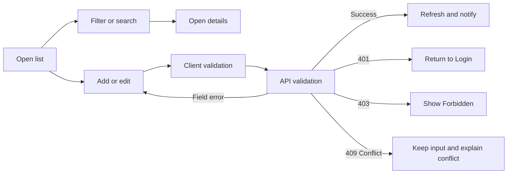

# Information Architecture, Screen Hierarchy, and UI/UX Contract

> Design status: TARGET
>
> UI prototype: Figma (see [UI/UX](05-ui-ux.md))

UI language is Vietnamese; labels in parentheses below are the Vietnamese menu names.

## Information architecture

Recruitment ATS has two frontend applications on one backend:

```text
Career site (Trang tuyển dụng) — separate public app for candidates, no login
├── Job list (filters: title, location, department, employment type, level; department chips; pagination)
├── Job detail (with other open jobs)
├── Apply form (modal on desktop, full page on mobile; CV upload, consent, CAPTCHA)
├── Thank-you page
├── Privacy policy
└── Consent management (opened from the signed link in emails)

Internal app (Recruitment ATS) — hiring team
├── Login (Đăng nhập)
└── Authenticated (sidebar + topbar)
    ├── Dashboard (Tổng quan)
    │   └── Interviewer variant: my interviews + pending scorecards
    ├── Positions (Vị trí tuyển dụng)
    │   ├── List (search, status / department / owner / job post filters, paging)
    │   ├── Create / edit modal (details + criteria builder)
    │   └── Detail
    │       ├── Overview
    │       ├── Criteria (AI-suggested drafts available in the create / edit modal)
    │       ├── Job post (public content, publish / unpublish, share links)
    │       ├── Pipeline (Kanban board)
    │       └── Pool matches (Gợi ý từ kho ứng viên — AI semantic matches)
    ├── Candidates (Ứng viên)
    │   ├── Table across positions (filters, sort by fit score, export Excel)
    │   ├── Add application modal (CV upload)
    │   └── Application detail
    │       ├── Profile & CV preview
    │       ├── Criteria evaluation (fit score, per-criterion evidence, override modal)
    │       ├── Interviews & scorecards
    │       ├── Emails (sent, pending with countdown, failed)
    │       └── Stage history
    ├── CV inbox (Hộp thư CV)
    │   ├── Items from the recruitment mailbox (needs review / converted / dismissed)
    │   └── Assign to position modal
    ├── Talent pool (Kho ứng viên)
    │   ├── Search (skills, source, last position, date) + export Excel
    │   └── Add to position modal
    ├── Interviews (Lịch phỏng vấn)
    │   ├── My interviews (list / week)
    │   └── Scorecard form (with the attached interview questions)
    ├── Bulk import (Nhập hàng loạt)
    │   ├── Wizard: upload → preview → result
    │   └── Import history
    ├── Reports (Báo cáo)
    ├── Audit log (Nhật ký hoạt động)
    ├── Users (Người dùng)
    ├── Settings (Cài đặt)
    │   ├── Email templates (Mẫu email)
    │   └── Mailbox & sender (Hộp thư & người gửi) — Admin only
    ├── Profile (Hồ sơ cá nhân)
    │   ├── Account
    │   ├── Security
    │   └── Roles & permissions
    └── 403 Forbidden
```

### Routes

Internal app (hash routes): `#/login` `#/dashboard` `#/jobs` `#/jobs/new` `#/jobs/:id` `#/jobs/:id/edit` `#/jobs/:id/post` `#/jobs/:id/pipeline` `#/applications` `#/applications/:id` `#/inbox` `#/talent-pool` `#/interviews` `#/interviews/:id/scorecard` `#/import` `#/reports` `#/audit` `#/users` `#/settings/email-templates` `#/settings/mailbox` `#/profile` `#/403`

Career site (separate app with its own domain, e.g. `careers.recruitment-ats.vn`, path routes for shareable links): `/jobs` `/jobs/:slug` `/jobs/:slug/apply` `/jobs/:slug/thank-you` `/privacy` `/consent/:token`. Share links add `?src=linkedin|facebook|topcv|vietnamworks|referral` (BR-18), e.g. `https://careers.recruitment-ats.vn/jobs/backend-dotnet?src=linkedin`.

Internal forms (create/edit position, add application, edit candidate, move stage, reject, schedule interview, override a criterion result, assign inbox item, add pool candidate to position, edit pending email, user form) open as **modals** on their parent page, following the reference project's modal pattern: breadcrumb, title, short description, grouped field sections, and a sticky footer with actions.

## Navigation by role

| Menu | Admin | HR Manager | Recruiter | Interviewer |
|---|---|---|---|---|
| Tổng quan | ✓ | ✓ | ✓ | ✓ (variant) |
| Vị trí tuyển dụng | ✓ | ✓ | ✓ | ✓ (assigned) |
| Ứng viên | ✓ | ✓ | ✓ | ✓ (assigned, no AI) |
| Hộp thư CV | ✓ | ✓ | ✓ | |
| Kho ứng viên | ✓ | ✓ | ✓ | |
| Lịch phỏng vấn | ✓ | ✓ | ✓ | ✓ |
| Nhập hàng loạt | ✓ | ✓ | ✓ | |
| Báo cáo | ✓ | ✓ | | |
| Nhật ký hoạt động | ✓ | ✓ | | |
| Người dùng | ✓ | | | |
| Cài đặt | ✓ (all tabs) | ✓ (email templates) | | |
| Hồ sơ cá nhân (from the user block at the bottom of the sidebar) | ✓ | ✓ | ✓ | ✓ |

Unauthorized items are **not rendered** in the sidebar; direct URL access shows `#/403`. The career site has its own header (company logo, "Việc làm", "Chính sách dữ liệu") and never links into the internal app.

## Screen inventory

| Screen ID | Screen | Presentation | Related stories |
|---|---|---|---|
| `SCR-01` | Login | Page (two-column) | US01, US02 |
| `SCR-02` | Dashboard | Page | US03 |
| `SCR-10` | Position list | Page | US04, US07 |
| `SCR-11` | Position create / edit, with AI-suggested criteria | Modal on `SCR-10` | US05, US06, US32 |
| `SCR-12` | Position detail | Tabbed page | US04, US07 |
| `SCR-13` | Pipeline board (Kanban) | Tab of `SCR-12` | US08, US11 |
| `SCR-14` | Job post editor + share links | Tab of `SCR-12` | US22 |
| `SCR-15` | Pool matches (AI semantic matches) | Tab of `SCR-12` | US33 |
| `SCR-20` | Candidate table + export | Page | US08, US30 |
| `SCR-21` | Add application | Modal | US09 |
| `SCR-22` | Application detail | Tabbed page | US08, US10, US11 |
| `SCR-23` | Criteria evaluation (AI) | Tab of `SCR-22` | US12 |
| `SCR-24` | Override criterion result | Modal on `SCR-23` | US13 |
| `SCR-25` | Move stage / reject | Modal | US11 |
| `SCR-26` | Edit candidate | Modal | US10 |
| `SCR-27` | Candidate emails | Tab of `SCR-22` | US27 |
| `SCR-28` | Edit / cancel pending email | Modal on `SCR-27` | US27 |
| `SCR-30` | Schedule / reschedule interview, with AI-suggested questions | Modal | US14, US34 |
| `SCR-31` | My interviews | Page | US03, US15 |
| `SCR-32` | Scorecard form with attached questions | Page | US15, US34 |
| `SCR-40` | Bulk import wizard + history | Page | US16 |
| `SCR-41` | CV inbox | Page | US25 |
| `SCR-42` | Assign inbox item to position | Modal on `SCR-41` | US25 |
| `SCR-45` | Talent pool + export | Page | US26, US30 |
| `SCR-46` | Add pool candidate to position | Modal on `SCR-45` | US26 |
| `SCR-50` | Reports and export | Page | US17, US18 |
| `SCR-60` | Audit log | Page | US19 |
| `SCR-70` | User management + user form | Page with modal | US20 |
| `SCR-75` | Settings — email templates | Page | US28 |
| `SCR-76` | Settings — mailbox & sender | Page | US29 |
| `SCR-80` | Personal profile | Tabbed page | US21 |
| `SCR-90` | Forbidden | Page | Cross-cutting |
| `PUB-01` | Career site — job list | Public page | US23 |
| `PUB-02` | Career site — job detail | Public page | US23 |
| `PUB-03` | Career site — apply form | Public page | US24 |
| `PUB-04` | Career site — thank-you | Public page | US24 |
| `PUB-05` | Privacy policy | Public page | US24, US31 |
| `PUB-06` | Consent management | Public page (signed link) | US31 |

## Requirement-to-screen mapping

| Requirement | Primary screen / action |
|---|---|
| US01 | `SCR-01` submit login |
| US02 | Topbar user menu → logout → `SCR-01` |
| US03 | `SCR-02` change date range |
| US04 | `SCR-10` search / filter → `SCR-12` |
| US05 | `SCR-11` save new position with criteria |
| US06 | `SCR-11` save changes (owner or HR Manager) |
| US07 | `SCR-10` / `SCR-12` close or reopen with confirmation |
| US08 | `SCR-13` Kanban or `SCR-20` table → `SCR-22` |
| US09 | `SCR-21` upload CV and confirm candidate info |
| US10 | `SCR-26` edit candidate or replace CV |
| US11 | `SCR-13` drag card or `SCR-25` move / reject with reason |
| US12 | `SCR-23` view analysis, "Analyze again" |
| US13 | `SCR-24` change criterion result with reason |
| US14 | `SCR-30` from `SCR-22` |
| US15 | `SCR-31` → `SCR-32` submit scorecard |
| US16 | `SCR-40` upload → preview → confirm |
| US17 | `SCR-50` filter |
| US18 | `SCR-50` export PDF / XLSX |
| US19 | `SCR-60` filter |
| US20 | `SCR-70` list / create / edit / activate / deactivate |
| US21 | `SCR-80` update profile or change password |
| US22 | `SCR-14` edit → preview → publish / unpublish → copy share link |
| US23 | `PUB-01` search / filter → `PUB-02` |
| US24 | `PUB-02` "Ứng tuyển" → `PUB-03` submit → `PUB-04` |
| US25 | `SCR-41` open item → `SCR-42` assign → application |
| US26 | `SCR-45` search → `SCR-46` add to position |
| US27 | `SCR-27` view history → `SCR-28` edit or cancel a pending email |
| US28 | `SCR-75` choose event → edit → preview → test send → save |
| US29 | `SCR-76` enter settings → test connection → save |
| US30 | `SCR-20` / `SCR-45` "Xuất Excel" |
| US31 | Email link → `PUB-06` choose action → confirm |
| US32 | `SCR-11` "Gợi ý tiêu chí bằng AI" → review drafts → accept / edit → save |
| US33 | `SCR-12` → `SCR-15` ranked matches → "Thêm vào vị trí" (`SCR-46`) |
| US34 | `SCR-30` "Gợi ý câu hỏi" → edit, keep ≤ 8 → save; panel sees them on `SCR-32` |

## Screen hierarchy



## Primary task flows

### Flow A — Screen a new CV (Recruiter)



### Flow B — Independent interview evaluation (Interviewer)



### Flow C — Publish and apply (Recruiter → Candidate)



### Flow D — Emailed CV (mailbox → application)



### Flow E — Automatic email with cancel window



### Generic form flow



## UI/UX state contract

| State | Required behavior |
|---|---|
| Initial loading | Keep the page shell; show a skeleton for the affected panel, table, or Kanban column. |
| Empty | Explain that no records match; distinguish an empty dataset from filtered-out results; show a permitted primary action (e.g. "Thêm ứng viên"). |
| Validation error | Keep entered values, show the message under the invalid field, and focus the first error. |
| API error | Show a short message with `traceId`; never expose technical details. |
| Unauthorized (401) | Clear authentication and return to Login. |
| Forbidden (403) | Keep authentication and render `#/403` with a link back to Dashboard. |
| Conflict (409) | Explain the rule (e.g. "Ứng viên đã ứng tuyển vị trí này", "Không thể chuyển từ NEW sang INTERVIEW") and show allowed options. |
| Saving / uploading / importing | Disable duplicate submission; show progress for uploads. |
| Success | Toast confirmation; close modal; refresh the affected data. When the action queues an email, the toast says so and offers "Xem email". |
| Destructive confirmation | Name the record (e.g. stop intake for a position, reject candidate, unpublish job post) and state the consequence, including any email that will be sent. |

### Public career site states

| State | Required behavior |
|---|---|
| No published posts | "Hiện chưa có vị trí đang tuyển" with a link to the privacy policy |
| Post expired | Content stays readable; badge "Đã hết hạn nhận hồ sơ"; apply button disabled |
| Post not found / unpublished | "Tin không còn tồn tại" with a link back to the list |
| Apply validation error | Keep all input, including the chosen CV file; message under each field |
| Rate limited (429) | "Bạn đã gửi quá nhiều lần, vui lòng thử lại sau" |
| Submitted | Thank-you page with the position name and "Chúng tôi đã gửi email xác nhận"; the same page for repeat applications (BR-21) |

### AI analysis states

| Status | Badge (UI) | Behavior |
|---|---|---|
| `PENDING` / `PROCESSING` | Card meta "Đang phân tích CV…", score chip "AI —" | Page polls every 5 s |
| `COMPLETED` | Score chip "AI 89"; warning line "Thiếu tiêu chí bắt buộc" with icon when flagged | Criteria table with result and quote; quotes highlighted in the CV preview |
| `FAILED` | "Không phân tích được" (listed under *Cần xử lý* on the dashboard) | Reason + "Phân tích lại"; manual screening remains available |
| `OUTDATED` | "Cần phân tích lại" | Criteria changed after analysis; old result still readable |
| Overridden | "Đã điều chỉnh" | Shows AI value and human value side by side, with reason and actor |

The score is shown as a plain number; AI output gets no special colour. Criterion results use a status dot plus text (Đạt / Một phần / Không đạt), never colour alone. Every AI result carries the provenance line **"Gợi ý bởi AI · phân tích lúc …"**, and the override modal states that the original AI result is kept.

### AI suggestion states (criteria, interview questions, pool matches)

| State | Behavior |
|---|---|
| Idle | Button "Gợi ý tiêu chí bằng AI" / "Gợi ý câu hỏi"; disabled with a hint when the input is too short |
| Loading | Button shows "AI đang gợi ý…"; the form stays editable; pool-match tab shows a skeleton list |
| Draft shown | Suggestions in a side list marked "Gợi ý bởi AI — chưa lưu", each with accept / edit / discard; nothing is saved until the form is saved |
| Error / limit | Short message ("Không gợi ý được, thử lại sau"); everything typed is kept |
| Pool matches empty | "Chưa có ứng viên phù hợp trong kho" with a link to the talent-pool search |

### Email, inbox, and job post states

| Object | Status | Badge (UI) | Behavior |
|---|---|---|---|
| Candidate email | `PENDING` | "Chờ gửi · 08:42" (countdown) | "Sửa" and "Huỷ" available until sent |
| | `SENT` | "Đã gửi" | Read-only; shows rendered content and time |
| | `FAILED` | "Gửi lỗi" | Error reason + "Gửi lại"; listed under *Cần xử lý* |
| | `CANCELLED` | "Đã huỷ" | Shows who cancelled and when |
| CV inbox item | `NEEDS_REVIEW` | "Cần xử lý" | Preview CV, assign, or dismiss |
| | `CONVERTED` | "Đã tạo hồ sơ" | Link to the application |
| | `DUPLICATE` | "Đã có hồ sơ" | Link to the existing application |
| | `DISMISSED` | "Đã bỏ qua" | Deleted after 7 days |
| Job post | `DRAFT` | "Bản nháp" | Preview and publish |
| | `PUBLISHED` | "Đang đăng" | Share links, unpublish |
| | `UNPUBLISHED` | "Đã gỡ" | Republish (position must be `OPEN`) |

## Responsive and accessibility rules

- Internal app: desktop first (≥ 1280 px). Tablet uses a collapsible sidebar; the Kanban board scrolls horizontally.
- Career site: **mobile first** (≥ 360 px), because most candidates open shared links on a phone; the apply form is a single column and the CV upload accepts files from the phone.
- Kanban drag-and-drop always has a keyboard alternative ("Chuyển giai đoạn…" menu).
- Modals trap focus, close with `Escape` when no submission is running, and restore focus to the trigger.
- Every input has a visible label; icon-only buttons have accessible names; status and scores are never shown by colour alone.
- CAPTCHA offers an accessible alternative challenge.
- Text contrast meets WCAG 2.1 AA (4.5:1 for body text).
- Dates use `dd/MM/yyyy` and times `HH:mm` in the user's timezone.

## Screen-to-API mapping (target)

| Screen | API operations |
|---|---|
| Login | `login`, `refreshToken`, `logout` |
| Dashboard | `getDashboard` |
| Positions | `listPositions`, `getPosition`, `createPosition`, `updatePosition`, `updatePositionStatus`, `suggestCriteria`, `listDepartments`, `listUserOptions` |
| Pool matches | `listPoolMatches`, `addCandidateToPosition` |
| Job post | `getJobPost`, `updateJobPost`, `publishJobPost`, `unpublishJobPost`, `getShareLinks` |
| Pipeline / candidates | `getPipeline`, `listApplications`, `getApplication`, `matchCandidate`, `createApplication`, `updateApplication`, `replaceCv`, `getCvFileContent`, `moveApplicationStage`, `getStageHistory`, `exportApplications` |
| AI analysis | `getAnalysis`, `listAnalyses`, `requestAnalysis`, `overrideCriterionResult` |
| Candidate emails | `listApplicationEmails`, `listEmails`, `updatePendingEmail`, `cancelPendingEmail`, `resendEmail` |
| CV inbox | `listInboxItems`, `getInboxItem`, `getInboxAttachmentContent`, `assignInboxItem`, `dismissInboxItem` |
| Talent pool | `searchTalentPool`, `getCandidate`, `addCandidateToPosition`, `exportTalentPool` |
| Interviews | `suggestInterviewQuestions`, `listInterviews`, `getInterview`, `createInterview`, `updateInterview`, `cancelInterview`, `getScorecards`, `getMyScorecard`, `saveScorecardDraft`, `submitScorecard` |
| Import | `downloadImportTemplate`, `previewImport`, `confirmImport`, `listImports`, `getImport` |
| Reports | `getReport`, `exportReport` |
| Audit | `listAuditLogs` |
| Users | `listUsers`, `getUser`, `createUser`, `updateUser`, `updateUserStatus` |
| Settings | `listEmailTemplates`, `updateEmailTemplate`, `previewEmailTemplate`, `sendTestEmail`, `getMailSettings`, `updateMailSettings`, `testMailSettings` |
| Profile | `getProfile`, `updateProfile`, `changePassword` |
| Career site (public API) | `listPublicJobPosts`, `getPublicJobPostFilters`, `getPublicJobPost`, `submitPublicApplication`, `getPrivacyPolicy`, `getConsent`, `updateConsent` |

Operation names are final; paths, schemas, and error codes are in the [OpenAPI contract](08-openapi-contract.md).

**Related:** [Use cases](02-use-cases.md) · [INVEST requirements](03-invest-requirements.md) · [UI/UX](05-ui-ux.md)
