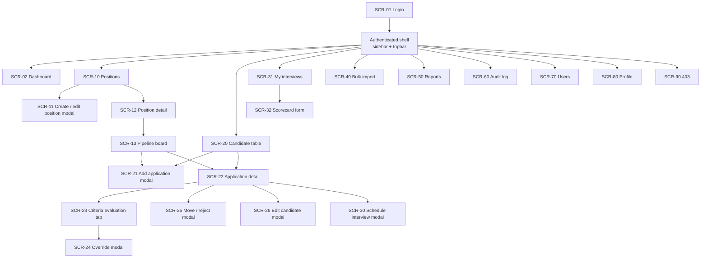
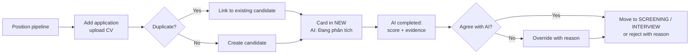
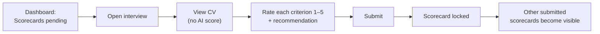
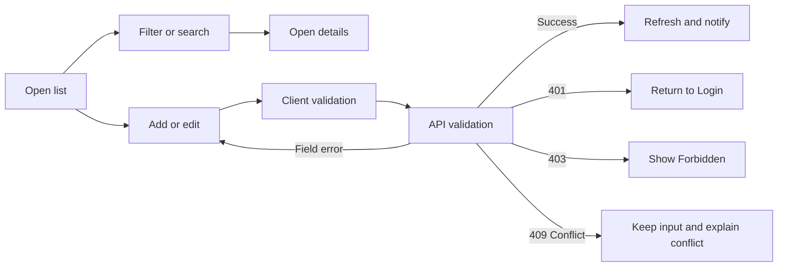

# Information Architecture, Screen Hierarchy, and UI/UX Contract

> Design status: TARGET V1
>
> UI prototype: Figma (see [UI/UX](05-ui-ux.md))

UI language is Vietnamese; labels in parentheses below are the Vietnamese menu names.

## Information architecture

```text
Recruitment ATS
│
├── Public
│   └── Login
│
└── Authenticated (sidebar + topbar)
    ├── Dashboard (Tổng quan)
    │   └── Interviewer variant: my interviews + pending scorecards
    ├── Positions (Vị trí tuyển dụng)
    │   ├── List (search, status / department / owner filters, paging)
    │   ├── Create / edit modal (details + criteria builder)
    │   └── Detail
    │       ├── Overview
    │       ├── Criteria
    │       └── Pipeline (Kanban board)
    ├── Candidates (Ứng viên)
    │   ├── Table across positions (filters, sort by fit score)
    │   ├── Add application modal (CV upload)
    │   └── Application detail
    │       ├── Profile & CV preview
    │       ├── Criteria evaluation (fit score, per-criterion evidence, override modal)
    │       ├── Interviews & scorecards
    │       └── Stage history
    ├── Interviews (Lịch phỏng vấn)
    │   ├── My interviews (list / week)
    │   └── Scorecard form
    ├── Bulk import (Nhập hàng loạt)
    │   ├── Wizard: upload → preview → result
    │   └── Import history
    ├── Reports (Báo cáo)
    ├── Audit log (Nhật ký hoạt động)
    ├── Users (Người dùng)
    ├── Profile (Hồ sơ cá nhân)
    │   ├── Account
    │   ├── Security
    │   └── Roles & permissions
    └── 403 Forbidden
```

### Hash routes

`#/login` `#/dashboard` `#/jobs` `#/jobs/new` `#/jobs/:id` `#/jobs/:id/edit` `#/jobs/:id/pipeline` `#/applications` `#/applications/:id` `#/interviews` `#/interviews/:id/scorecard` `#/import` `#/reports` `#/audit` `#/users` `#/profile` `#/403`

Forms (create/edit position, add application, edit candidate, move stage, reject, schedule interview, override a criterion result, user form) open as **modals** on their parent page, following the reference project's modal pattern: breadcrumb, title, short description, grouped field sections, and a sticky footer with actions.

## Navigation by role

| Menu | Admin | HR Manager | Recruiter | Interviewer |
|---|---|---|---|---|
| Tổng quan | ✓ | ✓ | ✓ | ✓ (variant) |
| Vị trí tuyển dụng | ✓ | ✓ | ✓ | ✓ (assigned) |
| Ứng viên | ✓ | ✓ | ✓ | ✓ (assigned, no AI) |
| Lịch phỏng vấn | ✓ | ✓ | ✓ | ✓ |
| Nhập hàng loạt | ✓ | ✓ | ✓ | |
| Báo cáo | ✓ | ✓ | | |
| Nhật ký hoạt động | ✓ | ✓ | | |
| Người dùng | ✓ | | | |
| Hồ sơ cá nhân | ✓ | ✓ | ✓ | ✓ |

Unauthorized items are **not rendered** in the sidebar; direct URL access shows `#/403`.

## Screen inventory

| Screen ID | Screen | Presentation | Related stories |
|---|---|---|---|
| `SCR-01` | Login | Page (two-column) | US01, US02 |
| `SCR-02` | Dashboard | Page | US03 |
| `SCR-10` | Position list | Page | US04, US07 |
| `SCR-11` | Position create / edit | Modal on `SCR-10` | US05, US06 |
| `SCR-12` | Position detail | Tabbed page | US04, US07 |
| `SCR-13` | Pipeline board (Kanban) | Tab of `SCR-12` | US08, US11 |
| `SCR-20` | Candidate table | Page | US08 |
| `SCR-21` | Add application | Modal | US09 |
| `SCR-22` | Application detail | Tabbed page | US08, US10, US11 |
| `SCR-23` | Criteria evaluation (AI) | Tab of `SCR-22` | US12 |
| `SCR-24` | Override criterion result | Modal on `SCR-23` | US13 |
| `SCR-25` | Move stage / reject | Modal | US11 |
| `SCR-26` | Edit candidate | Modal | US10 |
| `SCR-30` | Schedule interview | Modal | US14 |
| `SCR-31` | My interviews | Page | US03, US15 |
| `SCR-32` | Scorecard form | Page | US15 |
| `SCR-40` | Bulk import wizard + history | Page | US16 |
| `SCR-50` | Reports and export | Page | US17, US18 |
| `SCR-60` | Audit log | Page | US19 |
| `SCR-70` | User management + user form | Page with modal | US20 |
| `SCR-80` | Personal profile | Tabbed page | US21 |
| `SCR-90` | Forbidden | Page | Cross-cutting |

## Requirement-to-screen mapping

| Requirement | Primary screen / action |
|---|---|
| US01 | `SCR-01` submit login |
| US02 | Topbar user menu → logout → `SCR-01` |
| US03 | `SCR-02` change date range |
| US04 | `SCR-10` search / filter → `SCR-12` |
| US05 | `SCR-11` save new position with criteria |
| US06 | `SCR-11` save changes (owner or HR Manager) |
| US07 | `SCR-10` / `SCR-12` close or reopen with confirmation |
| US08 | `SCR-13` Kanban or `SCR-20` table → `SCR-22` |
| US09 | `SCR-21` upload CV and confirm candidate info |
| US10 | `SCR-26` edit candidate or replace CV |
| US11 | `SCR-13` drag card or `SCR-25` move / reject with reason |
| US12 | `SCR-23` view analysis, "Analyze again" |
| US13 | `SCR-24` change criterion result with reason |
| US14 | `SCR-30` from `SCR-22` |
| US15 | `SCR-31` → `SCR-32` submit scorecard |
| US16 | `SCR-40` upload → preview → confirm |
| US17 | `SCR-50` filter |
| US18 | `SCR-50` export PDF / XLSX |
| US19 | `SCR-60` filter |
| US20 | `SCR-70` list / create / edit / activate / deactivate |
| US21 | `SCR-80` update profile or change password |

## Screen hierarchy



## Primary task flows

### Flow A — Screen a new CV (Recruiter)



### Flow B — Independent interview evaluation (Interviewer)



### Generic form flow



## UI/UX state contract

| State | Required behavior |
|---|---|
| Initial loading | Keep the page shell; show a skeleton for the affected panel, table, or Kanban column. |
| Empty | Explain that no records match; distinguish an empty dataset from filtered-out results; show a permitted primary action (e.g. "Thêm ứng viên"). |
| Validation error | Keep entered values, show the message under the invalid field, and focus the first error. |
| API error | Show a short message with `traceId`; never expose technical details. |
| Unauthorized (401) | Clear authentication and return to Login. |
| Forbidden (403) | Keep authentication and render `#/403` with a link back to Dashboard. |
| Conflict (409) | Explain the rule (e.g. "Ứng viên đã ứng tuyển vị trí này", "Không thể chuyển từ NEW sang INTERVIEW") and show allowed options. |
| Saving / uploading / importing | Disable duplicate submission; show progress for uploads. |
| Success | Toast confirmation; close modal; refresh the affected data. |
| Destructive confirmation | Name the record (e.g. stop intake for a position, reject candidate) and state the consequence. |

### AI analysis states

| Status | Badge (UI) | Behavior |
|---|---|---|
| `PENDING` / `PROCESSING` | Card meta "Đang phân tích CV…", score chip "AI —" | Page polls every 5 s |
| `COMPLETED` | Score chip "AI 89"; warning line "Thiếu tiêu chí bắt buộc" with icon when flagged | Criteria table with result and quote; quotes highlighted in the CV preview |
| `FAILED` | "Không phân tích được" (listed under *Cần xử lý* on the dashboard) | Reason + "Phân tích lại"; manual screening remains available |
| `OUTDATED` | "Cần phân tích lại" | Criteria changed after analysis; old result still readable |
| Overridden | "Đã điều chỉnh" | Shows AI value and human value side by side, with reason and actor |

The score is shown as a plain number; AI output gets no special colour. Criterion results use a status dot plus text (Đạt / Một phần / Không đạt), never colour alone. Every AI result carries the provenance line **"Gợi ý bởi AI · phân tích lúc …"**, and the override modal states that the original AI result is kept.

## Responsive and accessibility rules

- Target: desktop first (≥ 1280 px). Tablet uses a collapsible sidebar; the Kanban board scrolls horizontally.
- Kanban drag-and-drop always has a keyboard alternative ("Chuyển giai đoạn…" menu).
- Modals trap focus, close with `Escape` when no submission is running, and restore focus to the trigger.
- Every input has a visible label; icon-only buttons have accessible names; status and scores are never shown by colour alone.
- Text contrast meets WCAG 2.1 AA (4.5:1 for body text).
- Dates use `dd/MM/yyyy` and times `HH:mm` in the user's timezone.

## Screen-to-API mapping (target)

| Screen | API operations |
|---|---|
| Login | `login`, `logout` |
| Dashboard | `getDashboard` |
| Positions | `listJobs`, `getJob`, `createJob`, `updateJob`, `updateJobStatus` |
| Pipeline / candidates | `listApplications`, `getApplication`, `createApplication`, `updateCandidate`, `replaceCv`, `moveApplicationStage`, `getStageHistory` |
| AI analysis | `getAnalysis`, `requestAnalysis`, `overrideAnalysis` |
| Interviews | `listInterviews`, `createInterview`, `getScorecards`, `submitScorecard` |
| Import | `previewImport`, `createImport`, `listImports`, `getImport` |
| Reports | `getReport`, `exportReport` |
| Audit | `listAuditLogs` |
| Users | `listUsers`, `getUser`, `createUser`, `updateUser`, `updateUserStatus` |
| Profile | `getProfile`, `updateProfile`, `changePassword` |

Operation names are provisional; they become final in the OpenAPI contract (README section 4).

**Related:** [Use cases](02-use-cases.md) · [INVEST requirements](03-invest-requirements.md) · [UI/UX](05-ui-ux.md)
