# UI/UX Design

> Design status: TARGET V1 — high-fidelity prototype
>
> Figma file: [Recruitment ATS — UI](https://www.figma.com/design/0TYozUq5jB0KJcdo8vjVjQ/Untitled?node-id=0-1)

The visual language follows the course reference project (HandmadeFinance): light sidebar, breadcrumb topbar with a one-line page description, white cards on a light-grey canvas, uppercase table headers, monospace record codes, and forms in modals. The UI is a working tool, not a marketing page: no decorative gradients in the app shell, no colour reserved for AI, no explanatory copy about how the system works inside the screens.

## Figma structure

| Page | Content |
|---|---|
| `00 Foundations` | Colour variables, text styles, icons, and reusable components |
| `01 Screens` | 11 desktop screens (1440 × 900), arranged in three rows by flow |
| `02 Mind map` | Product mind map (exported to `docs/mindmap.png`) |

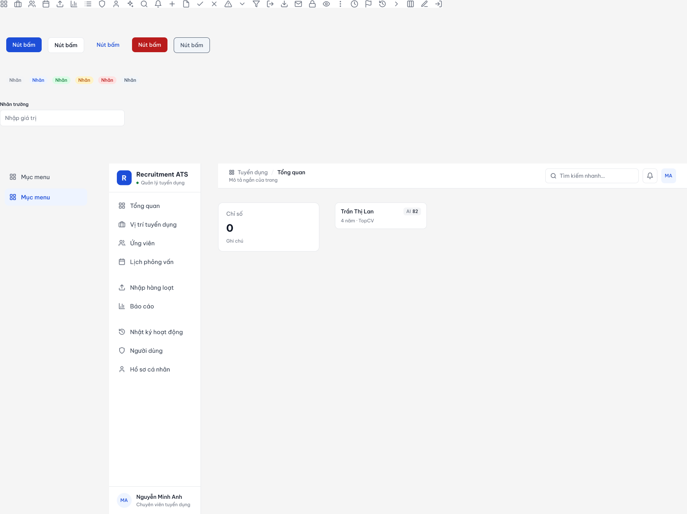

## Design foundations

### Typography

| Style | Font | Weight | Size / line height | Usage |
|---|---|---|---|---|
| `Display/H1` | Be Vietnam Pro | SemiBold | 24 / 32 | Modal titles |
| `Display/H2` | Be Vietnam Pro | SemiBold | 18 / 26 | Brand name |
| `Display/H3` | Be Vietnam Pro | SemiBold | 16 / 24 | Card titles |
| `Body/Regular` · `Body/Medium` | Be Vietnam Pro | Regular · Medium | 14 / 20 | Body text, table cells, buttons |
| `Caption/Regular` · `Caption/Medium` | Be Vietnam Pro | Regular · Medium | 12 / 16 | Meta information, labels |
| `Table/Header` | Be Vietnam Pro | Medium, uppercase, +4% tracking | 12 / 16 | Table column headers |
| `KPI/Value` | Be Vietnam Pro | Bold | 26–30 | Stat cards, fit score |
| `Mono/Code` | JetBrains Mono | Medium | 12 / 16 | Record codes (`JOB-014`, `APP-0142`), interview times |

Be Vietnam Pro is designed for Vietnamese diacritics.

### Colour tokens (Figma variables, collection `ATS Tokens`)

| Token | Value | Usage |
|---|---|---|
| `color/primary` / `-soft` | `#1D4ED8` / `#EEF4FF` | Primary actions, active navigation, links, chart bars, selected options |
| `color/text` / `color/text-muted` | `#111827` / `#6B7280` | Text hierarchy |
| `color/bg` / `color/surface` / `color/border` | `#F4F5F7` / `#FFFFFF` / `#E5E7EB` | Canvas, cards, dividers |
| `color/success` / `-soft` | `#15803D` / `#DCFCE7` | Status: active, valid, criterion met |
| `color/warning` / `-soft` | `#B45309` / `#FEF3C7` | Status: target hire date near, partial, missing must-have, CV evidence highlight |
| `color/danger` / `-soft` | `#B91C1C` / `#FEE2E2` | Status: errors, criterion not met, overdue |

Status colours appear only as a small pill or a dot next to text — never as the only signal and never to separate chart series.

### Components

| Component | Variants / properties |
|---|---|
| `Sidebar` | `User name`, `User role`, `Initials`; three nav groups; items hidden per role |
| `NavItem` | `State` = Default, Active · `Label` · `Icon` (instance swap) |
| `Topbar` | `Section`, `Page`, `Subtitle`, `Initials` |
| `Button` | `Type` = Primary, Secondary, Ghost, Danger · `Label` · `Has icon` · `Icon` |
| `Badge` | `Tone` · `Label` |
| `Input` | `Label`, `Value` |
| `Stat Card` | `Label`, `Value`, `Note` |
| `Candidate Card` | `Name`, `Meta`, `Score`, `Missing must-have` (boolean) |
| `icon/*` | 32 line icons (24-grid, 2 px stroke) |

## Screens

| Screen | Figma frame | Role shown | Key UX decisions |
|---|---|---|---|
| `SCR-01` Login | SCR-01 Đăng nhập | — | Two panels as in the reference; demo-account chips per role; generic error for wrong password and disabled account |
| `SCR-02` Dashboard | SCR-02 Tổng quan | HR Manager | Pipeline per position as a table, today's interviews, newest applications, and a *Cần xử lý* list of actionable items |
| `SCR-10` Positions | SCR-10 Vị trí tuyển dụng | Recruiter | Codes in monospace; hires vs. headcount; target hire date; status pill only where it matters |
| `SCR-11` Create position | SCR-11 Tạo vị trí tuyển dụng (modal) | Recruiter | Modal with grouped sections; target hire date instead of an application deadline; criteria as editable rows (name, type, weight); internal JD collapsed |
| `SCR-13` Pipeline | SCR-13 Pipeline ứng viên | Recruiter | Kanban columns with counts; card shows AI score chip and a warning line only when a must-have is missing |
| `SCR-23` Criteria evaluation | SCR-23 Chi tiết hồ sơ — Đánh giá tiêu chí | Recruiter | Stage stepper; criteria table (weight, result, CV quote); CV preview with the quoted passages highlighted |
| `SCR-24` Override | SCR-24 Điều chỉnh kết quả tiêu chí (modal) | Recruiter | AI result vs. adjusted result; mandatory reason with counter; score preview 89 → 92 |
| `SCR-32` Scorecard | SCR-32 Phiếu đánh giá phỏng vấn | Interviewer | 1–5 segmented rating per criterion; unscored row marked; submit disabled until complete; panel status without others' content |
| `SCR-40` Bulk import | SCR-40 Nhập hàng loạt | Recruiter | Stepper; file summary; counts; error rows explained in the last column; import disabled while errors exist |
| `SCR-50` Reports | SCR-50 Báo cáo | HR Manager | Filter panel as in the reference; single-hue bar charts with value labels; export |
| `SCR-70` Users | SCR-70 Người dùng | Admin | Role as plain text, status pill, inline edit and actions |

Remaining screens from the [screen inventory](04-information-architecture.md#screen-inventory) (position detail overview, candidate table, add-application modal, move/reject modal, edit candidate, schedule interview, my interviews, audit log, profile, 403) reuse the same shell and components.

### Login

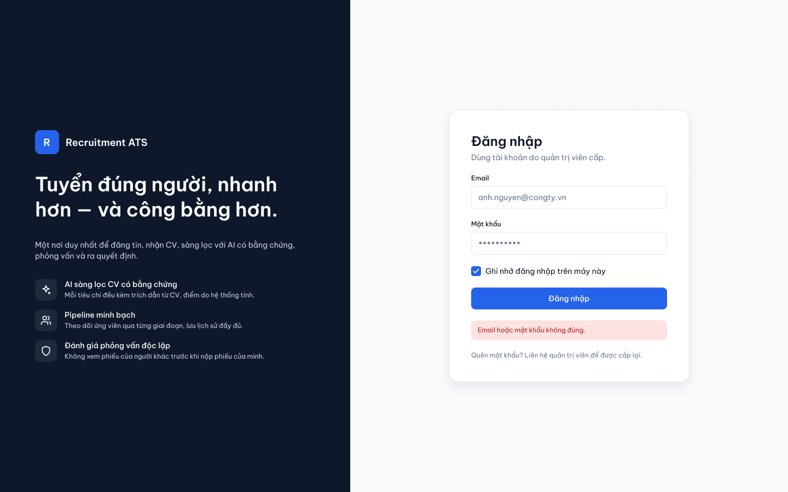

### Dashboard (HR Manager)

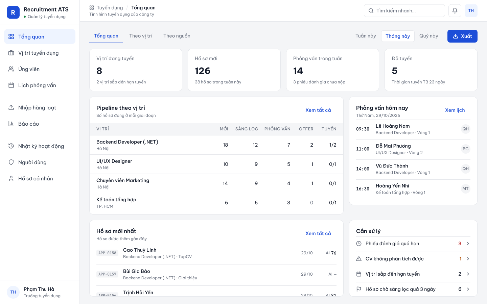

### Positions

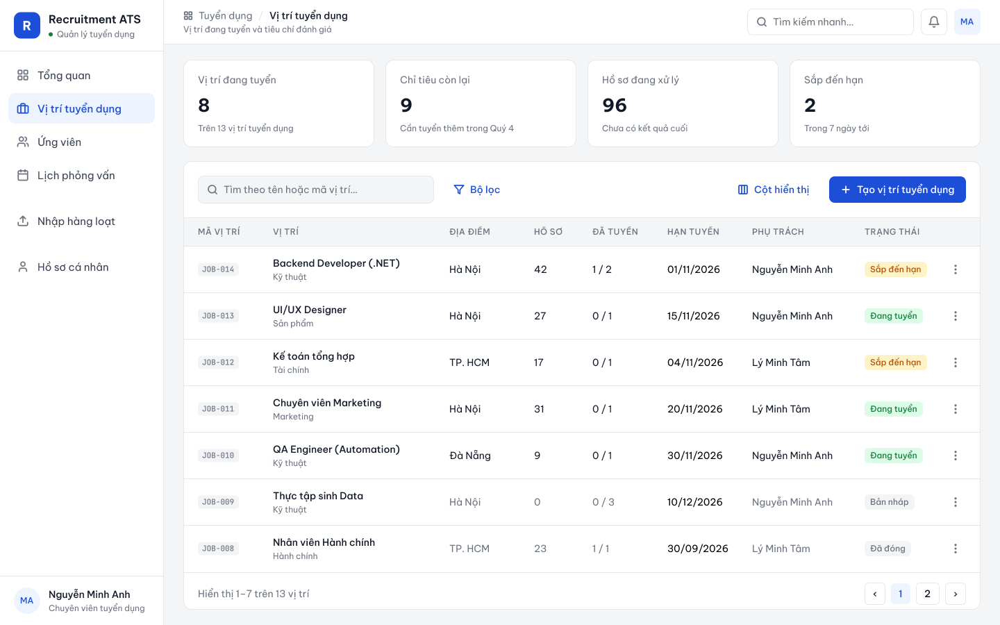

### Create position

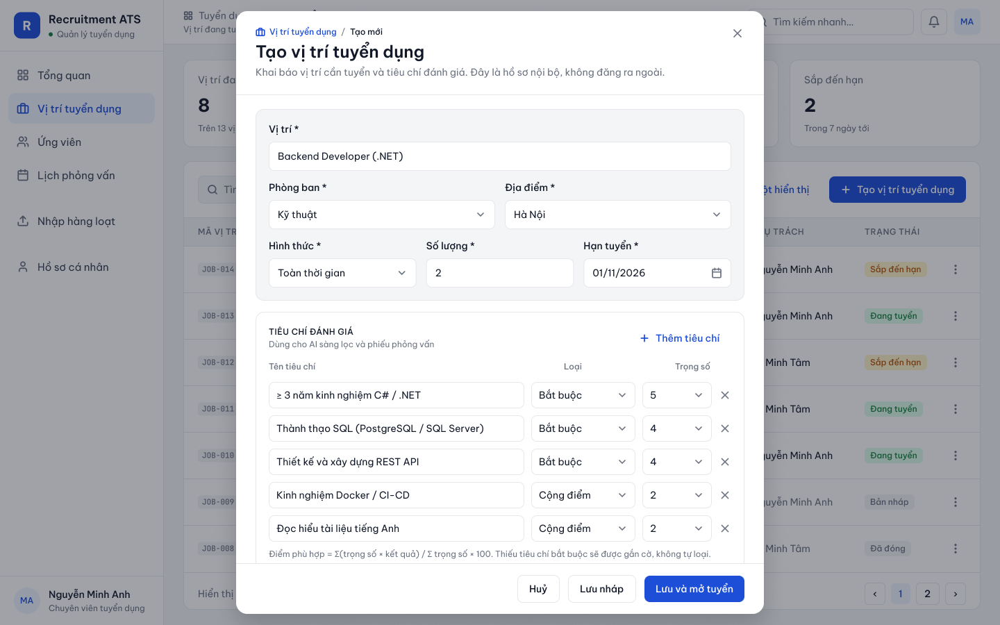

### Pipeline (Kanban)

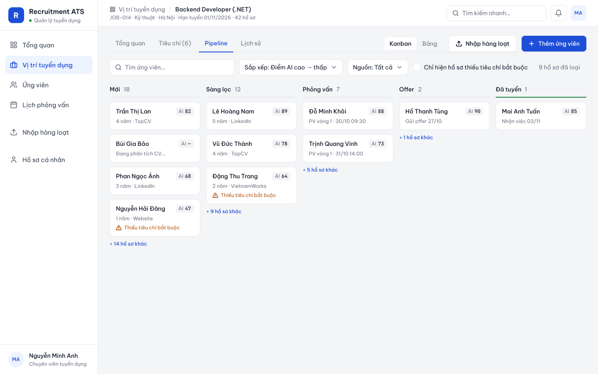

### Application detail — criteria evaluation

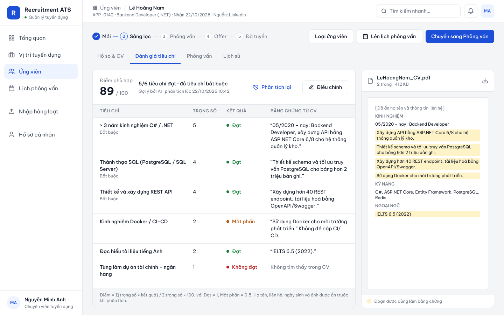

### Override a criterion result

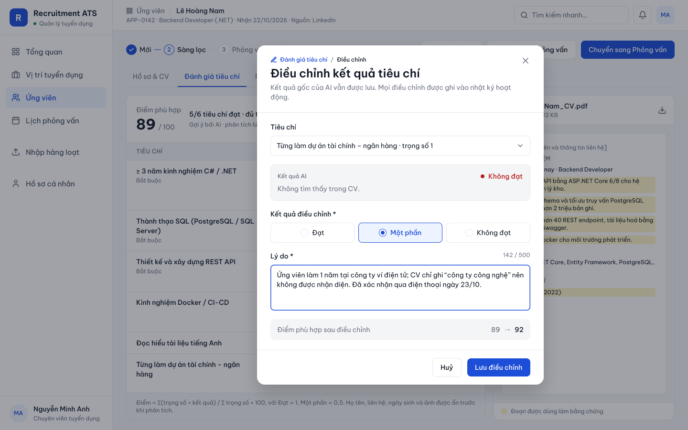

### Interview scorecard (Interviewer)

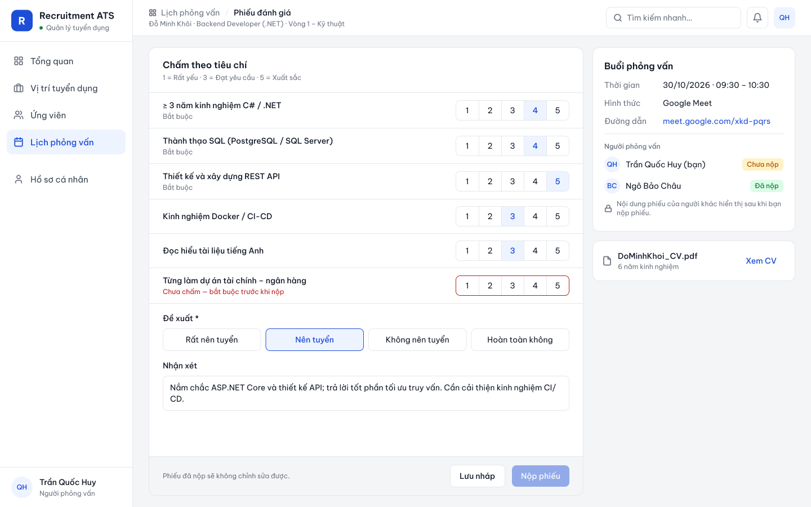

### Bulk import

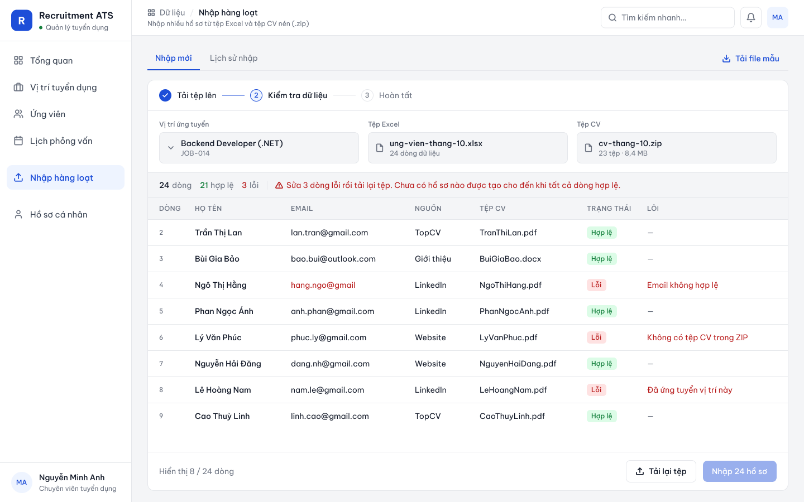

### Reports

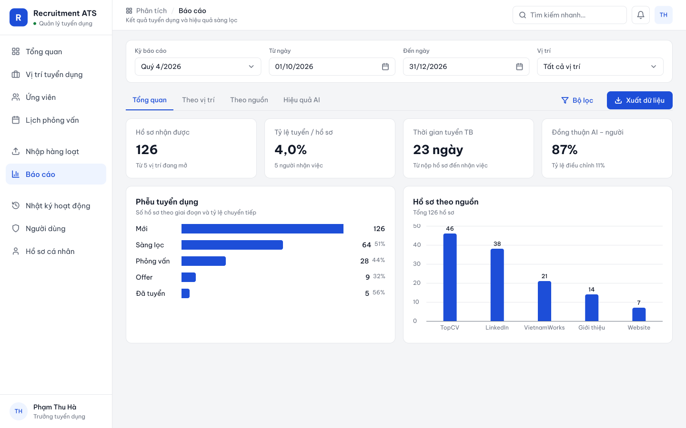

### User management (Admin)

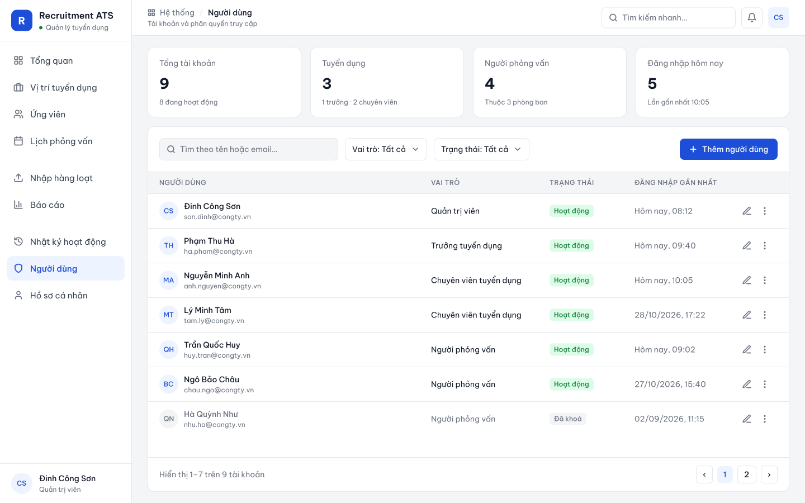

## UX principles applied

1. **Evidence over decoration.** An AI score is a number next to the quotes that justify it; the quoted passages are highlighted in the CV so a recruiter can check them in seconds.
2. **Human decisions stay explicit.** Stage changes are buttons the user presses; adjusting an AI result requires a reason and keeps the original.
3. **Independent evaluation.** Interviewers see who has submitted, not what they wrote, until their own scorecard is in; the AI score is not shown to interviewers.
4. **Role-shaped navigation.** The sidebar shows only permitted items (Recruiter 6, Interviewer 5, HR Manager and Admin 9).
5. **Recoverable errors.** Validation keeps input and states the rule where it applies (import errors per row, unscored criterion, wrong credentials).
6. **Accessible by default.** Visible labels, WCAG AA contrast, status never by colour alone, keyboard alternative for drag-and-drop.

**Related:** [Information architecture](04-information-architecture.md) · [Use cases](02-use-cases.md)
