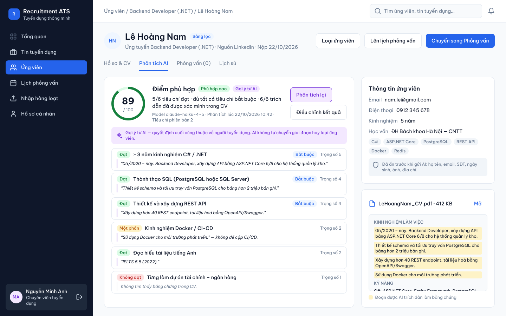
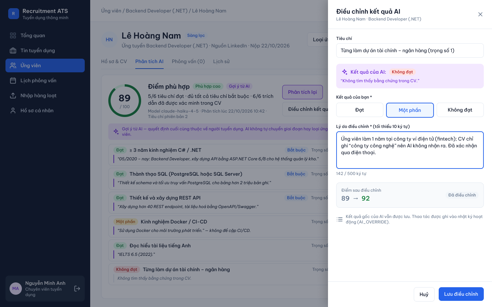

# UI/UX Design

> Design status: TARGET V1 — high-fidelity prototype
>
> Figma file: [Recruitment ATS — UI](https://www.figma.com/design/0TYozUq5jB0KJcdo8vjVjQ/Untitled?node-id=0-1)

## Figma structure

| Page | Content |
|---|---|
| `00 Foundations` | Colour variables, text styles, icons, and reusable components |
| `01 Screens` | 11 desktop screens (1440 × 900), arranged in three rows by flow |

## Design foundations

### Typography

Font: **Be Vietnam Pro** (designed for Vietnamese diacritics).

| Style | Weight | Size / line height | Usage |
|---|---|---|---|
| `Display/H1` | SemiBold | 24 / 32 | Page titles |
| `Display/H2` | SemiBold | 18 / 26 | Section titles, drawer titles |
| `Display/H3` | SemiBold | 16 / 24 | Panel titles |
| `Body/Regular` | Regular | 14 / 20 | Body text, table cells |
| `Body/Medium` | Medium | 14 / 20 | Buttons, names, emphasis |
| `Caption/Regular` | Regular | 12 / 16 | Meta information, hints |
| `Caption/Medium` | Medium | 12 / 16 | Labels, badges, table headers |
| `KPI/Value` | Bold | 28 / 36 | KPI numbers, fit score |

### Colour tokens (Figma variables, collection `ATS Tokens`)

| Token | Value | Usage |
|---|---|---|
| `color/primary` | `#2563EB` | Primary actions, active navigation, chart bars |
| `color/text` / `color/text-muted` | `#0F172A` / `#64748B` | Text hierarchy |
| `color/bg` / `color/surface` / `color/border` | `#F8FAFC` / `#FFFFFF` / `#E2E8F0` | Page, cards, dividers |
| `color/sidebar` | `#0F172A` | Navigation sidebar |
| `color/success` (+ `-soft`) | `#15803D` | Status: valid, active, score ≥ 75 |
| `color/warning` (+ `-soft`) | `#B45309` | Status: score 50–74, missing must-have, deadline near |
| `color/danger` (+ `-soft`) | `#B91C1C` | Status: errors, rejected, not met |
| `color/ai` (+ `-soft`) | `#6D28D9` | Everything produced by AI is purple, so users always know what is an AI suggestion |

Status colours are reserved for states and are always paired with a text label; they are never used to separate chart series.

### Components

| Component | Variants / properties |
|---|---|
| `Button` | `Type` = Primary, Secondary, Ghost, Danger, AI · `Label` |
| `Badge` | `Tone` = Neutral, Info, Success, Warning, Danger, AI · `Label` |
| `Input` | `Label`, `Value` (label is always visible) |
| `NavItem` | `State` = Default, Active · `Label` · `Icon` (instance swap) |
| `Sidebar` | `User name`, `User role`; nav items hidden per role |
| `Topbar` | `Breadcrumb` |
| `KPI Card` | `Label`, `Value`, `Delta` |
| `Candidate Card` | `Name`, `Meta`, `Initials`, `Missing must-have` (boolean); nested score badge |
| `icon/*` | 20 line icons (24-grid, 2 px stroke) |

## Screens

| Screen | Figma frame | Role shown | Key UX decisions |
|---|---|---|---|
| `SCR-01` Login | SCR-01 Đăng nhập | — | Generic error for wrong password and disabled account (no account enumeration) |
| `SCR-02` Dashboard | SCR-02 Tổng quan | HR Manager | KPIs, funnel, upcoming interviews, AI screening status, postings near deadline |
| `SCR-10` Job postings | SCR-10 Danh sách tin tuyển dụng | Recruiter | Pipeline counts per posting in one column; status badge with text |
| `SCR-11` Create posting | SCR-11 Tạo tin tuyển dụng | Recruiter | Criteria builder with must-have / nice-to-have and weight 1–5; scoring formula explained in place |
| `SCR-13` Pipeline | SCR-13 Pipeline (Kanban) | Recruiter | AI score on every card, "Đang phân tích" state, "Thiếu tiêu chí bắt buộc" flag; Kanban/table toggle |
| `SCR-23` AI analysis | SCR-23 Chi tiết hồ sơ — Phân tích AI | Recruiter | Score ring, per-criterion result + quote, highlighted quotes in CV preview, redaction note, AI disclaimer |
| `SCR-24` Override AI | SCR-24 Điều chỉnh kết quả AI | Recruiter | Drawer keeps context; AI result vs. human result; mandatory reason; live score preview; audit note |
| `SCR-32` Scorecard | SCR-32 Phiếu đánh giá phỏng vấn | Interviewer | Other scorecards locked until submit; AI score hidden; validation blocks incomplete submission |
| `SCR-40` Bulk import | SCR-40 Nhập hàng loạt | Recruiter | 3-step wizard; all-or-nothing message; error rows highlighted with reason; import button disabled |
| `SCR-50` Reports | SCR-50 Báo cáo tuyển dụng | HR Manager | Single-hue charts, direct value labels, "Xem dạng bảng" alternative, export PDF/XLSX |
| `SCR-70` Users | SCR-70 Quản lý người dùng | Admin | Role and status badges; activate / deactivate inline |

Remaining screens from the [screen inventory](04-information-architecture.md#screen-inventory) (job detail overview, candidate table, add-application modal, move/reject modal, edit candidate, schedule interview, my interviews, audit log, profile, 403) reuse the same shell and components and are specified in the IA document.

### Login

### Dashboard (HR Manager)

### Job postings

### Create job posting with evaluation criteria

### Pipeline (Kanban)

### Application detail — AI analysis

### Override AI result

### Interview scorecard (Interviewer, blind)

### Bulk import — preview

### Reports

### User management (Admin)

## UX principles applied

1. **AI is visibly advisory.** Purple marks every AI output; a disclaimer appears wherever a score is shown; no button lets AI change a stage.
2. **Evidence before trust.** Each criterion shows the CV quote; quotes are highlighted in the CV preview so the recruiter can check them in seconds.
3. **Human override is cheap but accountable.** Override is one drawer away, requires a reason, previews the new score, and is audited.
4. **Fairness by design.** Personal data is redacted before AI analysis; interviewers do not see AI scores or other scorecards before submitting.
5. **Role-shaped navigation.** The sidebar shows only permitted items (Recruiter: 6 items, Interviewer: 5, HR Manager and Admin: 9).
6. **Recoverable errors.** Validation keeps user input and explains the rule (import errors per row, incomplete scorecard, wrong credentials).
7. **Accessible by default.** Visible labels, WCAG AA contrast, status never by colour alone, keyboard alternative for drag-and-drop.

**Related:** [Information architecture](04-information-architecture.md) · [Use cases](02-use-cases.md)
