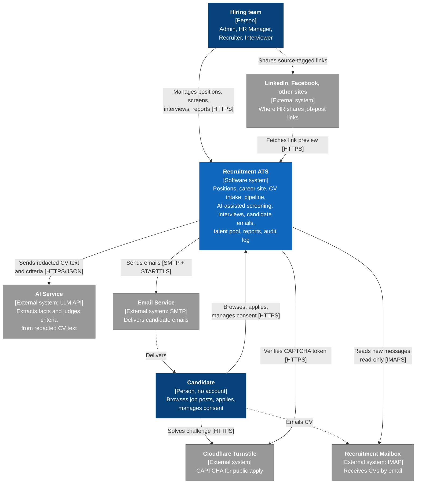
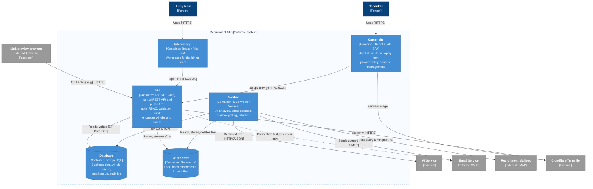
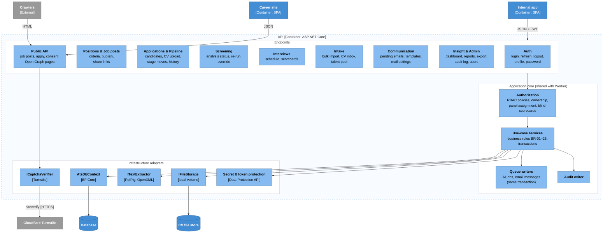
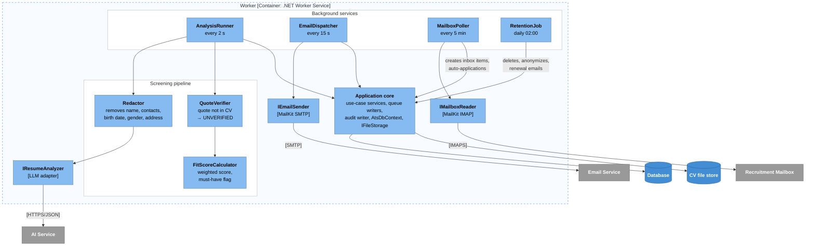
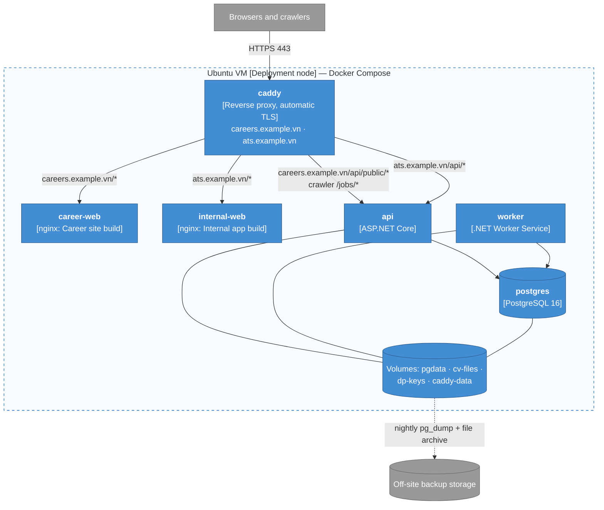

# C4 Architecture

> Design status: TARGET
>
> Notation: [C4 model](https://c4model.com) — Level 1 System Context, Level 2 Container, Level 3 Component, plus a Deployment view. Level 4 (Code) is covered by the class and sequence design (README section 6).

Diagrams are Mermaid flowcharts styled with the C4 colour scheme so they render on GitHub: dark blue = person, blue = the ATS, light blue = container, pale blue = component, grey = external system. Every arrow is labelled with its purpose and, in brackets, the protocol.

## Architecture drivers

| Driver | Source | Consequence for the architecture |
|---|---|---|
| Stack | [Constraints](01-research-top-down.md#8-constraints-and-assumptions) | React (Vite) SPAs, ASP.NET Core, PostgreSQL |
| Career site is a separate app on its own domain | Constraints | Two SPAs; the public API is a separate, restricted route group |
| AI analysis within 60 s, never blocking the user | G2, US12 | AI runs in a background **Worker**, not in the request |
| Personal data never leaves unredacted | BR-10, Law 91/2025 | Redaction is a component inside the Worker, in front of the AI adapter |
| AI result must be explainable and verifiable | BR-11, BR-12 | Quote verification and scoring are backend code, not AI output |
| Outcome emails wait 10 min and can be edited or cancelled | BR-23, US27 | Emails are rows in a database queue, written in the same transaction as the triggering action |
| Mailbox read every 5 min; retention deletes data on schedule | BR-22, BR-17, BR-24 | Periodic jobs in the Worker |
| Public apply abuse | BR-21 | CAPTCHA (Cloudflare Turnstile), rate limits, server-side file checks |
| Shared links must show a preview on LinkedIn / Facebook | US22, G9 | Crawlers get server-rendered Open Graph HTML |
| External services replaceable and testable | Constraints | Adapters behind interfaces: `IResumeAnalyzer`, `IEmailSender`, `IMailboxReader`, `IFileStorage`, `ICaptchaVerifier` |
| Small company, single tenant, free channels | Constraints | One VM, Docker Compose, no message broker, no cloud object storage in V1 |

## Level 1 — System Context

| Element | Responsibility | Data crossing the boundary |
|---|---|---|
| Hiring team | Four internal roles (see README 1.5) | Everything they are permitted to see |
| Candidate | Public user without an account | Published job posts only; their own consent record via a signed link |
| AI Service | Returns structured JSON: skills, experience, education, languages, per-criterion result with quote | **Redacted** CV text and public criteria text; no names, contacts, photo, birth date, gender, address (BR-10) |
| Email Service | Outgoing SMTP of the company's domain (SPF/DKIM) | Rendered emails to candidates and users |
| Recruitment Mailbox | Company mailbox that candidates and job boards send CVs to | Messages with PDF/DOCX attachments, read-only |
| Cloudflare Turnstile | Bot check on the apply form | Turnstile token and client IP |
| LinkedIn, Facebook | Show previews of shared links | Public job-post title, description, and image only |

## Level 2 — Containers

All browser and crawler traffic passes through the reverse proxy shown in the [Deployment view](#deployment).

| Container | Technology | Responsibility | Talks to |
|---|---|---|---|
| Career site | React + Vite, static files on `careers.<domain>` | Public, mobile-first pages; renders the Turnstile widget; reads `src` from the share link and sends it with the application | API public routes only (same origin through the proxy) |
| Internal app | React + Vite, static files on `ats.<domain>` | All authenticated screens; polls AI status while an analysis is pending | API internal routes (same origin through the proxy) |
| API | ASP.NET Core 8+, EF Core, Npgsql | Authentication, RBAC and record rules, validation, business transactions, audit, Excel/PDF export, enqueuing AI jobs and emails, Open Graph pages for crawlers | Database, file store, Turnstile; SMTP/IMAP only for the Admin connection test |
| Worker | .NET Worker Service (`BackgroundService`), same core libraries as the API | Everything slow, scheduled, or external: AI analysis, email dispatch with retries, mailbox intake, retention and consent expiry | Database, file store, AI Service, SMTP, IMAP |
| Database | PostgreSQL 16 | Single source of truth, including the two queues and the audit log | — |
| CV file store | Docker volume behind `IFileStorage` | Binary files; keys stored in the database, never public URLs | — |

### Key interactions

**AI analysis (US12, BR-10–12).** The API validates the file (BR-15), extracts text, stores the file and text, and inserts a `cv_analyses` row with status `PENDING` in the same transaction as the application. The Worker polls every 2 s, claims the job with `SELECT … FOR UPDATE SKIP LOCKED`, sets `PROCESSING` with a lease, redacts, calls the AI Service (45 s timeout), verifies each quote against the CV text, computes the score, and saves `COMPLETED`. A transient error (timeout, 429, 5xx) is retried once; then the status is `FAILED` with a reason and the user can analyze again. A job whose lease expires (Worker crashed) is claimed again. The internal app polls the analysis every 5 s while it is `PENDING` or `PROCESSING`.

**Candidate emails (US27, BR-23).** The action that triggers an email (receipt, stage change, interview saved) inserts a rendered `email_messages` row with `scheduled_at` (now, or now + 10 min) in the **same transaction**, so an email exists only if the action committed. Edit and cancel are `UPDATE … WHERE status = 'PENDING'`; the Worker claims due emails with `UPDATE … SET status = 'SENDING' WHERE status = 'PENDING'`, so a cancel and a send can never both succeed. Failures are retried after 1, 5, and 30 min, then marked `FAILED`.

**Public apply (US24, BR-21).** Career site → `POST /api/public/applications` with the Turnstile token. The API verifies the token with Cloudflare, applies the per-IP rate limit (ASP.NET Core rate limiter, real client IP from the proxy's `X-Forwarded-For`) and the per-email daily limit (database), validates the file, and then runs the same intake transaction as manual entry. Duplicate applications get the same neutral response.

**Link previews (US22).** Requests to `careers.<domain>/jobs/{slug}` from crawler user agents (`facebookexternalhit`, `LinkedInBot`, `Twitterbot`, …) are routed by the proxy to `GET /api/public/share/jobs/{slug}`, which returns a small HTML page with Open Graph tags built from public job-post fields (BR-20). Browsers receive the SPA as usual.

## Level 3 — Components

### API

| Component | Responsibility | Stories / rules |
|---|---|---|
| Auth | Login with lockout, JWT access token, rotating refresh token in an `httpOnly` cookie, logout, profile, password change | US01, US02, US21 |
| Positions & Job posts | Position CRUD with weighted criteria, close/reopen, publish/unpublish, source-tagged share links | US04–07, US22, BR-05, BR-14, BR-20 |
| Applications & Pipeline | Candidate de-duplication, CV upload and replacement, stage moves, rejection reasons, stage history | US08–11, BR-01–06, BR-15, BR-18 |
| Screening | Analysis status and history, re-run, per-criterion override with reason | US12, US13, BR-09, BR-13 |
| Interviews | Scheduling with panel; blind scorecards | US14, US15, BR-07, BR-08 |
| Intake | Bulk import preview and atomic commit; CV inbox assign/dismiss; talent pool search and add to position | US16, US25, US26, BR-16, BR-22, BR-24 |
| Communication | List, edit, cancel, resend candidate emails; templates with preview; mailbox and sender settings with connection test | US27–29, BR-23 |
| Insight & Admin | Dashboard, reports and export, candidate Excel export, audit log, user management | US03, US17–20, US30, BR-25 |
| Public API | Published job posts, apply, consent read/update by signed token, Open Graph HTML; anonymous, rate-limited, never returns internal fields | US23, US24, US31, BR-19–21 |
| Authorization | One place for every access rule; endpoints declare a policy, services re-check record-level rules | Cross-cutting |
| Use-case services | Business transactions; one database transaction per command | Cross-cutting |
| Queue writers | Insert `analysis` jobs and rendered `email_message` rows inside the caller's transaction; cancel or replace pending emails when an action is undone | BR-23 |
| Audit writer | Writes audit entries inside the caller's transaction | US19, G5 |
| Text extractor | Extracts text at upload so files without text are rejected immediately | BR-15 |
| Secret & token protection | Encrypts mailbox and SMTP passwords at rest; signs consent links | US29, US31 |

### Worker

| Component | Responsibility | Stories / rules |
|---|---|---|
| AnalysisRunner | Claims pending analyses, runs redact → analyze → verify → score, saves the result with model name and duration, logs every AI call | US12, BR-09–12 |
| Redactor | Removes the candidate's known name, email, and phone, plus patterns for contacts, birth dates, gender, and addresses; only text is ever sent, never the file | BR-10 |
| QuoteVerifier | Normalizes whitespace and case and checks each quote exists in the original CV text | BR-11 |
| FitScoreCalculator | Deterministic score and *Missing must-have* flag | BR-12 |
| EmailDispatcher | Claims due emails, sends, records the result, schedules retries (1, 5, 30 min) | US27, BR-23 |
| MailboxPoller | Reads unseen messages read-only, de-duplicates by Message-ID, stores attachments, creates CV inbox items, auto-creates applications for `[JOB-xxx]` subjects | US25, BR-22 |
| RetentionJob | BR-17 deletion and anonymization, BR-24 renewal emails and pool expiry, deletion of dismissed inbox items after 7 days; every deletion audited | US31, BR-17, BR-22, BR-24 |
| Adapters | Replaceable implementations with fakes for tests | Constraints |

Every background service can run in more than one Worker replica: queue rows are claimed with row locks, and scheduled jobs take a PostgreSQL advisory lock so only one instance runs them at a time.

## Deployment

| Item | Decision |
|---|---|
| Network | Only `caddy` publishes ports (80, 443). `postgres` is reachable only on the internal Compose network. |
| Domains | `careers.<domain>` for candidates, `ats.<domain>` for the hiring team. Each SPA and its API calls share an origin, so no CORS is needed and the refresh cookie can be `SameSite=Strict`. `ats.<domain>` does not expose `/api/public/*`, and `careers.<domain>` exposes nothing else. |
| Secrets | Connection strings, JWT signing key, AI API key, Turnstile secret come from environment variables / Docker secrets, never from the repository. Mailbox and SMTP passwords set in the UI are encrypted with ASP.NET Data Protection; keys persist in the `dp-keys` volume. |
| Backup | Nightly `pg_dump` and archive of `cv-files` to off-site storage, kept 14 days, so deleted candidate data disappears from backups within 14 days. |
| Migrations | EF Core migrations run as a one-off step before `api` and `worker` start. |
| Observability | Structured JSON logs with `traceId` on every request and job; `/health` endpoints on `api` and `worker` used by Compose health checks. |
| Local development | Same Compose file; Mailpit replaces SMTP, GreenMail replaces IMAP, Turnstile test keys, and a fake `IResumeAnalyzer` unless an AI key is set. |

## Architecture decisions

| # | Decision | Alternatives considered | Reason |
|---|---|---|---|
| AD-01 | **Separate Worker container** sharing the application core with the API | Hosted services inside the API | AI calls take up to 60 s, mailbox polling and retention are scheduled; isolating them keeps the API responsive and lets each restart independently |
| AD-02 | **Queues are PostgreSQL tables** claimed with `FOR UPDATE SKIP LOCKED` | Hangfire; RabbitMQ or Redis | Pending emails must be editable and cancellable as business data anyway (BR-23); writing the job in the same transaction as the action avoids lost or orphan messages; no extra infrastructure |
| AD-03 | **CV files on a volume behind `IFileStorage`** | `bytea` in PostgreSQL; S3 / MinIO | Keeps the database small and backups simple; switching to object storage later changes one adapter |
| AD-04 | **Career site stays a Vite SPA; crawlers get Open Graph HTML from the API** | Next.js SSR for the career site | Keeps the agreed stack; only the job-detail preview needs server-rendered HTML |
| AD-05 | **Public API is a route group in the same API**, anonymous, rate-limited, CAPTCHA with **Cloudflare Turnstile** | Separate public service; reCAPTCHA | One codebase for intake rules; Turnstile is free and needs no puzzle for most users |
| AD-06 | **JWT access token (15 min, in memory) + rotating refresh token (7 days, `httpOnly` cookie, hashed in DB)** | Cookie session only; long-lived JWT in `localStorage` | Stateless API calls; refresh tokens are revocable when a user is disabled; nothing readable by scripts |
| AD-07 | **Redaction runs in the Worker before the AI adapter**; the AI provider sits behind `IResumeAnalyzer` | Sending the raw CV; redaction by the AI itself | Personal data never leaves the system (BR-10); provider can change without touching business logic |
| AD-08 | **The internal app polls** AI status every 5 s while pending | SignalR / WebSocket push | Simple and sufficient for a few users and a 60 s target |
| AD-09 | **One VM with Docker Compose** behind Caddy | Kubernetes; managed PaaS | Matches a small single-tenant deployment and free/low-cost constraint |
| AD-10 | **Mermaid flowcharts with C4 styling** | Mermaid `C4Context` syntax; Structurizr; PlantUML | Renders reliably on GitHub, same style as the existing diagrams |

## Open items

| Item | Needed before |
|---|---|
| AI provider and model behind `IResumeAnalyzer`, including where it processes data (cross-border transfer under Law 91/2025 and Decree 356/2025) | Implementing US12 |
| Company domain names and SMTP provider with SPF/DKIM | First deployment |

**Related:** [Top-down research](01-research-top-down.md) · [Use cases](02-use-cases.md) · [INVEST requirements](03-invest-requirements.md) · [Information architecture](04-information-architecture.md)
