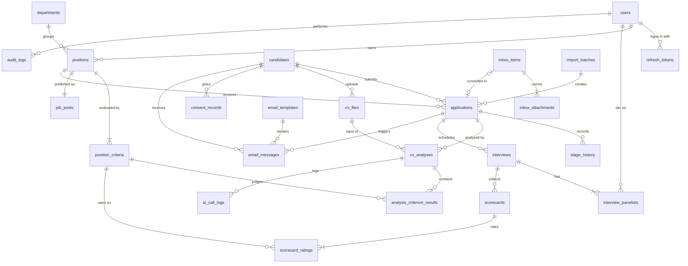
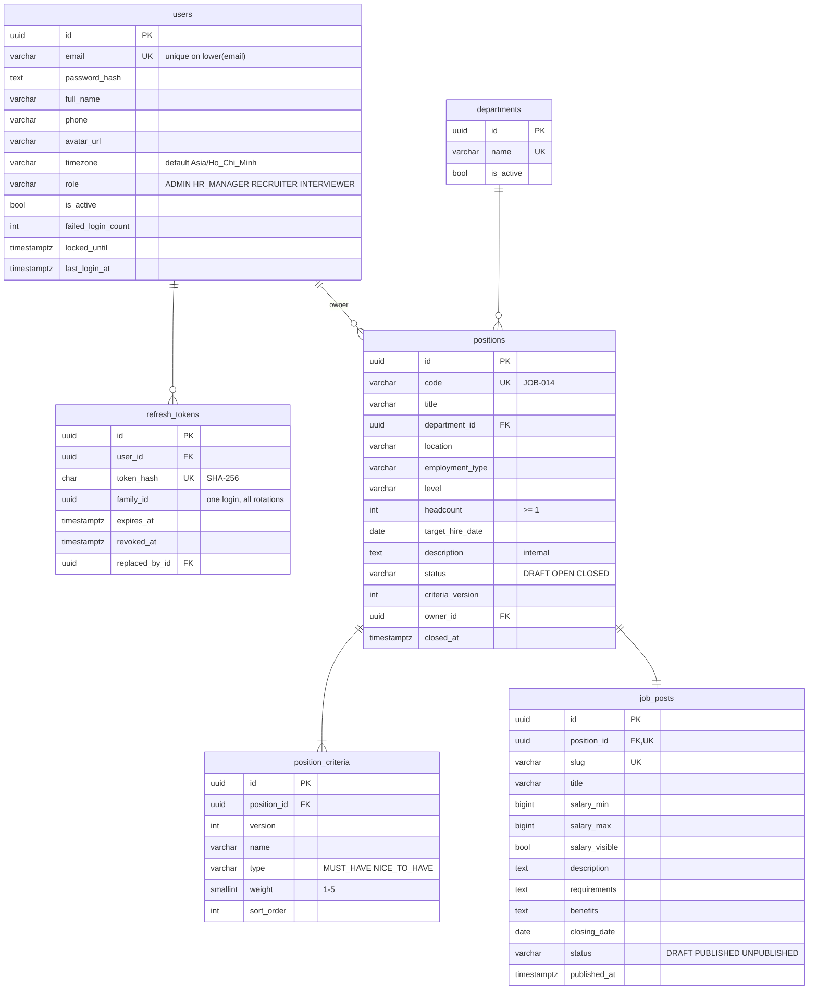
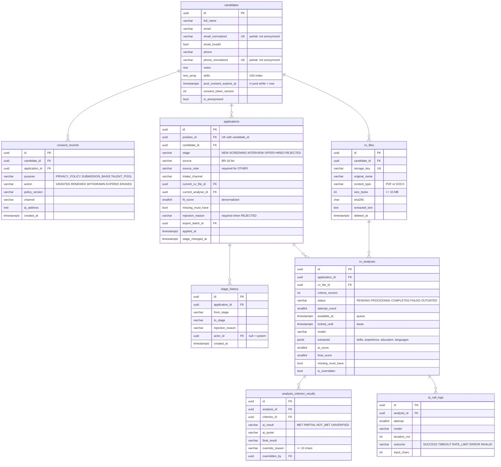
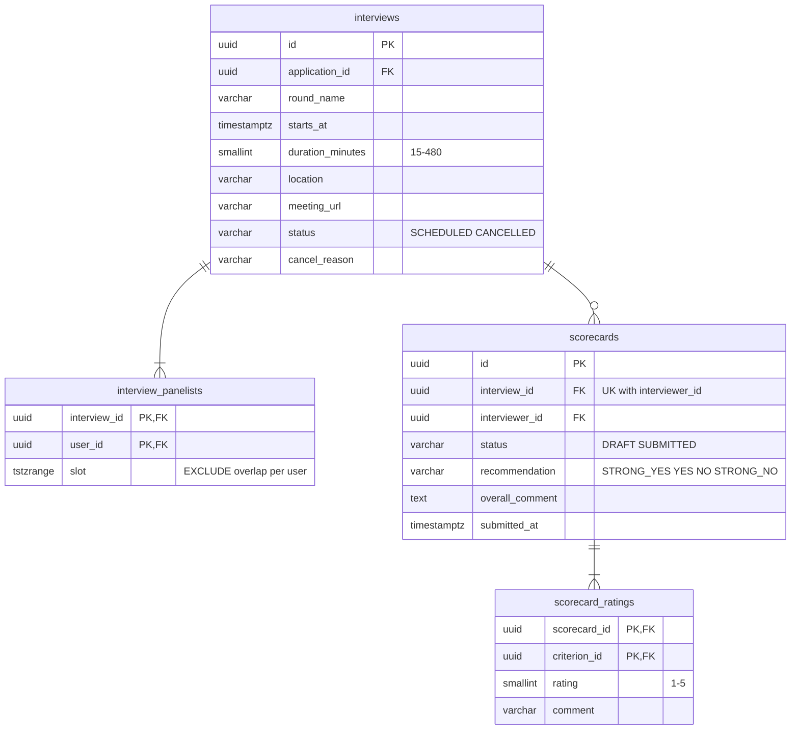
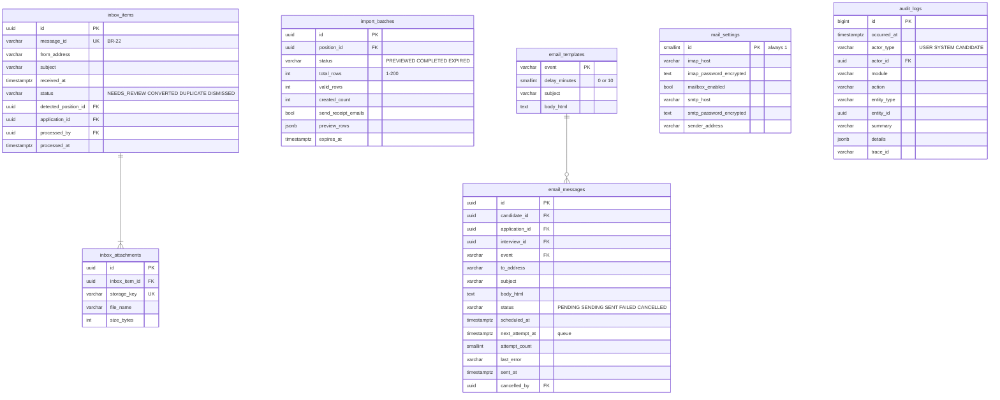

# Database Design

> Design status: TARGET
>
> Reference DDL: [`database/schema.sql`](database/schema.sql) (PostgreSQL 16, verified to run). EF Core migrations must produce an equivalent schema.

The database is the single source of truth for the API and the Worker ([C4 containers](06-c4-architecture.md#level-2--containers)). It also holds the two work queues — `cv_analyses` and `email_messages` — so that a job or an email is written in the same transaction as the action that causes it (AD-02).

## Conventions

| Topic | Decision |
|---|---|
| Naming | `snake_case`, plural table names; EF Core maps them with `UseSnakeCaseNamingConvention()` |
| Keys | `uuid` primary keys generated by the application as UUIDv7 (time-ordered, not guessable). `audit_logs` uses `bigint` identity because it is append-only and high-volume |
| Human-readable codes | `positions.code` = `JOB-001`, `JOB-002`… from a sequence; used in mailbox subjects (BR-22) |
| Time | `timestamptz` in UTC; the client converts to the user's `timezone`. Calendar-only values (`target_hire_date`, `closing_date`) are `date` |
| Enumerations | `varchar` + `CHECK` constraint, values in `UPPER_SNAKE_CASE`, identical to the API enums |
| Concurrency | Optimistic locking on `xmin` for positions, applications, interviews, email messages; a stale update returns 409 `CONCURRENCY_CONFLICT` |
| Deletion | Business records are never hard-deleted by users. Personal data is removed by **anonymization** (BR-17, BR-24): CV files deleted, personal columns cleared, statistics kept |
| Secrets | Passwords hashed (ASP.NET Identity PBKDF2); refresh tokens stored as SHA-256; mailbox/SMTP passwords encrypted with Data Protection |
| Files | Only metadata and a `storage_key` are stored; binaries live in the CV file store (AD-03) |

## Entity overview



`mail_settings` (one row) has no relationships other than `updated_by`.

## Identity, positions, and job posts



- **Criteria versioning (US06).** Editing criteria inserts a new set of rows with `version = criteria_version + 1`; old rows stay because analyses and scorecards reference them. The current criteria are `WHERE version = positions.criteria_version`. Existing analyses with an older `criteria_version` are set to `OUTDATED`.
- **Job post (BR-20).** Holds only public fields. Department is read from the position. A job post row is created as `DRAFT` together with the position (UC05). Publishing requires `positions.status = 'OPEN'`; closing the position sets the post to `UNPUBLISHED` in the same transaction (BR-05).
- **Login lockout.** Five consecutive failures set `locked_until` to 15 minutes later; the API still answers with the generic 401 (AC-US01).

## Candidates, applications, and AI screening



- **One candidate, many applications (BR-06).** Partial unique indexes on `email_normalized` and `phone_normalized` prevent duplicate people; `UNIQUE (position_id, candidate_id)` prevents a second application to the same position. If the email matches one candidate and the phone another, the email match wins and the conflict is shown to the recruiter.
- **Stage rules.** The transition table (BR-01, BR-03) is enforced in code; the database guarantees that `rejection_reason` is set exactly when `stage = 'REJECTED'` (BR-02) and that `OTHER` has a note (BR-18). Every change inserts a `stage_history` row; the initial `NEW` row has `from_stage = NULL`.
- **Rejection reasons** (fixed list, BR-02): `SKILLS_MISMATCH`, `EXPERIENCE_MISMATCH`, `SALARY_MISMATCH`, `FAILED_INTERVIEW`, `CULTURE_FIT`, `POSITION_FILLED`, `NO_RESPONSE`, `CANDIDATE_WITHDREW` ("Ứng viên rút hồ sơ"), `OTHER`.
- **Analysis history (AC-US10).** Every run is a new `cv_analyses` row; `applications.current_analysis_id` points to the latest. `ai_score` is the AI's result; `final_score` includes overrides. `applications.fit_score` and `missing_must_have` copy the current analysis's values so lists can sort and filter without joins.
- **Overrides (BR-13).** `ai_result` is never changed; an override writes `final_result`, `override_reason`, `overridden_by`, `overridden_at`, recalculates `final_score`, and writes an `AI_OVERRIDE` audit entry.
- **Talent pool (BR-24)** is the view `talent_pool`: candidates not anonymized with `pool_consent_expires_at > now()`. `consent_records` keeps the full history; `candidates.pool_consent_*` is the current state.
- **Consent links (US31)** are signed tokens containing `candidate_id` and `consent_token_version`; increasing the version invalidates every earlier link.

## Interviews and scorecards



- **No double booking (AC-US14).** `interview_panelists.slot` copies the interview's time range; the exclusion constraint `EXCLUDE USING gist (user_id WITH =, slot WITH &&)` makes the database reject an overlapping interview for the same person even under concurrent requests. Cancelling an interview sets `slot = NULL`.
- **Blind scorecards (BR-07).** The rule is enforced by the query: an interviewer's request returns other scorecards of the same application only if a `SUBMITTED` scorecard by that interviewer exists. Submitted scorecards are never updated.
- Ratings reference the criteria version that was current when the interview was scheduled.

## Intake, communication, and governance



- **Email events** and default delays (BR-23): `RECEIPT` 0, `INTERVIEW_INVITATION` 10, `INTERVIEW_CHANGED` 10, `INTERVIEW_CANCELLED` 10, `REJECTION` 10, `OFFER` 10, `POOL_RENEWAL` 0, `CONSENT_CONFIRMATION` 0. Messages are stored **rendered**, so editing a pending email changes only that message.
- **Bulk import (BR-16).** Preview validates and stores the rows in `preview_rows` with the uploaded files in a staging folder; confirm re-checks and creates every application in one transaction or none. Unconfirmed previews expire after 24 hours.
- **Audit (US19).** Written in the same transaction as the change. `details` holds before/after values of changed fields, never passwords, tokens, or CV text. Audit rows are never updated or deleted; candidate names in `summary` are replaced by the candidate code on anonymization.

## Queues

Both queues use row locks so several Worker replicas can run safely.

```sql
-- AnalysisRunner: claim the next analysis with a 2-minute lease
UPDATE cv_analyses SET status = 'PROCESSING', locked_until = now() + interval '2 minutes',
       attempt_count = attempt_count + 1, started_at = now()
WHERE id = (
    SELECT id FROM cv_analyses
    WHERE (status = 'PENDING' AND available_at <= now())
       OR (status = 'PROCESSING' AND locked_until < now())        -- Worker crashed
    ORDER BY available_at
    FOR UPDATE SKIP LOCKED
    LIMIT 1)
RETURNING *;

-- EmailDispatcher: claim due emails; a concurrent cancel (WHERE status = 'PENDING') loses or wins atomically
UPDATE email_messages SET status = 'SENDING'
WHERE id IN (
    SELECT id FROM email_messages
    WHERE status = 'PENDING' AND next_attempt_at <= now()
    ORDER BY next_attempt_at
    FOR UPDATE SKIP LOCKED
    LIMIT 20)
RETURNING *;
```

| Queue | Success | Failure |
|---|---|---|
| `cv_analyses` | `COMPLETED`, results and scores saved, application's `fit_score` updated | Transient error and `attempt_count < 2` → `PENDING`, `available_at = now() + 10 s`; otherwise `FAILED` with `failure_reason` |
| `email_messages` | `SENT`, `sent_at`, `provider_message_id` | `attempt_count` 1, 2, 3 → `PENDING` with `next_attempt_at` + 1, 5, 30 min; after the 4th failure `FAILED` |

## Retention and anonymization

The Worker's `RetentionJob` runs daily and audits every deletion as `CV_DELETE` or `ANONYMIZE` with `actor_type = 'SYSTEM'`.

| Rule | Selection | Action |
|---|---|---|
| BR-17 | Not in the pool, every application `REJECTED`, latest `closed_at` older than 6 months (hired candidates are kept) | Anonymize |
| BR-24 renewal | `pool_consent_expires_at` within 30 days and `pool_renewal_sent_at IS NULL` | Queue `POOL_RENEWAL` email |
| BR-24 expiry | `pool_consent_expires_at <= now()` | `consent_records` `EXPIRED`; then BR-17 applies |
| BR-22 | Inbox items `DISMISSED` more than 7 days ago | Delete the item, its attachments, and their files |
| Import staging | `import_batches.expires_at < now()` and `PREVIEWED` | Delete staging files; status `EXPIRED` |
| Refresh tokens | Expired more than 30 days ago | Delete rows |

**Anonymize** (also used for "Xoá toàn bộ dữ liệu", US31): delete all CV files from storage and set `cv_files.deleted_at`, clear `extracted_text`; set `candidates.full_name = 'Ứng viên ' || short id`, clear `email*`, `phone*`, `notes`, `skills`, pool fields; increase `consent_token_version`; clear `cover_message` and `analysis_criterion_results.ai_quote`; replace `email_messages.to_address`, `subject`, and `body_html` with a placeholder; reject open applications with `CANDIDATE_WITHDREW`. Stage history, scores, and sources remain, so reports stay correct.

## Rule-to-schema traceability

| Rule / story | Where it is enforced in the database |
|---|---|
| BR-02 | `CHECK ((stage = 'REJECTED') = (rejection_reason IS NOT NULL))` |
| BR-04 | `stage_history` |
| BR-05 | `job_posts.status` updated with `positions.status` in one transaction |
| BR-06 | `ux_candidates_email`, `ux_candidates_phone`, `ux_applications_position_candidate` |
| BR-11, BR-12 | `analysis_criterion_results.ai_result` includes `UNVERIFIED`; `ai_score`, `final_score` |
| BR-13 | `override_reason` length check; `ai_result` kept |
| BR-15 | `cv_files.content_type` and `size_bytes` checks (the API checks first) |
| BR-16 | `import_batches.total_rows BETWEEN 1 AND 200` |
| BR-18 | `applications.source` check; `OTHER` requires `source_note` |
| BR-19, BR-24 | `consent_records`, `candidates.pool_consent_expires_at`, view `talent_pool` |
| BR-22 | `inbox_items.message_id` unique |
| BR-23 | `email_templates.delay_minutes`, `email_messages` queue columns |
| AC-US14 | `ex_panelist_overlap` exclusion constraint |
| AC-US15 | `ux_scorecard_interviewer`; submitted requires recommendation |
| US19 | `audit_logs` |

## Seed data

| Table | Rows |
|---|---|
| `users` | One `ADMIN` account; the password must be changed at first login |
| `departments` | The company's departments |
| `email_templates` | One Vietnamese template per event, each containing `{{link_dong_y}}` |
| `mail_settings` | Row `id = 1` with `mailbox_enabled = false` |

**Related:** [C4 architecture](06-c4-architecture.md) · [OpenAPI contract](08-openapi-contract.md) · [Use cases](02-use-cases.md)
