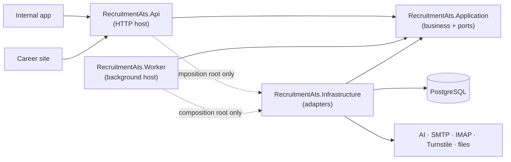

# Frontend and Backend Folder Structures

> Design status: TARGET — no source code exists yet; implementation (README section 7) creates it in this layout.
>
> Based on the course reference project [finance-manager](https://github.com/PhamHiep948/finance-manager) (Simplified Clean Architecture, feature-based React), extended for this project's second backend host (Worker) and second frontend (career site).

This document fixes where every piece of code lives and which way dependencies point, so that each [C4 component](06-c4-architecture.md#level-3--components), [database table](07-database-design.md), and [OpenAPI operation](08-openapi-contract.md) has exactly one owner.

## 1. Architecture choice

| Option | Fit for Recruitment ATS | Verdict |
|---|---|---|
| **Layered (N-tier)** — Controllers → Services → Repositories, Business depends on Data | Simple, but business code depends on EF Core and concrete adapters, so the AI service, SMTP, and IMAP cannot be swapped for fakes cleanly; the Worker would have to reach into API-shaped services | Rejected |
| **Full Clean Architecture** — Domain, Application, Infrastructure, Api; CQRS with MediatR, a handler per operation | 85 operations would become ~85 command/query classes plus handlers, pipelines, and a separate Domain project; ceremony larger than the problem | Rejected |
| **Vertical slices** — one folder per endpoint with its own data access | Good for many independent endpoints, but our rules (stage transitions, scoring, consent, audit) are shared across slices and by the Worker | Rejected |
| **Simplified Clean Architecture** — Application (business rules + ports), Infrastructure (adapters), thin hosts (Api, Worker) | Same 3-project core as the reference project; dependencies point inward, so **two hosts reuse the same use cases** and every external service has a fake | **Selected (AD-11)** |

Why it fits this scale (31 stories, 25 tables, 85 operations, 2 hosts, 4 external systems):

1. **Two hosts, one core.** The API and the Worker run the same business rules (e.g. a mailbox CV and a manual upload go through the same intake). Business code must not depend on ASP.NET Core or on `BackgroundService`.
2. **Replaceable adapters are a requirement**, not a nicety (constraint in [research §8](01-research-top-down.md#8-constraints-and-assumptions)): `IResumeAnalyzer`, `IEmailSender`, `IMailboxReader`, `IFileStorage`, `ICaptchaVerifier` are defined by Application and implemented by Infrastructure.
3. **The interesting logic is pure** — stage transitions, fit score, quote verification, redaction, blind-scorecard visibility, email delays — and can be unit-tested without a database.
4. **No extra layers without a driver**: entities live inside their Application module (as in the reference project), services are plain classes instead of MediatR handlers, and request/response records are shared with the API instead of being mapped twice (§3.4).

## 2. Repository layout

```text
recruitment-ats/
├── docs/                               # documentation (this folder)
│   ├── api/openapi.yaml                # API contract — single source of truth
│   └── database/schema.sql             # reference DDL
├── src/
│   ├── backend/                        # .NET solution (§3)
│   └── frontend/                       # npm workspace: 2 apps + shared packages (§4)
├── deploy/
│   ├── Caddyfile                       # domains, routing, crawler rule (AD-04, AD-05)
│   └── backup/                         # pg_dump + file archive scripts
├── compose.yaml                        # caddy, career-web, internal-web, api, worker, postgres
├── compose.override.yaml               # local only: Mailpit, GreenMail, exposed ports
├── .env.example                        # documented variable names, no secrets
├── .github/workflows/ci.yml            # build, lint, test, contract check
└── README.md
```

## 3. Backend — ASP.NET Core (.NET 10 LTS)

### 3.1 Solution

```text
src/backend/
├── RecruitmentAts.slnx
├── Directory.Build.props               # net10.0, nullable, warnings as errors, analyzers
├── Directory.Packages.props            # central package versions
├── .editorconfig
├── src/
│   ├── RecruitmentAts.Application/     # business rules, use cases, ports — no framework references
│   ├── RecruitmentAts.Infrastructure/  # EF Core + PostgreSQL, MailKit, LLM, files, Excel, PDF
│   ├── RecruitmentAts.Api/             # HTTP host: controllers, auth, ProblemDetails
│   └── RecruitmentAts.Worker/          # background host: queues and schedules
└── tests/
    ├── RecruitmentAts.Application.Tests/     # unit tests with fakes
    ├── RecruitmentAts.Infrastructure.Tests/  # real PostgreSQL (Testcontainers), adapters
    ├── RecruitmentAts.Api.Tests/             # HTTP integration, auth matrix, OpenAPI contract
    ├── RecruitmentAts.Worker.Tests/          # background services with fakes
    └── RecruitmentAts.ArchitectureTests/     # dependency rules (§3.7)
```



| Project | Layer | Allowed | Not allowed |
|---|---|---|---|
| `Application` | Business | Entities, rules, use-case services, validation, authorization policies, ports (interfaces), request/response records | ASP.NET Core, EF Core, Npgsql, MailKit, HTTP clients, `IFormFile`, file system |
| `Infrastructure` | Data / adapters | `DbContext`, configurations, migrations, repositories, queue claims, adapters for every port | Business decisions, HTTP status codes |
| `Api` | Presentation (host) | Controllers, model binding, JWT, rate limiting, ProblemDetails, file streaming, DI composition | SQL, `DbContext` in controllers, business rules |
| `Worker` | Presentation (host) | `BackgroundService` loops, schedules, advisory locks, DI composition | Business rules (they call Application use cases) |

### 3.2 Application

Modules follow the OpenAPI tags. Each module holds its entities, rules, services, and contract records.

```text
RecruitmentAts.Application/
├── Abstractions/                       # ports implemented by Infrastructure
│   ├── Persistence/                    # I<Aggregate>Repository, IUnitOfWork, IAnalysisQueue, IEmailQueue
│   ├── Ai/IResumeAnalyzer.cs
│   ├── Email/IEmailSender.cs
│   ├── Mailbox/IMailboxReader.cs
│   ├── Files/                          # IFileStorage, ITextExtractor
│   ├── Spreadsheets/                   # ISpreadsheetReader, ISpreadsheetWriter
│   ├── Reports/IReportPdfRenderer.cs
│   ├── Security/                       # IPasswordHasher, ITokenIssuer, ISecretProtector, IConsentTokenService
│   ├── Captcha/ICaptchaVerifier.cs
│   └── Time/IClock.cs
├── Common/
│   ├── Actor.cs                        # current user id, role, IP, traceId
│   ├── AppException.cs                 # carries ErrorCode → mapped to ProblemDetails by Api
│   ├── ErrorCodes.cs                   # the 32 codes from the OpenAPI contract
│   ├── PagedResult.cs · PageQuery.cs
│   └── Audit/AuditWriter.cs            # writes audit entries inside the caller's transaction
├── Auth/                               # AuthService, RefreshToken, lockout rules
├── Users/                              # User, UserService, Role
├── Profile/
├── Lookups/                            # Department
├── Dashboard/                          # DashboardService (read models)
├── Positions/                          # Position, PositionCriterion, criteria versioning
├── JobPosts/                           # JobPost, slug rules, share links
├── Applications/                       # JobApplication, StageHistoryEntry, StageTransitions, pipeline
├── Candidates/                         # Candidate, CvFile, ContactNormalizer, duplicate matching
├── Intake/                             # IntakeService — one path for manual, public, mailbox, import, pool
├── Screening/                          # CvAnalysis, Redactor, QuoteVerifier, FitScoreCalculator, overrides
├── Interviews/                         # Interview, Scorecard, ScorecardVisibilityPolicy
├── Communication/                      # EmailMessage, EmailTemplate, TemplateRenderer, EmailScheduler, MailSettings
├── Inbox/                              # InboxItem, PositionCodeParser, MailboxIntakeService
├── Imports/                            # ImportBatch, ImportValidator
├── TalentPool/
├── Consent/                            # ConsentRecord, ConsentService, AnonymizationService
├── Retention/                          # RetentionService (BR-17, BR-22, BR-24)
├── Reports/                            # ReportService, metric definitions
├── Audit/                              # AuditLog, AuditQueryService
├── Careers/                            # public job posts, PublicApplyService
└── DependencyInjection.cs              # AddApplication()
```

Inside a module (create only what the module needs):

```text
Applications/
├── JobApplication.cs                   # entity; table `applications`
├── StageHistoryEntry.cs
├── Stage.cs · RejectionReason.cs · Source.cs   # enums with the database / API values
├── StageTransitions.cs                 # BR-01, BR-03 — pure, unit-tested
├── ApplicationService.cs               # use cases: list, get, update, move stage, replace CV
├── ApplicationQueries.cs               # list filters, sort, pipeline read model
├── Contracts/                          # records shared with the API (= OpenAPI schemas)
│   ├── ApplicationListItem.cs
│   ├── ApplicationDetail.cs
│   ├── StageMoveRequest.cs
│   └── StageMoveResult.cs
└── Validation/StageMoveRequestValidator.cs
```

The entity is named `JobApplication` (not `Application`) to avoid a clash with the `RecruitmentAts.Application` namespace; it still maps to the `applications` table.

### 3.3 Infrastructure

```text
RecruitmentAts.Infrastructure/
├── Persistence/
│   ├── AtsDbContext.cs
│   ├── Configurations/                 # one IEntityTypeConfiguration per table (snake_case, CHECKs, indexes)
│   ├── Migrations/                     # EF Core migrations; must match docs/database/schema.sql
│   ├── Repositories/                   # one implementation per I<Aggregate>Repository
│   ├── Queues/                         # AnalysisQueue, EmailQueue — FOR UPDATE SKIP LOCKED
│   ├── UnitOfWork.cs
│   └── Seed/                           # admin user, departments, email templates
├── Ai/
│   ├── LlmResumeAnalyzer.cs            # provider SDK / HTTP, JSON schema, timeout
│   ├── ResumeAnalysisPrompt.cs
│   └── FakeResumeAnalyzer.cs           # used when no API key is configured (local, tests)
├── Email/MailKitEmailSender.cs
├── Mailbox/MailKitMailboxReader.cs
├── Files/
│   ├── LocalFileStorage.cs             # cv-files volume
│   └── TextExtractor.cs                # PdfPig (PDF), DocumentFormat.OpenXml (DOCX)
├── Spreadsheets/                       # ClosedXML reader and writer
├── Reports/QuestPdfReportRenderer.cs
├── Security/                           # PasswordHasher (PBKDF2), JwtTokenIssuer, DataProtection secret/consent tokens
├── Captcha/TurnstileVerifier.cs
├── Time/SystemClock.cs
└── DependencyInjection.cs              # AddInfrastructure(configuration)
```

### 3.4 Api

```text
RecruitmentAts.Api/
├── Program.cs                          # composition root
├── Controllers/                        # one per OpenAPI tag; [HttpX(Name = "<operationId>")]
│   ├── AuthController.cs · ProfileController.cs · DashboardController.cs · LookupsController.cs
│   ├── PositionsController.cs · JobPostsController.cs · ApplicationsController.cs · CandidatesController.cs
│   ├── ScreeningController.cs · InterviewsController.cs · EmailsController.cs · InboxController.cs
│   ├── TalentPoolController.cs · ImportsController.cs · ReportsController.cs · AuditLogsController.cs
│   ├── UsersController.cs · SettingsController.cs
│   └── Public/                         # /api/public/* — anonymous, rate-limited
│       ├── PublicJobPostsController.cs
│       ├── PublicConsentController.cs
│       └── SharePageController.cs      # Open Graph HTML for crawlers
├── Forms/                              # multipart models with IFormFile (create application, apply, import)
├── Auth/                               # JWT setup, refresh cookie, ActorAccessor, role policies
├── RateLimiting/                       # login and public-apply policies (BR-21)
├── Errors/ProblemDetailsMapper.cs      # AppException.ErrorCode → status + problem+json
├── Files/FileResults.cs                # streaming with Content-Disposition, no-store
├── appsettings.json                    # safe defaults only
└── appsettings.Development.json
```

**Contracts are not duplicated.** Controllers accept and return the records in `Application/<Module>/Contracts`, which mirror the OpenAPI schemas. The only Api-specific input types are multipart forms (`IFormFile` must not reach Application; forms are converted to a stream + metadata). This is a deliberate difference from the reference project: with 85 operations a second DTO layer and mapping code would double the surface without protecting anything.

### 3.5 Worker

```text
RecruitmentAts.Worker/
├── Program.cs                          # Host.CreateApplicationBuilder, AddApplication, AddInfrastructure
├── Jobs/
│   ├── AnalysisRunner.cs               # every 2 s → Screening.AnalyzeNextAsync()
│   ├── EmailDispatcher.cs              # every 15 s → Communication.DispatchDueAsync()
│   ├── MailboxPoller.cs                # every 5 min → Inbox.PollAsync()
│   └── RetentionJob.cs                 # daily 02:00 → Retention.RunAsync()
├── Scheduling/
│   ├── PeriodicJob.cs                  # PeriodicTimer loop, error logging, per-run scope
│   └── AdvisoryLock.cs                 # pg_try_advisory_lock for single-instance jobs
├── Health/                             # /health for Compose
└── appsettings.json
```

A job only loops, opens a DI scope, and calls one Application method; all decisions stay in Application, so the same code is tested without the Worker.

### 3.6 Tests

| Project | What it covers | How |
|---|---|---|
| `Application.Tests` | Rules and use cases per module: transitions, scoring, redaction, quote checks, blind scorecards, email delays and cancel, consent, import atomicity | xUnit, fakes for every port, `FakeClock` |
| `Infrastructure.Tests` | EF mappings vs real schema, constraints (exclusion, partial unique), queue claims under concurrency, text extraction, Excel | Testcontainers PostgreSQL 16, sample CV files |
| `Api.Tests` | Status codes, ProblemDetails, auth matrix per `x-roles`, AI fields absent for Interviewer, rate limits, multipart | `WebApplicationFactory`, Testcontainers |
| `Api.Tests/Contract` | Every `operationId` in `docs/api/openapi.yaml` has exactly one route with the same name, method, and path | Parse the YAML and compare with the endpoint data source |
| `Worker.Tests` | Job scheduling, lease recovery, retry timing | Fakes + `FakeClock` |
| `ArchitectureTests` | Rules in §3.7 | NetArchTest |

Folders inside each test project mirror the module folders (`Screening/`, `Interviews/`, …).

### 3.7 Dependency rules

```text
Application     → (no project)            packages: FluentValidation only
Infrastructure  → Application
Api             → Application, Infrastructure (Program.cs / DI only)
Worker          → Application, Infrastructure (Program.cs / DI only)
```

Enforced by `ArchitectureTests`:

- Application has no reference to `Microsoft.AspNetCore.*`, `Microsoft.EntityFrameworkCore*`, `Npgsql`, `MailKit`.
- Controllers and Worker jobs do not use `AtsDbContext` or any type in `Infrastructure.*` except in `Program.cs`.
- No module calls another module's repository; cross-module work goes through that module's service (e.g. `Intake` calls `Screening` to queue an analysis).
- Types in `*.Contracts` namespaces have no behavior.

### 3.8 Main packages

| Purpose | Package |
|---|---|
| Persistence | `Npgsql.EntityFrameworkCore.PostgreSQL`, `EFCore.NamingConventions` |
| Validation | `FluentValidation` |
| Auth | `Microsoft.AspNetCore.Authentication.JwtBearer` |
| Email, mailbox | `MailKit` |
| CV text | `UglyToad.PdfPig`, `DocumentFormat.OpenXml` |
| Excel | `ClosedXML` |
| PDF reports | `QuestPDF` (Community license) |
| Logging | `Serilog.AspNetCore` (JSON to stdout) |
| Tests | `xunit`, `Testcontainers.PostgreSql`, `Microsoft.AspNetCore.Mvc.Testing`, `NetArchTest.Rules` |

## 4. Frontend — React (Vite, TypeScript)

Two apps share design tokens, UI components, and the API client, so the frontend is one npm workspace.

**TypeScript, not JavaScript (difference from the reference project).** With 85 operations, types generated from `openapi.yaml` turn contract drift into a build error instead of a runtime bug.

### 4.1 Workspace

```text
src/frontend/
├── package.json                        # npm workspaces, shared scripts
├── tsconfig.base.json
├── eslint.config.js
├── apps/
│   ├── internal/                       # ats.<domain> — hiring team (§4.2)
│   └── career/                         # careers.<domain> — candidates (§4.3)
├── packages/
│   ├── api-client/                     # generated types + fetch client (§4.4)
│   └── ui/                             # tokens and shared components (§4.5)
└── e2e/                                # Playwright: apply → screen → interview → offer
```

| Library | Use |
|---|---|
| React 19, Vite, TypeScript | Both apps |
| React Router | Internal: hash routes (`#/positions/:id`, as in [IA](04-information-architecture.md#routes)); career: path routes (`/jobs/:slug`) for shareable links |
| TanStack Query | Server state, cache invalidation after mutations, polling AI status every 5 s |
| `openapi-typescript` + `openapi-fetch` | Types and typed requests from `docs/api/openapi.yaml` |
| React Hook Form + Zod | Forms and client-side validation (UX only; the API is authoritative) |
| Chart.js | Dashboard and report charts (as in the reference project) |
| Vitest, Testing Library, MSW | Unit and component tests with API mocks per `operationId` |
| Playwright | End-to-end tests against the Compose stack |

### 4.2 Internal app

```text
apps/internal/
├── index.html
├── vite.config.ts
└── src/
    ├── main.tsx
    ├── app/
    │   ├── App.tsx
    │   ├── router.tsx                  # routes, RequireAuth, RequireRole → #/403
    │   ├── providers.tsx               # QueryClient, AuthProvider, Toasts
    │   └── navigation.ts               # sidebar items per role (IA navigation table)
    ├── components/layout/              # AppShell, Sidebar, Topbar, UserMenu
    ├── features/
    │   ├── auth/                       # SCR-01, session, refresh, role guards
    │   ├── dashboard/                  # SCR-02 (+ interviewer variant)
    │   ├── positions/                  # SCR-10, SCR-11, SCR-12 overview & criteria tabs
    │   ├── job-posts/                  # SCR-14 job post tab, share links
    │   ├── applications/               # SCR-13 pipeline, SCR-20 table, SCR-21 add, SCR-22 detail, SCR-25 move, SCR-26 edit
    │   ├── screening/                  # SCR-23 evaluation tab, SCR-24 override
    │   ├── interviews/                 # SCR-30 schedule, SCR-31 my interviews, SCR-32 scorecard
    │   ├── emails/                     # SCR-27 emails tab, SCR-28 edit / cancel
    │   ├── inbox/                      # SCR-41, SCR-42
    │   ├── talent-pool/                # SCR-45, SCR-46
    │   ├── imports/                    # SCR-40 wizard and history
    │   ├── reports/                    # SCR-50
    │   ├── audit/                      # SCR-60
    │   ├── users/                      # SCR-70
    │   ├── settings/                   # SCR-75 email templates, SCR-76 mailbox & sender
    │   └── profile/                    # SCR-80
    ├── pages/ForbiddenPage.tsx         # SCR-90
    └── test/                           # setup, renderWithProviders, MSW handlers by operationId
```

Feature template (from the reference project, adapted to TanStack Query):

```text
features/applications/
├── api.ts                              # one function per operationId: listApplications(), moveApplicationStage()…
├── queries.ts                          # query keys and hooks: useApplications(), useMoveStage()
├── components/                         # ApplicationTable, KanbanColumn, StageMoveModal, CandidateCard…
├── pages/                              # PipelinePage, ApplicationListPage, ApplicationDetailPage
├── schemas.ts                          # Zod schemas for this feature's forms
├── permissions.ts                      # which buttons a role sees (mirrors x-roles; never authoritative)
└── index.ts                            # the only file other features may import
```

### 4.3 Career site

```text
apps/career/
├── index.html                          # default Open Graph tags; per-job tags come from the API (AD-04)
├── vite.config.ts
└── src/
    ├── main.tsx
    ├── app/                            # router, providers, CareerHeader, CareerFooter
    ├── features/
    │   ├── jobs/                       # PUB-01 list with filters, PUB-02 detail
    │   ├── apply/                      # PUB-03 form, Turnstile widget, PUB-04 thank-you
    │   ├── consent/                    # PUB-06 consent management by token
    │   └── privacy/                    # PUB-05
    └── test/
```

The career site imports only the public part of the API client (`@ats/api-client/public`), so internal endpoints cannot be called from it by mistake.

### 4.4 API client package

```text
packages/api-client/
├── package.json                        # "generate": openapi-typescript ../../../../docs/api/openapi.yaml
└── src/
    ├── schema.d.ts                     # generated — never edited
    ├── client.ts                       # openapi-fetch instance for the internal app
    ├── public.ts                       # client restricted to /api/public/*
    ├── auth.ts                         # access token in memory; on 401 call refreshToken once, then retry
    ├── problem.ts                      # ProblemDetails → ApiError { status, errorCode, fieldErrors, traceId }
    └── index.ts
```

CI runs `generate` and fails if `schema.d.ts` changed, so the frontend always matches the committed contract.

### 4.5 UI package

```text
packages/ui/
└── src/
    ├── tokens.css                      # colors, type, spacing from Figma (UI/UX doc)
    ├── components/                     # Button, Input, Select, Checkbox, Modal, Table, Pagination,
    │                                   # Tag, Toast, EmptyState, Skeleton, FileDrop, Tabs, DateRange
    ├── icons/                          # the 47 icons from the Figma library
    └── index.ts
```

### 4.6 Frontend rules

- Data flow: **Page → feature hook (`queries.ts`) → feature `api.ts` → `api-client` → API**. Components never call `fetch`.
- `packages/*` never import from `apps/*`; a feature never imports another feature's internals, only its `index.ts`.
- Code moves to `packages/ui` only when both apps use it; internal-only shared code stays in `apps/internal/src/components`.
- Function names in `api.ts` equal OpenAPI `operationId`s.
- The access token is kept in memory only; nothing sensitive in `localStorage`.
- Status is never shown by color alone; every list has loading, empty, and error states ([UI state contract](04-information-architecture.md#uiux-state-contract)).

## 5. Ownership map

| C4 component ([L3](06-c4-architecture.md#level-3--components)) | Application module | Api controller | Frontend feature |
|---|---|---|---|
| Auth | `Auth`, `Profile` | `AuthController`, `ProfileController` | `auth`, `profile` |
| Positions & Job posts | `Positions`, `JobPosts`, `Lookups` | `PositionsController`, `JobPostsController`, `LookupsController` | `positions`, `job-posts` |
| Applications & Pipeline | `Applications`, `Candidates`, `Intake` | `ApplicationsController`, `CandidatesController` | `applications` |
| Screening | `Screening` | `ScreeningController` | `screening` |
| Interviews | `Interviews` | `InterviewsController` | `interviews` |
| Intake | `Inbox`, `Imports`, `TalentPool`, `Intake` | `InboxController`, `ImportsController`, `TalentPoolController` | `inbox`, `imports`, `talent-pool` |
| Communication | `Communication` | `EmailsController`, `SettingsController` | `emails`, `settings` |
| Insight & Admin | `Dashboard`, `Reports`, `Audit`, `Users` | `DashboardController`, `ReportsController`, `AuditLogsController`, `UsersController` | `dashboard`, `reports`, `audit`, `users` |
| Public API | `Careers`, `Consent` | `Public/*` | career `jobs`, `apply`, `consent`, `privacy` |
| Worker: AnalysisRunner, Redactor, QuoteVerifier, FitScoreCalculator | `Screening` | — | — |
| Worker: EmailDispatcher | `Communication` | — | — |
| Worker: MailboxPoller | `Inbox`, `Intake` | — | — |
| Worker: RetentionJob | `Retention`, `Consent` | — | — |

## 6. Naming conventions

| Item | Convention | Example |
|---|---|---|
| C# projects, namespaces | `RecruitmentAts.<Project>.<Module>` | `RecruitmentAts.Application.Screening` |
| Entities | Singular PascalCase | `Position`, `JobApplication`, `CvAnalysis` |
| Services | `<Module>Service`, use-case methods as verbs | `ApplicationService.MoveStageAsync` |
| Contract records | OpenAPI schema name | `StageMoveRequest`, `ApplicationDetail` |
| Ports | `I` + capability | `IResumeAnalyzer`, `IFileStorage` |
| Controllers | Plural / tag name + `Controller`; route name = `operationId` | `[HttpPost("{applicationId}/stage", Name = "moveApplicationStage")]` |
| Database | `snake_case` via `UseSnakeCaseNamingConvention()` | `stage_changed_at` |
| JSON | `camelCase`, enums as strings | `"stage": "SCREENING"` |
| React | Components `PascalCase.tsx`, hooks `useX`, folders `kebab-case` | `features/talent-pool/components/PoolTable.tsx` |
| Tests | `<Unit>Tests`, method `Method_State_Expected` | `StageTransitionsTests.Move_NewToInterview_IsRejected` |

## 7. Configuration and secrets

| Setting | Where |
|---|---|
| Connection string, JWT signing key, AI API key, Turnstile secret | Environment variables / Docker secrets (`.env` locally, never committed) |
| Mailbox and SMTP passwords | Database, encrypted with Data Protection (keys in the `dp-keys` volume) |
| Non-secret defaults (timeouts, delays, limits) | `appsettings.json`, overridable by environment |
| Frontend | `VITE_TURNSTILE_SITE_KEY` only; API calls are same-origin, so no API URL is needed |

## 8. Order of creation

1. Solution skeleton, `Directory.Build.props`, architecture tests (empty projects must already pass them).
2. Persistence: `AtsDbContext`, configurations, first migration compared with `schema.sql` in `Infrastructure.Tests`.
3. Auth and Users end to end (API + internal app shell) — proves JWT, refresh, ProblemDetails, and the API client.
4. Positions → Applications/Intake → Screening (with `FakeResumeAnalyzer`) → Worker `AnalysisRunner`.
5. Interviews, Communication + `EmailDispatcher`, Career site, Inbox + `MailboxPoller`, Imports, Talent pool, Reports, Audit, Retention.

**Related:** [C4 architecture](06-c4-architecture.md) · [Database design](07-database-design.md) · [OpenAPI contract](08-openapi-contract.md) · [Information architecture](04-information-architecture.md)
