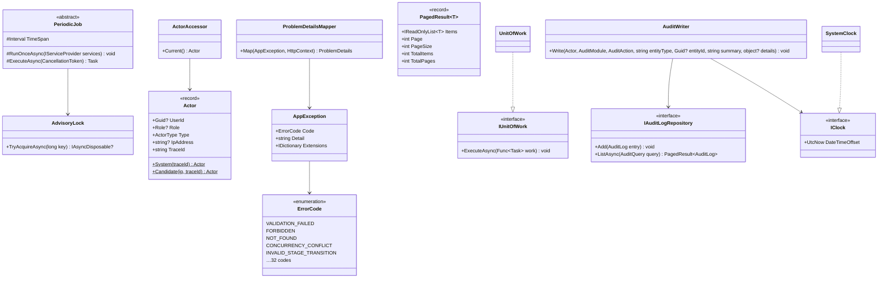
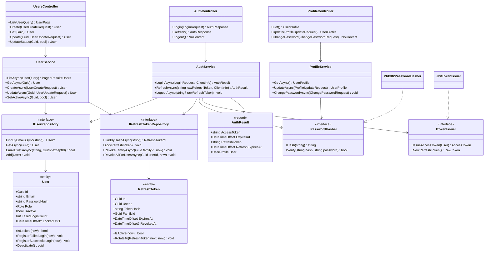
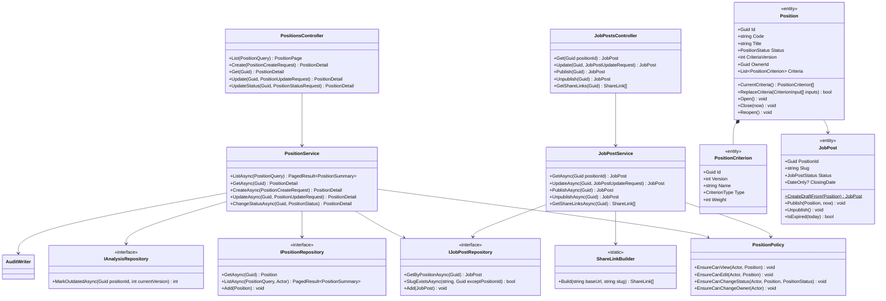
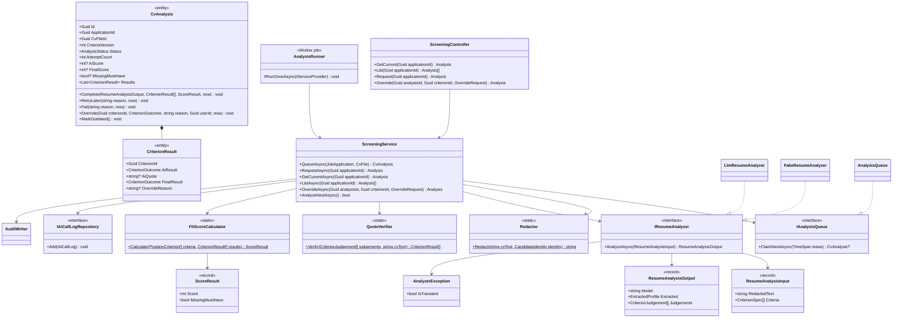
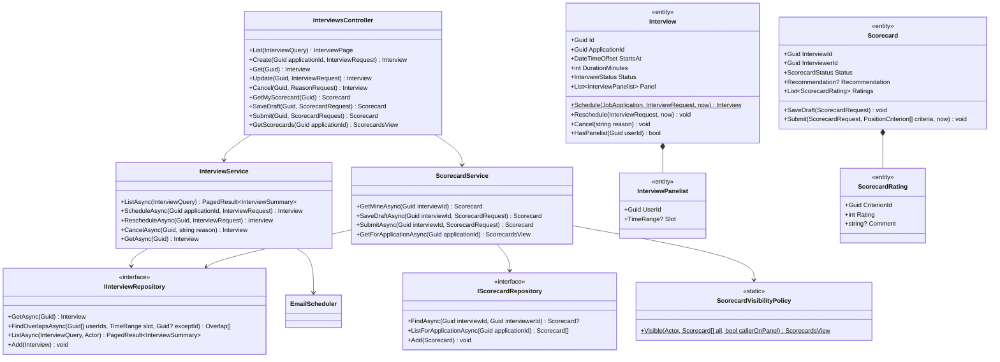
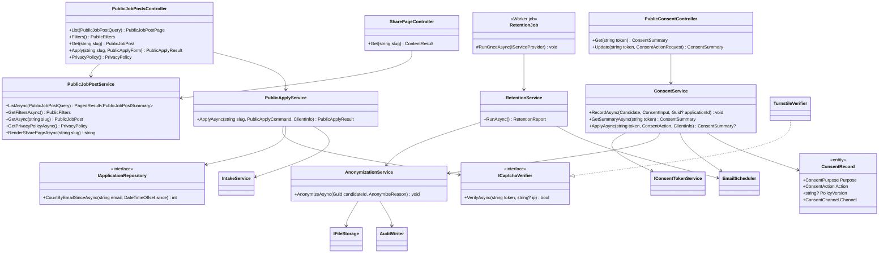
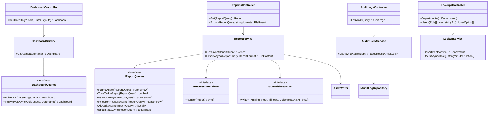

# Detailed Class Design

> Design status: TARGET — class and method names that implementation must use.
>
> Notation: Mermaid `classDiagram`, as in the course reference project. Runtime behaviour is in [Sequence and state diagrams](11-sequence-and-state-diagrams.md).

The diagrams zoom into the [C4 components](06-c4-architecture.md#level-3--components) using the projects and modules of the [folder structure](09-folder-structure.md). Read each diagram top to bottom as **host (Api / Worker) → Application → ports → Infrastructure**.

| Notation | Meaning |
|---|---|
| `<<interface>>` | Port defined in Application, implemented in Infrastructure |
| `<<entity>>` | Persistent class mapped to a table in [database design](07-database-design.md) |
| `<<record>>` | Immutable request/response or value; contract records mirror OpenAPI schemas |
| `<<static>>` | Pure rule with no dependencies, unit-tested in isolation |
| `..|>` | Implements |
| `-->` | Uses / depends on |
| `*--` | Owns (composition) |

All service methods are `async`, take a `CancellationToken` as the last parameter, and receive the caller as `Actor`; both are omitted from the diagrams for readability. Return types are shown without `Task<…>`.

## 1. Cross-cutting

- `IUnitOfWork.ExecuteAsync` opens one database transaction, runs the work, calls `SaveChanges`, and commits. Every command (and the audit entries, AI jobs, and emails it creates) is saved in one `ExecuteAsync`.
- Services throw `AppException` with an `ErrorCode`; only `ProblemDetailsMapper` turns it into an HTTP status. A stale `xmin` (`DbUpdateConcurrencyException`) is translated to `CONCURRENCY_CONFLICT` by `UnitOfWork`.
- Record-level checks live in each module's `*Policy` class and return `FORBIDDEN` or `NOT_FOUND` (when existence must not leak, e.g. an Interviewer opening an application they do not interview).

## 2. Auth, users, and profile

- `AuthService.LoginAsync` returns the same `INVALID_CREDENTIALS` for unknown email, wrong password, deactivated, and locked accounts; `User.RegisterFailedLogin` locks for 15 minutes after 5 failures.
- `RefreshAsync`: a token that is already revoked means reuse → `RevokeFamilyAsync` and 401. Otherwise the token is rotated (`RotateTo`) and a new access token is issued.
- `UserService.SetActiveAsync(false)` on oneself → `SELF_DEACTIVATION`; deactivation calls `RevokeAllForUserAsync`. `ChangePasswordAsync` revokes all other refresh tokens.

## 3. Positions and job posts

- `Position.ReplaceCriteria` returns `true` when anything changed; it then appends rows with `CriteriaVersion + 1`, and `PositionService` calls `IAnalysisRepository.MarkOutdatedAsync` in the same unit of work (US06).
- `Position.Close` and `PositionService.ChangeStatusAsync` also call `JobPost.Unpublish` (BR-05). `JobPost.Publish` throws `POSITION_NOT_OPEN` unless the position is `OPEN`.
- `PositionPolicy`: Recruiter may edit only `OwnerId == actor`; only Admin and HR Manager close, reopen, or change owner (BR-14, US07); Interviewer may view only positions where they sit on a panel.

## 4. Applications, candidates, and intake

```mermaid
classDiagram
    direction TB
    class ApplicationsController {
        +List(ApplicationQuery) ApplicationPage
        +GetPipeline(Guid positionId, int limit) Pipeline
        +Create(ApplicationCreateForm) ApplicationCreated
        +Export(ApplicationQuery) FileResult
        +Get(Guid) ApplicationDetail
        +Update(Guid, ApplicationUpdateRequest) ApplicationDetail
        +ReplaceCv(Guid, IFormFile) ApplicationDetail
        +MoveStage(Guid, StageMoveRequest) StageMoveResult
        +GetStageHistory(Guid) StageHistoryEntry[]
        +GetCvFile(Guid fileId) FileResult
    }
    class CandidatesController {
        +Match(string? email, string? phone, Guid? positionId) CandidateMatch
        +Get(Guid) CandidateDetail
    }
    class ApplicationService {
        +ListAsync(ApplicationQuery) PagedResult~ApplicationListItem~
        +GetPipelineAsync(Guid, int) Pipeline
        +GetAsync(Guid) ApplicationDetail
        +UpdateAsync(Guid, ApplicationUpdateRequest) ApplicationDetail
        +ReplaceCvAsync(Guid, CvUpload) ApplicationDetail
        +MoveStageAsync(Guid, StageMoveRequest) StageMoveResult
        +GetStageHistoryAsync(Guid) StageHistoryEntry[]
        +ExportAsync(ApplicationQuery) FileContent
        +OpenCvAsync(Guid fileId) FileContent
    }
    class IntakeService {
        +SubmitAsync(IntakeRequest) IntakeResult
    }
    class IntakeRequest {
        <<record>>
        +Guid PositionId
        +CandidateInput Candidate
        +Source Source
        +string? SourceNote
        +IntakeChannel Channel
        +CvUpload Cv
        +ConsentInput? Consent
        +bool SendReceipt
    }
    class CandidateService {
        +MatchAsync(string? email, string? phone, Guid? positionId) CandidateMatch
        +GetAsync(Guid) CandidateDetail
        +FindOrCreateAsync(CandidateInput) Candidate
    }
    class CvFileService {
        +StoreAsync(Guid candidateId, CvUpload) CvFile
    }
    class ApplicationPolicy {
        +EnsureCanView(Actor, JobApplication) void
        +HideAiFields(Actor) bool
    }
    class StageTransitions {
        <<static>>
        +AllowedNext(Stage from, Role role)$ Stage[]
        +EnsureAllowed(Stage from, Stage to, Role role)$ void
    }
    class ContactNormalizer {
        <<static>>
        +Email(string?)$ string?
        +Phone(string?)$ string?
    }
    class JobApplication {
        <<entity>>
        +Guid Id
        +Guid PositionId
        +Guid CandidateId
        +Stage Stage
        +Source Source
        +int? FitScore
        +bool MissingMustHave
        +RejectionReason? RejectionReason
        +MoveTo(Stage, Role, RejectionReason?, string? note, now) StageHistoryEntry
        +ReplaceCv(CvFile) void
        +ApplyAnalysis(CvAnalysis) void
    }
    class Candidate {
        <<entity>>
        +Guid Id
        +string FullName
        +string? EmailNormalized
        +string? PhoneNormalized
        +DateTimeOffset? PoolConsentExpiresAt
        +int ConsentTokenVersion
        +InPool(now) bool
        +Anonymize(now) void
    }
    class CvFile {
        <<entity>>
        +Guid Id
        +string StorageKey
        +string ExtractedText
        +DateTimeOffset? DeletedAt
    }
    class StageHistoryEntry {
        <<entity>>
        +Stage? FromStage
        +Stage ToStage
        +Guid? ActorId
    }
    class IApplicationRepository {
        <<interface>>
        +GetAsync(Guid) JobApplication
        +ExistsAsync(Guid positionId, Guid candidateId) Guid?
        +ListAsync(ApplicationQuery, Actor) PagedResult~ApplicationListItem~
        +Add(JobApplication) void
    }
    class ICandidateRepository {
        <<interface>>
        +FindByEmailAsync(string) Candidate?
        +FindByPhoneAsync(string) Candidate?
        +Add(Candidate) void
    }
    class IFileStorage {
        <<interface>>
        +SaveAsync(string key, Stream) void
        +OpenAsync(string key) Stream
        +DeleteAsync(string key) void
    }
    class ITextExtractor {
        <<interface>>
        +ExtractAsync(Stream, string contentType) string
    }
    class ScreeningService
    class EmailScheduler
    class ConsentService

    ApplicationsController --> ApplicationService
    ApplicationsController --> IntakeService
    CandidatesController --> CandidateService
    ApplicationService --> ApplicationPolicy
    ApplicationService --> StageTransitions
    ApplicationService --> IApplicationRepository
    ApplicationService --> CvFileService
    ApplicationService --> EmailScheduler
    ApplicationService --> ScreeningService
    IntakeService --> IntakeRequest
    IntakeService --> CandidateService
    IntakeService --> CvFileService
    IntakeService --> IApplicationRepository
    IntakeService --> ScreeningService
    IntakeService --> EmailScheduler
    IntakeService --> ConsentService
    CandidateService --> ContactNormalizer
    CandidateService --> ICandidateRepository
    CvFileService --> IFileStorage
    CvFileService --> ITextExtractor
    JobApplication --> StageTransitions
    JobApplication *-- StageHistoryEntry
    Candidate *-- CvFile
```

- **One intake path.** Manual upload, career site, mailbox, bulk import, and talent pool all call `IntakeService.SubmitAsync`, which checks the position is `OPEN`, stores the CV (BR-15), finds or creates the candidate (BR-06), rejects a second application to the same position (`DUPLICATE_APPLICATION`), records consent (BR-19), creates the application in `NEW` with its first `StageHistoryEntry`, queues the analysis, and queues the receipt email — in one unit of work.
- `CvFileService.StoreAsync` checks content type, size, and extractable text before writing to storage (`UNSUPPORTED_FILE_TYPE`, `FILE_TOO_LARGE`, `NO_EXTRACTABLE_TEXT`); a failed transaction deletes the stored file.
- `JobApplication.MoveTo` calls `StageTransitions.EnsureAllowed` (BR-01, BR-03) and requires a reason for `REJECTED` (BR-02). `ApplicationService.MoveStageAsync` then asks `EmailScheduler` for the `REJECTION` or `OFFER` email. `REJECTED` is final, so a mistaken rejection is handled by cancelling its pending email within the 10-minute window and noting it; the stage itself is not reverted.
- `ApplicationPolicy.HideAiFields` is true for Interviewers; the service then builds responses without `fitScore`, `missingMustHave`, `analysisStatus` (BR-08).

## 5. AI screening

- `AnalyzeNextAsync` claims one job (lease 2 minutes), loads the CV text and the criteria of `CriteriaVersion`, redacts with the candidate's own name, email, and phone plus generic patterns (BR-10), calls the analyzer with a 45 s timeout, verifies quotes (BR-11), computes the score (BR-12), completes the analysis, and copies score and flag to the application. It returns `false` when the queue is empty so the runner sleeps.
- `AnalyzerException.IsTransient` (timeout, 429, 5xx) → `RetryLater` while `AttemptCount < 2`, else `Fail`. Invalid JSON from the model is not transient. Every call writes an `AiCallLog` with model, duration, and outcome.
- `Override` keeps `AiResult`, sets `FinalResult`, recalculates `FinalScore` with `FitScoreCalculator`, and the service writes an `AI_OVERRIDE` audit entry (BR-13). Requires `Status == COMPLETED` (`ANALYSIS_NOT_COMPLETED`).
- `ScreeningService` never changes the application's stage (BR-09); `JobApplication.ApplyAnalysis` touches only `FitScore` and `MissingMustHave`.

## 6. Interviews and scorecards

- `Interview.Schedule` requires the application in `INTERVIEW` (`APPLICATION_NOT_IN_INTERVIEW`), a future start, and at least one panelist; `InterviewService` checks `FindOverlapsAsync` to return a readable `INTERVIEW_OVERLAP`, and the exclusion constraint catches races.
- Scheduling asks `EmailScheduler` for `INTERVIEW_INVITATION`. Rescheduling or cancelling replaces or cancels the pending invitation; if it was already sent, `INTERVIEW_CHANGED` or `INTERVIEW_CANCELLED` is queued (BR-23).
- `ScorecardVisibilityPolicy` implements BR-07: Admin, HR Manager, Recruiter see submitted scorecards; a panelist sees others only after their own is `SUBMITTED`; drafts of others are never visible. `Scorecard.Submit` requires every current criterion rated 1–5 and a recommendation; a second submit → `SCORECARD_ALREADY_SUBMITTED`.

## 7. Candidate communication

```mermaid
classDiagram
    direction TB
    class EmailsController {
        +List(EmailQuery) EmailPage
        +ListForApplication(Guid) EmailMessage[]
        +Update(Guid, EmailUpdateRequest) EmailMessage
        +Cancel(Guid) EmailMessage
        +Resend(Guid) EmailMessage
    }
    class SettingsController {
        +ListTemplates() EmailTemplate[]
        +UpdateTemplate(EmailEvent, EmailTemplateUpdateRequest) EmailTemplate
        +PreviewTemplate(EmailEvent, EmailTemplateUpdateRequest) RenderedEmail
        +SendTestEmail(EmailEvent, EmailTemplateUpdateRequest) ConnectionTestResult
        +GetMail() MailSettings
        +UpdateMail(MailSettingsUpdateRequest) MailSettings
        +TestMail(MailSettingsUpdateRequest) MailTestResult
    }
    class EmailDispatcher {
        <<Worker job>>
        #RunOnceAsync(IServiceProvider) void
    }
    class EmailScheduler {
        +ScheduleAsync(EmailEvent, Candidate, JobApplication?, Interview?) EmailMessage?
        +CancelPendingAsync(Guid applicationId, EmailEvent[] events, string reason) int
        +ReplacePendingAsync(Interview, EmailEvent) EmailMessage?
    }
    class EmailService {
        +ListAsync(EmailQuery) PagedResult~EmailMessage~
        +ListForApplicationAsync(Guid) EmailMessage[]
        +UpdatePendingAsync(Guid, EmailUpdateRequest) EmailMessage
        +CancelAsync(Guid) EmailMessage
        +ResendAsync(Guid) EmailMessage
        +DispatchDueAsync() int
    }
    class EmailTemplateService {
        +ListAsync() EmailTemplate[]
        +UpdateAsync(EmailEvent, EmailTemplateUpdateRequest) EmailTemplate
        +PreviewAsync(EmailEvent, EmailTemplateUpdateRequest) RenderedEmail
        +SendTestAsync(EmailEvent, EmailTemplateUpdateRequest) ConnectionTestResult
    }
    class MailSettingsService {
        +GetAsync() MailSettings
        +UpdateAsync(MailSettingsUpdateRequest) MailSettings
        +TestAsync(MailSettingsUpdateRequest) MailTestResult
    }
    class TemplateRenderer {
        <<static>>
        +Validate(EmailEvent, string subject, string body)$ void
        +Render(EmailTemplate, EmailContext)$ RenderedEmail
    }
    class EmailMessage {
        <<entity>>
        +Guid Id
        +EmailEvent Event
        +string ToAddress
        +EmailStatus Status
        +DateTimeOffset ScheduledAt
        +DateTimeOffset NextAttemptAt
        +int AttemptCount
        +Edit(string subject, string body, Guid userId, now) void
        +Cancel(Guid? userId, string reason, now) void
        +MarkSent(string providerId, now) void
        +MarkAttemptFailed(string error, now) void
        +Resend(now) void
    }
    class EmailTemplate {
        <<entity>>
        +EmailEvent Event
        +int DelayMinutes
        +string Subject
        +string BodyHtml
    }
    class IEmailSender {
        <<interface>>
        +SendAsync(OutgoingEmail, SmtpSettings) SendResult
    }
    class IEmailQueue {
        <<interface>>
        +ClaimDueAsync(int batchSize) EmailMessage[]
    }
    class IConsentTokenService {
        <<interface>>
        +Create(Candidate) string
        +TryRead(string token) ConsentTokenData?
    }
    class IEmailMessageRepository {
        <<interface>>
    }
    class IMailSettingsRepository {
        <<interface>>
    }
    class ISecretProtector {
        <<interface>>
        +Protect(string) string
        +Unprotect(string) string
    }
    class MailKitEmailSender
    class EmailQueue

    EmailsController --> EmailService
    SettingsController --> EmailTemplateService
    SettingsController --> MailSettingsService
    EmailDispatcher --> EmailService
    EmailScheduler --> TemplateRenderer
    EmailScheduler --> IConsentTokenService
    EmailScheduler --> IEmailMessageRepository
    EmailService --> IEmailQueue
    EmailService --> IEmailSender
    EmailService --> IMailSettingsRepository
    EmailTemplateService --> TemplateRenderer
    MailSettingsService --> ISecretProtector
    MailSettingsService --> IEmailSender
    EmailScheduler --> EmailMessage
    EmailMessage --> EmailTemplate
    MailKitEmailSender ..|> IEmailSender
    EmailQueue ..|> IEmailQueue
```

- `EmailScheduler` is the only creator of `EmailMessage`: it renders the template **now** (so a pending email can be edited), adds the signed consent link, sets `ScheduledAt = now + DelayMinutes`, and skips (with the application flagged `email_invalid`) when the address is invalid (BR-23). It runs inside the caller's unit of work.
- `EmailMessage.Edit` and `Cancel` require `PENDING` (`EMAIL_NOT_PENDING`); `Resend` requires `FAILED`. `MarkAttemptFailed` schedules retries at +1, +5, +30 minutes, then sets `FAILED`.
- `DispatchDueAsync` claims a batch (`PENDING → SENDING` with `SKIP LOCKED`), sends each outside the claim transaction, and saves the result per message.

## 8. CV inbox, bulk import, and talent pool

```mermaid
classDiagram
    direction TB
    class InboxController {
        +List(InboxQuery) InboxPage
        +Get(Guid) InboxItemDetail
        +GetAttachment(Guid, Guid) FileResult
        +Assign(Guid, InboxAssignRequest) ApplicationCreated
        +Dismiss(Guid) InboxItem
    }
    class ImportsController {
        +Template() FileResult
        +Preview(ImportPreviewForm) ImportBatch
        +Confirm(Guid, ImportConfirmRequest) ImportBatch
        +List(PageQuery) ImportPage
        +Get(Guid) ImportBatch
    }
    class TalentPoolController {
        +Search(PoolQuery) PoolPage
        +Export(PoolQuery) FileResult
        +AddToPosition(Guid candidateId, AddToPositionRequest) ApplicationCreated
    }
    class MailboxPoller {
        <<Worker job>>
        #RunOnceAsync(IServiceProvider) void
    }
    class MailboxIntakeService {
        +PollAsync() int
    }
    class InboxService {
        +ListAsync(InboxQuery) PagedResult~InboxItem~
        +GetAsync(Guid) InboxItemDetail
        +OpenAttachmentAsync(Guid, Guid) FileContent
        +AssignAsync(Guid, InboxAssignRequest) ApplicationCreated
        +DismissAsync(Guid) InboxItem
    }
    class PositionCodeParser {
        <<static>>
        +TryParse(string subject)$ string?
    }
    class InboxItem {
        <<entity>>
        +string MessageId
        +InboxStatus Status
        +Guid? DetectedPositionId
        +Convert(Guid applicationId, Guid? userId, now) void
        +MarkDuplicate(Guid existingApplicationId, now) void
        +Dismiss(Guid userId, now) void
    }
    class IMailboxReader {
        <<interface>>
        +FetchNewAsync(ImapSettings, string[] knownMessageIds) MailboxMessage[]
    }
    class IInboxRepository {
        <<interface>>
        +MessageIdExistsAsync(string) bool
        +Add(InboxItem) void
    }
    class ImportService {
        +TemplateAsync() FileContent
        +PreviewAsync(Guid positionId, FileUpload excel, FileUpload zip) ImportBatch
        +ConfirmAsync(Guid batchId, bool sendReceipts) ImportBatch
        +ListAsync(PageQuery) PagedResult~ImportBatch~
        +GetAsync(Guid) ImportBatch
    }
    class ImportValidator {
        <<static>>
        +Validate(ImportSheetRow[] rows, string[] zipEntries)$ ImportRow[]
    }
    class ImportBatch {
        <<entity>>
        +ImportStatus Status
        +int TotalRows
        +int ValidRows
        +ImportRow[] PreviewRows
        +Complete(int created, now) void
        +IsExpired(now) bool
    }
    class ISpreadsheetReader {
        <<interface>>
        +ReadRows(Stream) ImportSheetRow[]
    }
    class TalentPoolService {
        +SearchAsync(PoolQuery) PagedResult~PoolCandidate~
        +ExportAsync(PoolQuery) FileContent
        +AddToPositionAsync(Guid candidateId, AddToPositionRequest) ApplicationCreated
    }
    class IntakeService

    InboxController --> InboxService
    ImportsController --> ImportService
    TalentPoolController --> TalentPoolService
    MailboxPoller --> MailboxIntakeService
    MailboxIntakeService --> IMailboxReader
    MailboxIntakeService --> PositionCodeParser
    MailboxIntakeService --> IInboxRepository
    MailboxIntakeService --> IntakeService
    InboxService --> IntakeService
    InboxService --> IInboxRepository
    ImportService --> ISpreadsheetReader
    ImportService --> ImportValidator
    ImportService --> IntakeService
    TalentPoolService --> IntakeService
    IInboxRepository --> InboxItem
    ImportService --> ImportBatch
```

- `MailboxIntakeService.PollAsync` (BR-22): reads new messages read-only, skips known Message-IDs, keeps only PDF/DOCX attachments, stores them, and creates an `InboxItem`. When `PositionCodeParser` finds the code of an `OPEN` position and intake succeeds, the item is `CONVERTED` automatically; a duplicate becomes `DUPLICATE`; otherwise `NEEDS_REVIEW`.
- `ImportService.ConfirmAsync` re-validates and calls `IntakeService.SubmitAsync` for every row **inside one unit of work** (BR-16); one failure rolls back all rows and deletes files stored so far.
- `TalentPoolService` reads only candidates with active pool consent (view `talent_pool`, BR-24); `AddToPositionAsync` reuses the candidate's latest CV.

## 9. Career site, consent, and retention

- `PublicApplyService.ApplyAsync` (BR-21): Turnstile check (`CAPTCHA_FAILED`), 3 per email per day via `CountByEmailSinceAsync` (`RATE_LIMITED`; the per-IP limit is ASP.NET Core middleware), closing date (`JOB_POST_EXPIRED`), then `IntakeService` with channel `CAREER_SITE`, source from `src`, and consent. `DUPLICATE_APPLICATION` is swallowed and the same neutral result is returned.
- `ConsentService.ApplyAsync`: `JOIN_POOL` (24 months), `LEAVE_POOL`, or `DELETE_ALL` → `AnonymizationService` and returns `null` (HTTP 204). Every change appends a `ConsentRecord` and an audit entry with `actor_type = CANDIDATE`.
- `AnonymizationService` implements the procedure in [database design](07-database-design.md#retention-and-anonymization), including cancelling pending emails and rejecting open applications with `CANDIDATE_WITHDREW`.

## 10. Dashboard, reports, audit, and lookups

- Read models are built by `I*Queries` in Infrastructure with EF Core projections (no entity loading); they apply the caller's visibility (Interviewer variant, role filters).
- `ReportService.ExportAsync` produces the same figures as `GetAsync` and writes an `EXPORT` audit entry; `ExportAsync` in `ApplicationService` and `TalentPoolService` use `ISpreadsheetWriter` with the BR-25 columns and the 5,000-row limit.

## 11. API-to-code traceability

Every OpenAPI operation maps to one controller action and one Application method. Controller actions carry `Name = operationId`, which the contract test compares with `openapi.yaml`.

Roles: **A** Admin · **H** HR Manager · **R** Recruiter · **I** Interviewer · **Public** anonymous.

| Operation | HTTP | Roles | Controller action | Application method | Diagram |
|---|---|---|---|---|---|
| `login` | `POST /api/auth/login` | Public | `AuthController.Login` | `AuthService.LoginAsync` | [seq_login](11-sequence-and-state-diagrams.md#seq-login) |
| `refreshToken` | `POST /api/auth/refresh` | Refresh cookie | `AuthController.Refresh` | `AuthService.RefreshAsync` | [seq_refresh_token](11-sequence-and-state-diagrams.md#seq-refresh-token) |
| `logout` | `POST /api/auth/logout` | Any signed-in | `AuthController.Logout` | `AuthService.LogoutAsync` |  |
| `getProfile` | `GET /api/me` | Any signed-in | `ProfileController.Get` | `ProfileService.GetAsync` |  |
| `updateProfile` | `PUT /api/me` | Any signed-in | `ProfileController.Update` | `ProfileService.UpdateAsync` |  |
| `changePassword` | `PUT /api/me/password` | Any signed-in | `ProfileController.ChangePassword` | `ProfileService.ChangePasswordAsync` |  |
| `getDashboard` | `GET /api/dashboard` | A H R I | `DashboardController.Get` | `DashboardService.GetAsync` |  |
| `listDepartments` | `GET /api/lookups/departments` | A H R I | `LookupsController.Departments` | `LookupService.DepartmentsAsync` |  |
| `listUserOptions` | `GET /api/lookups/users` | A H R | `LookupsController.Users` | `LookupService.UsersAsync` |  |
| `listPositions` | `GET /api/positions` | A H R I | `PositionsController.List` | `PositionService.ListAsync` |  |
| `createPosition` | `POST /api/positions` | A H R | `PositionsController.Create` | `PositionService.CreateAsync` |  |
| `getPosition` | `GET /api/positions/{positionId}` | A H R I | `PositionsController.Get` | `PositionService.GetAsync` |  |
| `updatePosition` | `PUT /api/positions/{positionId}` | A H R | `PositionsController.Update` | `PositionService.UpdateAsync` |  |
| `updatePositionStatus` | `PUT /api/positions/{positionId}/status` | A H R | `PositionsController.UpdateStatus` | `PositionService.ChangeStatusAsync` | [st_position](11-sequence-and-state-diagrams.md#st-position) |
| `getPipeline` | `GET /api/positions/{positionId}/pipeline` | A H R I | `ApplicationsController.GetPipeline` | `ApplicationService.GetPipelineAsync` |  |
| `getJobPost` | `GET /api/positions/{positionId}/job-post` | A H R | `JobPostsController.Get` | `JobPostService.GetAsync` |  |
| `updateJobPost` | `PUT /api/positions/{positionId}/job-post` | A H R | `JobPostsController.Update` | `JobPostService.UpdateAsync` |  |
| `publishJobPost` | `POST /api/positions/{positionId}/job-post/publish` | A H R | `JobPostsController.Publish` | `JobPostService.PublishAsync` | [seq_publish_job_post](11-sequence-and-state-diagrams.md#seq-publish-job-post) |
| `unpublishJobPost` | `POST /api/positions/{positionId}/job-post/unpublish` | A H R | `JobPostsController.Unpublish` | `JobPostService.UnpublishAsync` | [st_job_post](11-sequence-and-state-diagrams.md#st-job-post) |
| `getShareLinks` | `GET /api/positions/{positionId}/job-post/share-links` | A H R | `JobPostsController.GetShareLinks` | `JobPostService.GetShareLinksAsync` | [seq_publish_job_post](11-sequence-and-state-diagrams.md#seq-publish-job-post) |
| `listApplications` | `GET /api/applications` | A H R I | `ApplicationsController.List` | `ApplicationService.ListAsync` |  |
| `createApplication` | `POST /api/applications` | A H R | `ApplicationsController.Create` | `IntakeService.SubmitAsync` | [seq_add_application](11-sequence-and-state-diagrams.md#seq-add-application) |
| `exportApplications` | `GET /api/applications/export` | A H R | `ApplicationsController.Export` | `ApplicationService.ExportAsync` |  |
| `getApplication` | `GET /api/applications/{applicationId}` | A H R I | `ApplicationsController.Get` | `ApplicationService.GetAsync` |  |
| `updateApplication` | `PUT /api/applications/{applicationId}` | A H R | `ApplicationsController.Update` | `ApplicationService.UpdateAsync` |  |
| `replaceCv` | `POST /api/applications/{applicationId}/cv` | A H R | `ApplicationsController.ReplaceCv` | `ApplicationService.ReplaceCvAsync` |  |
| `moveApplicationStage` | `POST /api/applications/{applicationId}/stage` | A H R | `ApplicationsController.MoveStage` | `ApplicationService.MoveStageAsync` | [seq_move_stage](11-sequence-and-state-diagrams.md#seq-move-stage) |
| `getStageHistory` | `GET /api/applications/{applicationId}/stage-history` | A H R | `ApplicationsController.GetStageHistory` | `ApplicationService.GetStageHistoryAsync` |  |
| `getCvFileContent` | `GET /api/cv-files/{cvFileId}/content` | A H R I | `ApplicationsController.GetCvFile` | `ApplicationService.OpenCvAsync` |  |
| `matchCandidate` | `GET /api/candidates/match` | A H R | `CandidatesController.Match` | `CandidateService.MatchAsync` | [seq_add_application](11-sequence-and-state-diagrams.md#seq-add-application) |
| `getCandidate` | `GET /api/candidates/{candidateId}` | A H R | `CandidatesController.Get` | `CandidateService.GetAsync` |  |
| `listAnalyses` | `GET /api/applications/{applicationId}/analyses` | A H R | `ScreeningController.List` | `ScreeningService.ListAsync` |  |
| `requestAnalysis` | `POST /api/applications/{applicationId}/analyses` | A H R | `ScreeningController.Request` | `ScreeningService.RequestAsync` | [seq_analyze_cv](11-sequence-and-state-diagrams.md#seq-analyze-cv) |
| `getAnalysis` | `GET /api/applications/{applicationId}/analysis` | A H R | `ScreeningController.GetCurrent` | `ScreeningService.GetCurrentAsync` | [seq_analyze_cv](11-sequence-and-state-diagrams.md#seq-analyze-cv) |
| `overrideCriterionResult` | `PUT /api/analyses/{analysisId}/criteria/{criterionId}/override` | A H R | `ScreeningController.Override` | `ScreeningService.OverrideAsync` | [seq_override_ai](11-sequence-and-state-diagrams.md#seq-override-ai) |
| `listInterviews` | `GET /api/interviews` | A H R I | `InterviewsController.List` | `InterviewService.ListAsync` |  |
| `createInterview` | `POST /api/applications/{applicationId}/interviews` | A H R | `InterviewsController.Create` | `InterviewService.ScheduleAsync` | [seq_schedule_interview](11-sequence-and-state-diagrams.md#seq-schedule-interview) |
| `getInterview` | `GET /api/interviews/{interviewId}` | A H R I | `InterviewsController.Get` | `InterviewService.GetAsync` |  |
| `updateInterview` | `PUT /api/interviews/{interviewId}` | A H R | `InterviewsController.Update` | `InterviewService.RescheduleAsync` | [seq_schedule_interview](11-sequence-and-state-diagrams.md#seq-schedule-interview) |
| `cancelInterview` | `POST /api/interviews/{interviewId}/cancel` | A H R | `InterviewsController.Cancel` | `InterviewService.CancelAsync` |  |
| `getMyScorecard` | `GET /api/interviews/{interviewId}/scorecard` | H I | `InterviewsController.GetMyScorecard` | `ScorecardService.GetMineAsync` | [seq_submit_scorecard](11-sequence-and-state-diagrams.md#seq-submit-scorecard) |
| `saveScorecardDraft` | `PUT /api/interviews/{interviewId}/scorecard` | H I | `InterviewsController.SaveDraft` | `ScorecardService.SaveDraftAsync` |  |
| `submitScorecard` | `POST /api/interviews/{interviewId}/scorecard/submit` | H I | `InterviewsController.Submit` | `ScorecardService.SubmitAsync` | [seq_submit_scorecard](11-sequence-and-state-diagrams.md#seq-submit-scorecard) |
| `getScorecards` | `GET /api/applications/{applicationId}/scorecards` | A H R I | `InterviewsController.GetScorecards` | `ScorecardService.GetForApplicationAsync` | [seq_submit_scorecard](11-sequence-and-state-diagrams.md#seq-submit-scorecard) |
| `listEmails` | `GET /api/emails` | A H R | `EmailsController.List` | `EmailService.ListAsync` |  |
| `listApplicationEmails` | `GET /api/applications/{applicationId}/emails` | A H R | `EmailsController.ListForApplication` | `EmailService.ListForApplicationAsync` |  |
| `updatePendingEmail` | `PUT /api/emails/{emailId}` | A H R | `EmailsController.Update` | `EmailService.UpdatePendingAsync` | [st_email_message](11-sequence-and-state-diagrams.md#st-email-message) |
| `cancelPendingEmail` | `POST /api/emails/{emailId}/cancel` | A H R | `EmailsController.Cancel` | `EmailService.CancelAsync` | [seq_email_dispatch](11-sequence-and-state-diagrams.md#seq-email-dispatch) |
| `resendEmail` | `POST /api/emails/{emailId}/resend` | A H R | `EmailsController.Resend` | `EmailService.ResendAsync` | [st_email_message](11-sequence-and-state-diagrams.md#st-email-message) |
| `listInboxItems` | `GET /api/inbox-items` | A H R | `InboxController.List` | `InboxService.ListAsync` |  |
| `getInboxItem` | `GET /api/inbox-items/{inboxItemId}` | A H R | `InboxController.Get` | `InboxService.GetAsync` |  |
| `getInboxAttachmentContent` | `GET /api/inbox-items/{inboxItemId}/attachments/{attachmentId}/content` | A H R | `InboxController.GetAttachment` | `InboxService.OpenAttachmentAsync` |  |
| `assignInboxItem` | `POST /api/inbox-items/{inboxItemId}/assign` | A H R | `InboxController.Assign` | `InboxService.AssignAsync` | [seq_mailbox_intake](11-sequence-and-state-diagrams.md#seq-mailbox-intake) |
| `dismissInboxItem` | `POST /api/inbox-items/{inboxItemId}/dismiss` | A H R | `InboxController.Dismiss` | `InboxService.DismissAsync` | [st_inbox_item](11-sequence-and-state-diagrams.md#st-inbox-item) |
| `searchTalentPool` | `GET /api/talent-pool` | A H R | `TalentPoolController.Search` | `TalentPoolService.SearchAsync` |  |
| `exportTalentPool` | `GET /api/talent-pool/export` | A H R | `TalentPoolController.Export` | `TalentPoolService.ExportAsync` |  |
| `addCandidateToPosition` | `POST /api/talent-pool/{candidateId}/applications` | A H R | `TalentPoolController.AddToPosition` | `TalentPoolService.AddToPositionAsync` | [seq_intake](11-sequence-and-state-diagrams.md#seq-intake) |
| `downloadImportTemplate` | `GET /api/imports/template` | A H R | `ImportsController.Template` | `ImportService.TemplateAsync` |  |
| `previewImport` | `POST /api/imports/preview` | A H R | `ImportsController.Preview` | `ImportService.PreviewAsync` | [seq_bulk_import](11-sequence-and-state-diagrams.md#seq-bulk-import) |
| `listImports` | `GET /api/imports` | A H R | `ImportsController.List` | `ImportService.ListAsync` |  |
| `getImport` | `GET /api/imports/{batchId}` | A H R | `ImportsController.Get` | `ImportService.GetAsync` |  |
| `confirmImport` | `POST /api/imports/{batchId}/confirm` | A H R | `ImportsController.Confirm` | `ImportService.ConfirmAsync` | [seq_bulk_import](11-sequence-and-state-diagrams.md#seq-bulk-import) |
| `getReport` | `GET /api/reports` | A H | `ReportsController.Get` | `ReportService.GetAsync` |  |
| `exportReport` | `GET /api/reports/export` | A H | `ReportsController.Export` | `ReportService.ExportAsync` |  |
| `listAuditLogs` | `GET /api/audit-logs` | A H | `AuditLogsController.List` | `AuditQueryService.ListAsync` |  |
| `listUsers` | `GET /api/users` | A | `UsersController.List` | `UserService.ListAsync` |  |
| `createUser` | `POST /api/users` | A | `UsersController.Create` | `UserService.CreateAsync` |  |
| `getUser` | `GET /api/users/{userId}` | A | `UsersController.Get` | `UserService.GetAsync` |  |
| `updateUser` | `PUT /api/users/{userId}` | A | `UsersController.Update` | `UserService.UpdateAsync` |  |
| `updateUserStatus` | `PUT /api/users/{userId}/status` | A | `UsersController.UpdateStatus` | `UserService.SetActiveAsync` |  |
| `listEmailTemplates` | `GET /api/settings/email-templates` | A H | `SettingsController.ListTemplates` | `EmailTemplateService.ListAsync` |  |
| `updateEmailTemplate` | `PUT /api/settings/email-templates/{event}` | A H | `SettingsController.UpdateTemplate` | `EmailTemplateService.UpdateAsync` |  |
| `previewEmailTemplate` | `POST /api/settings/email-templates/{event}/preview` | A H | `SettingsController.PreviewTemplate` | `EmailTemplateService.PreviewAsync` |  |
| `sendTestEmail` | `POST /api/settings/email-templates/{event}/test` | A H | `SettingsController.SendTestEmail` | `EmailTemplateService.SendTestAsync` |  |
| `getMailSettings` | `GET /api/settings/mail` | A | `SettingsController.GetMail` | `MailSettingsService.GetAsync` |  |
| `updateMailSettings` | `PUT /api/settings/mail` | A | `SettingsController.UpdateMail` | `MailSettingsService.UpdateAsync` |  |
| `testMailSettings` | `POST /api/settings/mail/test` | A | `SettingsController.TestMail` | `MailSettingsService.TestAsync` |  |
| `listPublicJobPosts` | `GET /api/public/job-posts` | Public | `PublicJobPostsController.List` | `PublicJobPostService.ListAsync` |  |
| `getPublicJobPostFilters` | `GET /api/public/job-posts/filters` | Public | `PublicJobPostsController.Filters` | `PublicJobPostService.GetFiltersAsync` |  |
| `getPublicJobPost` | `GET /api/public/job-posts/{slug}` | Public | `PublicJobPostsController.Get` | `PublicJobPostService.GetAsync` |  |
| `submitPublicApplication` | `POST /api/public/job-posts/{slug}/applications` | Public | `PublicJobPostsController.Apply` | `PublicApplyService.ApplyAsync` | [seq_apply_online](11-sequence-and-state-diagrams.md#seq-apply-online) |
| `getPrivacyPolicy` | `GET /api/public/privacy-policy` | Public | `PublicJobPostsController.PrivacyPolicy` | `PublicJobPostService.GetPrivacyPolicyAsync` |  |
| `getConsent` | `GET /api/public/consent/{token}` | Public | `PublicConsentController.Get` | `ConsentService.GetSummaryAsync` | [seq_delete_my_data](11-sequence-and-state-diagrams.md#seq-delete-my-data) |
| `updateConsent` | `POST /api/public/consent/{token}` | Public | `PublicConsentController.Update` | `ConsentService.ApplyAsync` | [seq_delete_my_data](11-sequence-and-state-diagrams.md#seq-delete-my-data) |
| `getJobPostSharePage` | `GET /api/public/share/jobs/{slug}` | Public | `SharePageController.Get` | `PublicJobPostService.RenderSharePageAsync` | [seq_link_preview](11-sequence-and-state-diagrams.md#seq-link-preview) |

**Related:** [Sequence and state diagrams](11-sequence-and-state-diagrams.md) · [Folder structures](09-folder-structure.md) · [OpenAPI contract](08-openapi-contract.md) · [Database design](07-database-design.md)
